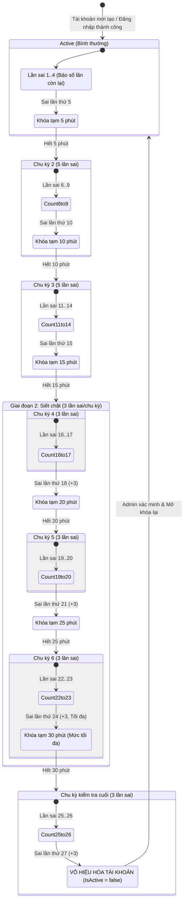
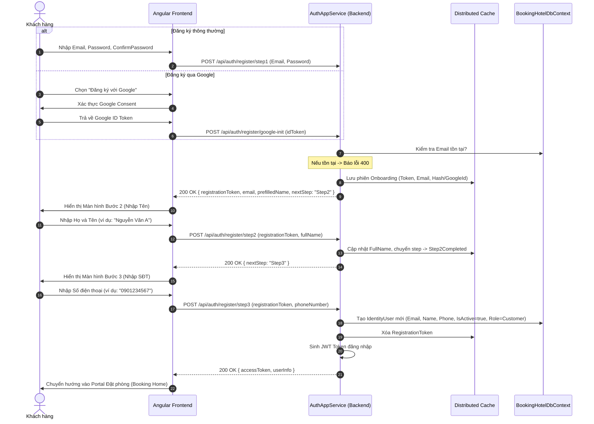

# Data Model & Architecture Design: RM-001

**Feature**: `001-auth-system`  
**Date**: 2026-11-11  
**Status**: Completed  

---

## 1. Mở Rộng Thực Thể `IdentityUser` (AppUser Extension)

Tận dụng cơ chế ABP Module Entity Extension: định nghĩa thuộc tính mở rộng tại `BookingHotel.Domain.Shared/BookingHotelModuleExtensionConfigurator.cs` và cấu hình ánh xạ EF Core tại `BookingHotel.EntityFrameworkCore/EntityFrameworkCore/BookingHotelEfCoreEntityExtensionMappings.cs`.

### Các trường dữ liệu mở rộng:

| Tên trường | Kiểu dữ liệu | Mặc định | Ý nghĩa & Quy tắc |
| :--- | :--- | :--- | :--- |
| `FailedAttemptsInCurrentCycle` | `int` | `0` | Số lần sai tích lũy trong chu kỳ hiện tại (tối đa 5 ở Giai đoạn 1; tối đa 3 ở Giai đoạn 2). |
| `TotalFailedAttempts` | `int` | `0` | Tổng số lần sai liên tiếp từ trước đến nay. |
| `CurrentLockoutMinutes` | `int` | `0` | Thời gian khóa phạt hiện tại (0, 5, 10, 15, 20, 25, 30). |
| `LockoutEnd` | `DateTimeOffset?` | `null` | *(Có sẵn)* Thời điểm kết thúc khóa phạt tạm thời. |
| `IsActive` | `bool` | `true` | *(Có sẵn)* Đặt thành `false` khi tài khoản bị vô hiệu hóa do brute-force. |
| `DeactivatedReason` | `string?` | `null` | Lý do vô hiệu hóa (ví dụ: `BruteForceLimitExceeded`). |
| `GoogleId` | `string?` | `null` | ID tài khoản Google (`sub` claim) nếu người dùng liên kết tài khoản Google. |

---

## 2. Mô Hình Dữ Liệu Bộ Nhớ Đệm (Distributed Cache - Onboarding State)

Quản lý trạng thái đăng ký 3 bước qua `IDistributedCache<UserRegistrationStateCacheItem>`.

```csharp
public class UserRegistrationStateCacheItem
{
    public Guid RegistrationId { get; set; }
    public string Email { get; set; } = default!;
    public string? PasswordHash { get; set; }
    public string? GoogleId { get; set; }
    public string? FullName { get; set; }
    public string? PhoneNumber { get; set; }
    public RegistrationStep CurrentStep { get; set; }
    public DateTime CreatedAt { get; set; }
}

public enum RegistrationStep
{
    Step1Completed = 1, // Đã nhập Email/Pass hoặc xác thực Google
    Step2Completed = 2, // Đã nhập Tên
    Completed = 3       // Đã nhập SĐT, đã tạo user trong CSDL
}
```
* **Cache Key**: `reg_flow_{RegistrationId}`
* **Thời gian sống (TTL)**: 15 phút (Sliding/Absolute Expiration).

---

## 3. Sơ Đồ Chuyển Đổi Trạng Thái Brute-Force (State Machine)



---

## 4. Sơ Đồ Luồng Đăng Ký 3 Bước (Registration Flow)



