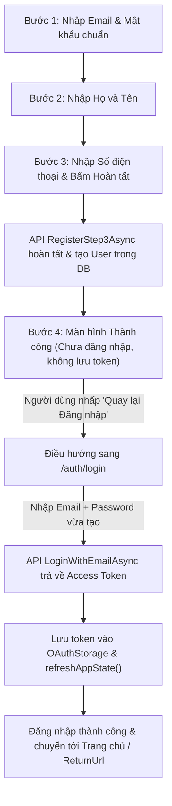

# Mô Hình Dữ Liệu & Luồng Trạng Thái (Data Model & State Flow): RM-002

**Feature Branch**: `002-replace-default-auth`  
**Date**: 2026-11-11  
**Status**: Completed  

---

## 1. Cấu Trúc Lưu Trữ Phiên (Client-side Session Storage Schema)

Trong Angular SPA, đối tượng `OAuthStorage` (mặc định lưu tại `localStorage`) lưu trữ các khóa sau:

| Khóa (Key) | Kiểu dữ liệu | Mô tả | Nguồn gốc dữ liệu |
|:---|:---|:---|:---|
| `access_token` | `string` (JWT) | Bearer token được dùng trong header `Authorization` của mọi request HTTP | Trả về từ `AuthAppService.LoginWithEmailAsync` hoặc `LoginWithGoogleAsync` |
| `expires_at` | `number` (Timestamp ms) | Thời điểm token hết hạn tính bằng mili-giây (`Date.now() + expiresIn * 1000`) | Tính toán từ `res.expiresIn` |
| `refresh_token` | `string` (Optional) | Chuỗi token dùng để gia hạn phiên làm việc | Trả về từ `AuthAppService` |

---

## 2. Sơ Đồ Chuyển Đổi Trạng Thái Phiên (Session State Lifecycle)

```mermaid
stateDiagram-v2
    [*] --> Unauthenticated: Khách vãng lai truy cập SPA

    state Unauthenticated {
        Header: Hiển thị nút "Login" trên LeptonX
        Routes: Bị chặn nếu vào trang yêu cầu [AuthGuard]
    }

    Unauthenticated --> LoggingIn: Bấm "Login" (Chuyển hướng /auth/login)
    
    state LoggingIn {
        Form: Nhập Email/Password hoặc Google One Tap
        API: Gọi AuthAppService.LoginWithEmailAsync()
    }

    LoggingIn --> Unauthenticated: Đăng nhập thất bại (Sai mật khẩu, Khóa phân tầng)
    LoggingIn --> StateSyncing: Đăng nhập thành công (Nhận JWT accessToken)

    state StateSyncing {
        Step1: Lưu accessToken và expires_at vào OAuthStorage
        Step2: Gọi ConfigStateService.refreshAppState()
        Step3: Tải lại claims, roles, permissions từ backend
    }

    StateSyncing --> Authenticated: Đồng bộ hoàn tất (Observable emit)

    state Authenticated {
        Header: Ẩn nút "Login", hiển thị Avatar và Tên tài khoản
        Permissions: Các menu được cấp quyền hiển thị theo role
        Routes: Truy cập tự do các trang có [AuthGuard]
    }

    Authenticated --> LoggingOut: Bấm nút "Logout" trên User Menu LeptonX
    
    state LoggingOut {
        Clear: Gọi clearOAuthStorage()
        Reset: Gọi ConfigStateService.refreshAppState()
    }

    LoggingOut --> Unauthenticated: Điều hướng về Trang chủ (/) dưới vai trò khách
```

---

## 3. Bảng Ánh Xạ Chuyển Hướng (Redirection Mapping Table)

### 3.1. Phía Frontend Angular (Route Redirects)

| Đường dẫn URL cũ (Legacy URL) | Đích chuyển hướng mới (Target URL) | Mã chuyển hướng | Ghi chú |
|:---|:---|:---:|:---|
| `/account/login` | `/auth/login` | Client Redirect | Giữ nguyên các `queryParams` như `returnUrl` |
| `/account/register` | `/auth/register` | Client Redirect | Chuyển thẳng vào Wizard 3 bước |
| `/account/forgot-password` | `/auth/forgot-password` | Client Redirect | Form có bảo vệ Turnstile Captcha |
| `/account/reset-password` | `/auth/reset-password` | Client Redirect | Giữ nguyên token và email params |

### 3.2. Phía Backend ASP.NET Core (Server-side Redirects)

| Đường dẫn Endpoint Backend | Đích chuyển hướng Frontend | Mã HTTP | Hành vi |
|:---|:---|:---:|:---|
| `GET https://localhost:44386/Account/Login` | `http://localhost:4200/auth/login` | 302 Found | Tự động đọc `App:AngularUrl`, nối query parameters và trả về `Redirect()` |
| `GET https://localhost:44386/Account/Register` | `http://localhost:4200/auth/register` | 302 Found | Tự động chuyển hướng sang Wizard đăng ký |

---

## 4. Mô Hình Kiểm Tra Tính Hợp Lệ Của Mật Khẩu (Password Complexity Policy)

### 4.1. Bảng Tiêu Chí Mật Khẩu (Password Rule Matrix)

| Tiêu chí | Biểu thức Regex kiểm tra | Thông điệp hiển thị (Validation Message) | Bắt buộc |
|:---|:---|:---|:---:|
| **Độ dài tối thiểu** | `.{8,}` | Mật khẩu phải có từ 8 ký tự trở lên. | Có |
| **Chữ in hoa** | `[A-Z]` | Mật khẩu phải chứa ít nhất 1 chữ cái in hoa (A-Z). | Có |
| **Chữ in thường** | `[a-z]` | Mật khẩu phải chứa ít nhất 1 chữ cái in thường (a-z). | Có |
| **Chữ số** | `[0-9]` | Mật khẩu phải chứa ít nhất 1 chữ số (0-9). | Có |
| **Ký tự đặc biệt** | `[^a-zA-Z0-9]` | Mật khẩu phải chứa ít nhất 1 ký tự đặc biệt (!@#$%^&*...). | Có |

### 4.2. Biểu thức Regex Tổng Hợp (Composite Regex)
```regex
^(?=.*[a-z])(?=.*[A-Z])(?=.*\d)(?=.*[^a-zA-Z0-9]).{8,}$
```

### 4.3. DTO áp dụng kiểm tra
1. `RegisterStep1InputDto.cs`: Kiểm tra trường `Password` và đối chiếu `ConfirmPassword`.
2. `ResetPasswordInputDto.cs`: Kiểm tra trường `NewPassword` và đối chiếu `ConfirmNewPassword`.

---

## 5. Luồng Trạng Thái Đăng Ký & Đăng Nhập Lại (Registration & Explicit Login State Flow)



