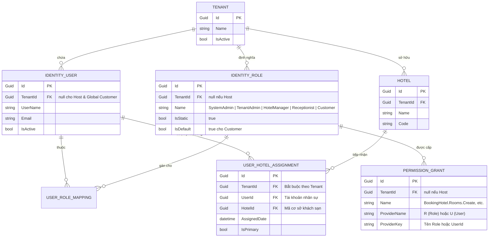
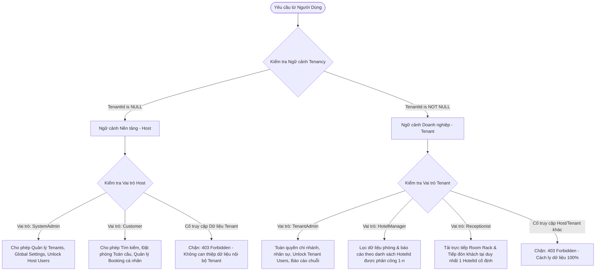

# Data Model: RM-003 - Chuẩn Bị Phân Quyền Hệ Thống & Vai Trò Người Dùng

**Feature Branch**: `003-prepare-permissions`  
**Date**: 2026-11-12  
**Status**: Ready for Implementation  
**Spec Reference**: [specs/003-prepare-permissions/spec.md](spec.md)

---

## 1. Tổng Quan Mô Hình Thực Thể

Kiến trúc phân quyền của `BookingHotel` kết hợp chặt chẽ giữa 3 thành phần:
1. **Hệ thống Vai trò Cốt lõi (Standard Roles)**: 5 vai trò cố định lưu trữ trong bảng `AbpRoles`.
2. **Cây Quyền hạn Hạt nhân (Atomic Permissions & Grants)**: Danh mục quyền hạt nhân định nghĩa trong mã nguồn và lưu vết cấp phép trong bảng `AbpPermissionGrants`.
3. **Thực thể Phân bổ Chi nhánh (UserHotelAssignment)**: Quản lý mối quan hệ gán nhân sự (`Hotel Manager` và `Receptionist`) với cơ sở khách sạn để kiểm soát quyền truy cập dữ liệu (Data Scoping).

---

## 2. Chi Tiết Thực Thể `UserHotelAssignment`

### Bảng Cơ sở Dữ liệu: `AppUserHotelAssignments`

Thực thể đại diện cho việc phân bổ nhân viên phụ trách một hoặc nhiều cơ sở khách sạn trong cùng một Tenant.

| Tên Cột | Kiểu Dữ Liệu | Ràng Buộc | Mô Tả |
| :--- | :--- | :---: | :--- |
| `Id` | `uniqueidentifier` | `PK, NOT NULL` | Khóa chính của bản ghi phân công. |
| `TenantId` | `uniqueidentifier` | `INDEX, NOT NULL` | Mã Tenant của doanh nghiệp quản lý (kế thừa `IMultiTenant`). |
| `UserId` | `uniqueidentifier` | `FK, INDEX, NOT NULL` | Khóa ngoại liên kết tới bảng `AbpUsers` (tài khoản nhân viên). |
| `HotelId` | `uniqueidentifier` | `FK, INDEX, NOT NULL` | Khóa ngoại liên kết tới cơ sở khách sạn trực thuộc Tenant. |
| `AssignedDate` | `datetime2` | `NOT NULL` | Thời điểm phân công nhân sự vào chi nhánh. |
| `IsPrimary` | `bit` | `NOT NULL, DEFAULT 1` | Đánh dấu chi nhánh chính (áp dụng khi nhân sự được phân công nhiều cơ sở). |
| `CreationTime` | `datetime2` | `NOT NULL` | Thời điểm tạo bản ghi (Audit log). |
| `CreatorId` | `uniqueidentifier` | `NULL` | Người thực hiện phân công (Tenant Admin). |

### Cấu hình Chỉ Mục & Toàn Vẹn Dữ Liệu (Fluent API)
- **Unique Constraint / Compound Index**:
  `CREATE UNIQUE INDEX IX_AppUserHotelAssignments_Tenant_User_Hotel ON AppUserHotelAssignments (TenantId, UserId, HotelId);`
  *Mục đích*: Ngăn chặn việc phân công trùng lặp cùng một cơ sở cho cùng một nhân sự.
- **Foreign Keys**:
  - `FK_AppUserHotelAssignments_AbpUsers_UserId` $\rightarrow$ `ON DELETE CASCADE`.
  - `FK_AppUserHotelAssignments_Hotels_HotelId` $\rightarrow$ `ON DELETE RESTRICT` (Không được xóa khách sạn nếu vẫn còn nhân sự đang được phân bổ).

### Quy tắc Nghiệp vụ (Business Invariants)
1. **Hotel Manager (1-n)**: Một tài khoản `Hotel Manager` có thể sở hữu $1$ hoặc $n$ bản ghi phân công chi nhánh khác nhau trong cùng một Tenant. Khi truy vấn danh sách phòng hoặc báo cáo, hệ thống lọc theo:
   $$\text{AccessibleHotelIds} = \{ a.\text{HotelId} \mid a.\text{UserId} = \text{CurrentUser.Id} \}$$
2. **Receptionist (1-1)**: Một tài khoản `Receptionist` chỉ được phép có duy nhất **$1$ bản ghi phân công chi nhánh có hiệu lực** tại một thời điểm. Khi Lễ tân đăng nhập, hệ thống tự động gán ngữ cảnh làm việc về cơ sở này mà không cần bước lựa chọn chi nhánh.

---

## 3. Danh Mục 5 Vai Trò Chuẩn Hóa (`BookingHotelRoleConsts`)

Hệ thống khóa cứng 5 vai trò chuẩn trong Wave 0:

| Tên Hằng Số (`Name`) | Tenancy Scope | Loại Vai Trò | Mặc định (`IsDefault`) | Đối Tượng Sử Dụng |
| :--- | :---: | :---: | :---: | :--- |
| `SystemAdmin` | `Host` | Cố định (`Static`) | `false` | Quản trị viên cấp cao nhất quản trị toàn bộ nền tảng SaaS. |
| `TenantAdmin` | `Tenant` | Cố định (`Static`) | `false` | Chủ doanh nghiệp / Ban điều hành chuỗi khách sạn. |
| `HotelManager` | `Tenant` | Cố định (`Static`) | `false` | Giám đốc / Quản lý điều hành cơ sở khách sạn. |
| `Receptionist` | `Tenant` | Cố định (`Static`) | `false` | Nhân viên lễ tân trực ca đón tiếp tại quầy. |
| `Customer` | `Host / Global` | Cố định (`Static`) | `true` | Khách hàng cá nhân đăng ký tài khoản đặt phòng trực tuyến. |

---

## 4. Ranh Giới Multi-Tenancy & Phân Giải Ngữ Cảnh Quyền Hạn

---

## 5. Ma Trận Quyền Hạn - Tương Thích Mô Hình Dữ Liệu

Mọi quyền hạn khi được cấp phát cho một vai trò thông qua `IPermissionManager.SetForRoleAsync(roleName, permissionName, isGranted: true)` sẽ được ghi vào bảng `AbpPermissionGrants`.

Khi người dùng đăng nhập và yêu cầu tài nguyên:
1. ABP nạp danh sách vai trò của người dùng (`CurrentUser.Roles`).
2. Tra cứu tập hợp quyền đã cấp cho các vai trò đó từ bộ nhớ đệm phân tán (`IDistributedCache`).
3. Nếu người dùng là nhân sự Tenant (`HotelManager` hoặc `Receptionist`), tầng ứng dụng nạp thêm danh sách chi nhánh được ủy quyền từ bảng `AppUserHotelAssignments` để áp dụng bộ lọc dữ liệu tự động (`Data Filter`).

