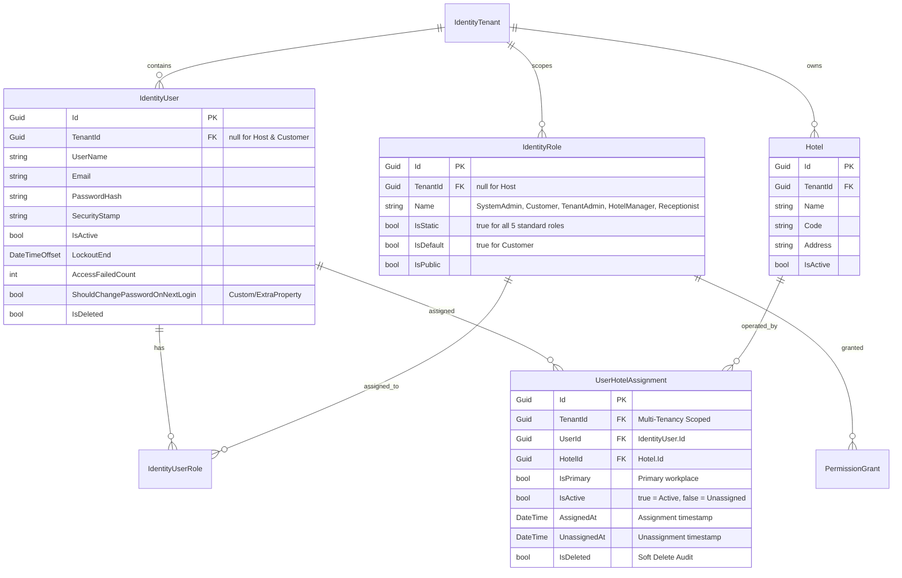
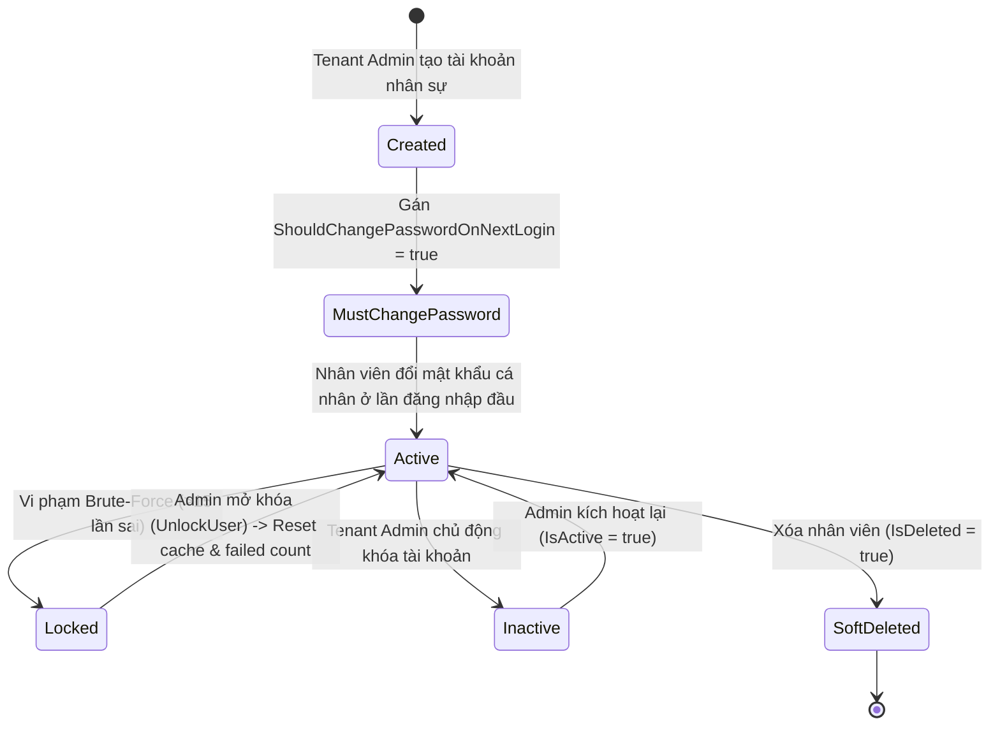
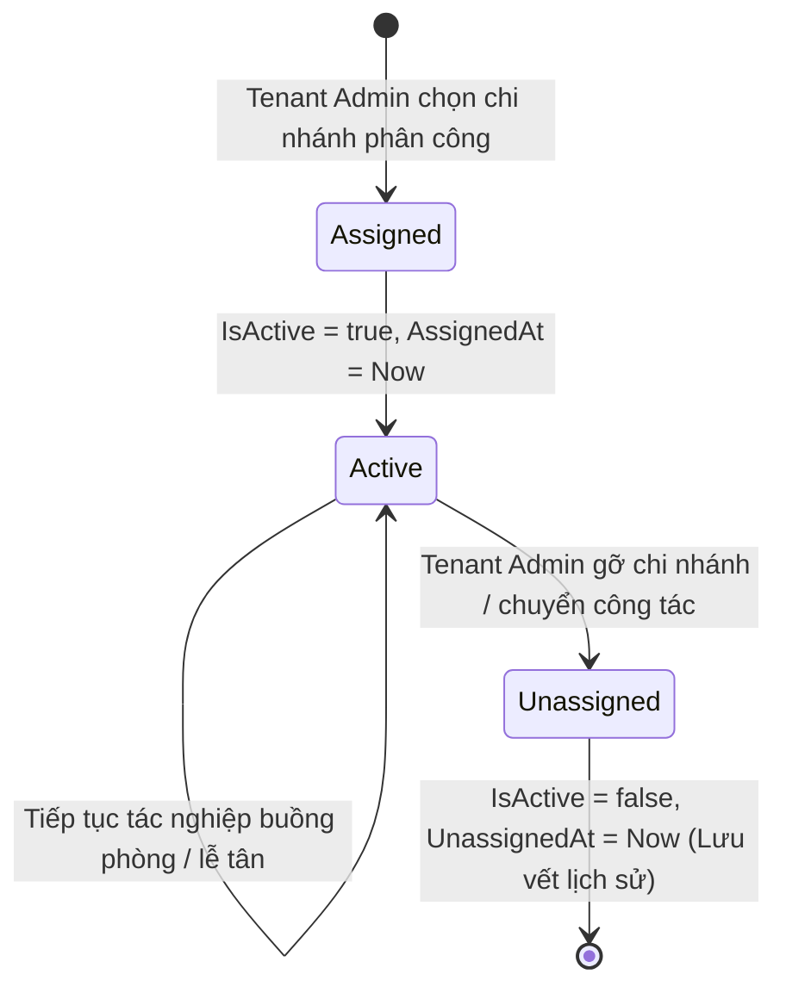

# Data Model: RM-005 - Quản Lý Tài Khoản & Phân Quyền Vai Trò

**Feature Branch**: `005-account-role-management`  
**Date**: 2026-11-13  
**Status**: Completed  
**Spec**: [specs/005-account-role-management/spec.md](spec.md)

---

## 1. Sơ Đồ Thực Thể Quan Hệ (Entity-Relationship Diagram)

---

## 2. Chi Tiết Thực Thể (Entity Definitions)

### 2.1. Thực Thể `UserHotelAssignment`

- **Mục đích**: Ánh xạ quan hệ giữa tài khoản nhân sự khách sạn và các cơ sở chi nhánh trực thuộc chuỗi trong cùng Tenant, phục vụ việc phân quyền dữ liệu (Data Scoping).
- **Lớp kế thừa**: `FullAuditedEntity<Guid>`, `IMultiTenant`.

| Thuộc tính | Kiểu dữ liệu | Bắt buộc | Mô tả |
| :--- | :--- | :---: | :--- |
| `Id` | `Guid` | Có | Khóa chính duy nhất của bản ghi phân công. |
| `TenantId` | `Guid?` | Không | Định danh Tenant sở hữu (tự động điền theo `CurrentTenant.Id`). |
| `UserId` | `Guid` | Có | Khóa ngoại liên kết tới người dùng `IdentityUser.Id`. |
| `HotelId` | `Guid` | Có | Khóa ngoại liên kết tới chi nhánh khách sạn `Hotel.Id`. |
| `IsPrimary` | `bool` | Có | Đánh dấu chi nhánh chính (mặc định `true` nếu chỉ có 1 cơ sở). |
| `IsActive` | `bool` | Có | Trạng thái phân công: `true` = đang phụ trách; `false` = đã hủy phân công/ngừng phụ trách. |
| `AssignedAt` | `DateTime` | Có | Thời điểm phân công bắt đầu có hiệu lực (UTC). |
| `UnassignedAt` | `DateTime?` | Không | Thời điểm hủy phân công / gỡ bỏ quyền phụ trách (UTC). |
| `IsDeleted` | `bool` | Có | Cờ xóa mềm theo chuẩn ABP `ISoftDelete`. |
| `CreationTime` | `DateTime` | Có | Thời điểm tạo bản ghi. |
| `CreatorId` | `Guid?` | Không | ID của Tenant Admin thực hiện phân công. |
| `LastModificationTime`| `DateTime?` | Không | Thời điểm cập nhật cuối cùng. |
| `LastModifierId` | `Guid?` | Không | ID của người cập nhật. |

- **Ràng buộc chỉ mục (Indexes & Constraints)**:
  - Chỉ mục kết hợp: `IX_UserHotelAssignments_TenantId_UserId_HotelId` (Non-unique).
  - Chỉ mục phân quyền nhanh: `IX_UserHotelAssignments_UserId_IsActive` bao gồm `HotelId`.

---

### 2.2. Mở Rộng Thực Thể `IdentityUser`

- **Mục đích**: Bổ sung cờ bắt buộc đổi mật khẩu ở lần đăng nhập đầu tiên cho nhân viên mới tạo.

| Thuộc tính | Kiểu dữ liệu | Mặc định | Mô tả |
| :--- | :--- | :---: | :--- |
| `ShouldChangePasswordOnNextLogin` | `bool` | `false` | Nếu `true`, người dùng bắt buộc phải đổi mật khẩu ở lần đăng nhập tiếp theo trước khi vào hệ thống. Được gán `true` khi Tenant Admin tạo nhân sự mới. Lưu trữ qua `ExtraProperties` hoặc Extension Column. |
| `IsActive` | `bool` | `true` | Trạng thái kích hoạt. Chuyển sang `false` khi bị phạt Brute-force quá số lần quy định hoặc khi bị Quản trị viên vô hiệu hóa. |
| `LockoutEnd` | `DateTimeOffset?` | `null` | Mốc thời gian kết thúc khóa tài khoản. Khi mở khóa (`UnlockUser`), trường này được gán về `null`. |
| `AccessFailedCount` | `int` | `0` | Số lần đăng nhập sai liên tiếp. Đặt lại về `0` khi mở khóa thành công. |

---

### 2.3. Ràng Buộc Vai Trò Chuẩn `IdentityRole`

Hệ thống cố định 5 vai trò chuẩn (*Standard Roles*), không cho phép tạo Custom Roles hay xóa bỏ trong Wave 0:

| Tên vai trò (`Name`) | Phạm vi Tenancy | `IsStatic` | `IsDefault` | Mô tả phạm vi |
| :--- | :--- | :---: | :---: | :--- |
| `SystemAdmin` | `Host` (`TenantId = null`) | `true` | `false` | Quản trị viên toàn bộ nền tảng SaaS. |
| `Customer` | `Host` (`TenantId = null`) | `true` | `true` | Khách hàng cá nhân toàn cầu dùng chung. |
| `TenantAdmin` | `Tenant` (`TenantId != null`)| `true` | `false` | Quản trị viên doanh nghiệp chuỗi khách sạn. |
| `HotelManager` | `Tenant` (`TenantId != null`)| `true` | `false` | Quản lý cơ sở khách sạn (phân bổ 1-n cơ sở). |
| `Receptionist` | `Tenant` (`TenantId != null`)| `true` | `false` | Nhân viên lễ tân quầy (khóa cứng 1 cơ sở). |

---

## 3. Sơ Đồ Vòng Đời & Chuyển Đổi Trạng Thái (Lifecycle State Diagrams)

### 3.1. Vòng Đời Tài Khoản Nhân Sự (Staff Account Lifecycle)

### 3.2. Vòng Đời Phân Công Cơ Sở (Hotel Assignment Lifecycle)

---

## 4. Quy Tắc Giới Hạn Phạm Vi Dữ Liệu (Data Scoping Invariants)

1. **Ràng buộc Nhân Viên Lễ Tân (Receptionist Invariant)**:
   - Một tài khoản có vai trò `Receptionist` tại một thời điểm chỉ được phép có **tối đa duy nhất 1 bản ghi** `UserHotelAssignment` có `IsActive == true`.
   - Nếu Tenant Admin chọn cơ sở mới, bản ghi cũ tự động chuyển sang `IsActive = false`, `UnassignedAt = Clock.Now`.
2. **Ràng buộc Quản Lý Khách Sạn (Hotel Manager Invariant)**:
   - Một tài khoản có vai trò `HotelManager` có thể có **1 hoặc nhiều bản ghi** `UserHotelAssignment` có `IsActive == true`.
   - Khi truy vấn buồng phòng, bảng giá và báo cáo, hệ thống tự động lọc theo điều kiện:
     `HotelId IN (SELECT HotelId FROM UserHotelAssignments WHERE UserId == CurrentUser.Id AND IsActive == true)`.
3. **Ràng buộc Cách Ly Khách Thuê (Tenant Isolation Invariant)**:
   - Mọi bản ghi `UserHotelAssignment` bắt buộc phải có `TenantId == CurrentTenant.Id`.
   - Cấm hoàn toàn việc phân công một nhân viên thuộc Tenant A sang một cơ sở khách sạn thuộc Tenant B.

