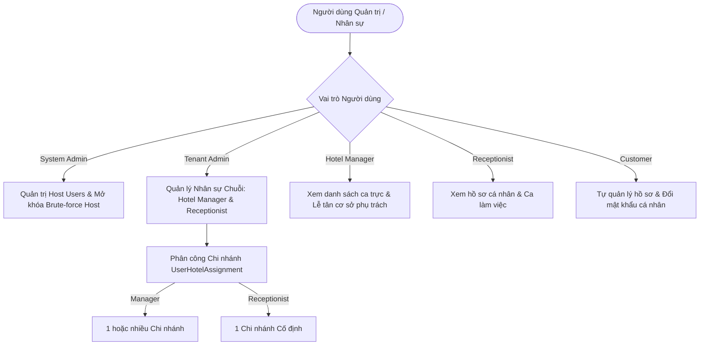

# Feature Specification: RM-005 - Quản Lý Tài Khoản & Phân Quyền Vai Trò (Identity & Role Management)

**Feature Branch**: `005-account-role-management`  
**Created**: 2026-11-13  
**Status**: Ready for Planning  
**Input**: User description: "RM-005 - Quản lý Tài khoản & Phân quyền vai trò (identity, Wave 0): Quản lý danh sách nhân sự khách sạn (Admin hệ thống, Admin tenant, Hotel Manager, Receptionist) và người dùng Customer; phân bổ quyền hạt nhân theo nhóm chức năng dựa trên cây quyền đã chuẩn bị ở RM-003."

---

## 1. Quyết Định Kiến Trúc & Làm Rõ (Clarifications & Architectural Decisions)

### Session 2026-11-13

- **Q1: Tích hợp với Module ABP Identity có sẵn**: Hệ thống sẽ xây dựng phân hệ quản lý tài khoản hoàn toàn mới hay tùy biến và mở rộng dựa trên Module `@abp/ng.identity` và `Volo.Abp.Identity`?  
  $\rightarrow$ **A (Chốt - Best Practice)**: **Kế thừa và mở rộng Module ABP Identity**.
  - Backend: Kế thừa `IdentityUserAppService` và `IdentityRoleAppService`, bổ sung các endpoint mở rộng chuyên biệt (`UnlockUserAsync`, `AssignHotelBranchesAsync`, `GetAssignedHotelsAsync`).
  - Frontend: Tùy biến giao diện quản trị người dùng và vai trò theo chuẩn Concept Quản trị RM-004 (Sidebar Đen `#000000`, Điểm nhấn Cyan `#00FFFF`, Nền Trắng `#FFFFFF`, Bảng dữ liệu `BhDataTable`, Hộp thoại `BhModal`).
  - Ràng buộc an ninh: 5 vai trò chuẩn (*Standard Roles*) được đóng dấu tĩnh (`IsStatic = true`), cấm xóa hoặc sửa cấu trúc hạt nhân của các vai trò này.

- **Q2: Cơ chế Phân bổ Cơ sở Khách sạn (Hotel Assignment Model)**: Mối quan hệ giữa tài khoản nhân sự và các chi nhánh khách sạn được tổ chức và lưu trữ như thế nào?  
  $\rightarrow$ **A (Chốt)**: Xây dựng thực thể liên kết `UserHotelAssignment`:
  - `HotelManager`: Hỗ trợ liên kết **1-nhiều (1-n)** trong cùng Tenant. Một quản lý có thể được phân công phụ trách một hoặc danh sách nhiều chi nhánh khách sạn.
  - `Receptionist`: Giới hạn liên kết **1-1 (cố định)** với duy nhất 1 chi nhánh khách sạn tại một thời điểm, khóa chặt phạm vi dữ liệu tác nghiệp tại quầy.
  - Khi Tenant Admin tạo hoặc cập nhật tài khoản nhân sự, form bắt buộc có trường chọn chi nhánh phân công tương ứng với vai trò.

- **Q3: Thẩm quyền Mở khóa Tài khoản Bị Khóa do Brute-Force (Unlock User Delegation)**: Cơ chế mở khóa tài khoản người dùng bị vô hiệu hóa bởi bộ phòng thủ Brute-force RM-001 được ủy quyền như thế nào giữa các cấp quản lý?  
  $\rightarrow$ **A (Chốt)**: Phân định thẩm quyền 2 tầng nghiêm ngặt qua quyền `BookingHotelPermissions.Identity.UnlockUser`:
  - **Host / System Admin**: Chỉ mở khóa cho các tài khoản quản trị cấp Host (`TenantId = null`).
  - **Tenant Admin**: Có toàn quyền mở khóa trực tiếp cho các tài khoản nhân sự nội bộ thuộc Tenant của mình (`HotelManager`, `Receptionist`, `TenantAdmin`).
  - Thao tác mở khóa sẽ khôi phục cờ `IsActive = true`, xóa bỏ thời gian khóa tạm thời `LockoutEnd = null`, đặt lại toàn bộ bộ đếm vi phạm brute-force về 0 và ghi nhật ký an ninh không thể xóa sửa.

- **Q4: Quản lý Tài khoản Khách hàng Toàn cầu (Global Customer Governance)**: Tài khoản Customer được quản trị và kiểm soát bởi cấp nào?  
  $\rightarrow$ **A (Chốt)**: Tài khoản `Customer` lưu trữ ở cấp Host (`TenantId = null`). Khách hàng tự quản lý hồ sơ cá nhân và đổi mật khẩu qua Cổng Đặt phòng (Customer Portal). Cấp Host System Admin chỉ giám sát tổng số lượng và hỗ trợ mở khóa khi có khiếu nại an ninh. Tenant Admin và Hotel Manager tuyệt đối không được phép can thiệp hoặc thay đổi thông tin định danh toàn cầu của khách hàng.

- **Q5: Chính sách Khởi tạo Mật khẩu Ban đầu & Bắt buộc Đổi mật khẩu cho Nhân sự mới**: Khi Tenant Admin tạo mới tài khoản cho Quản lý khách sạn (Hotel Manager) hoặc Lễ tân (Receptionist), cơ chế cấp phát mật khẩu ban đầu và quy định đổi mật khẩu sẽ thực hiện theo chính sách nào?  
  $\rightarrow$ **A (Chốt)**: **Option A**. Tenant Admin tự nhập mật khẩu ban đầu trực tiếp trên biểu mẫu tạo tài khoản (tuân thủ chính sách mật khẩu mạnh: $\ge 8$ ký tự, 1 chữ hoa, 1 chữ thường, 1 chữ số, 1 ký tự đặc biệt). Hệ thống mặc định thiết lập cờ `ShouldChangePasswordOnNextLogin = true`. Ở lần đăng nhập đầu tiên của nhân sự, hệ thống nhận diện cờ này và lập tức điều hướng bắt buộc tới màn hình cập nhật mật khẩu cá nhân mới trước khi cấp quyền truy cập vào bất kỳ phân hệ tác nghiệp nào. Phương án này bảo đảm an ninh tối đa, không phụ thuộc vào cấu hình máy chủ gửi email SMTP trong Wave 0, và trao quyền tự chủ mật khẩu cho nhân viên.

- **Q6: Xử lý Khi Hủy Phân Công hoặc Gỡ Bỏ Cơ Sở Khách Sạn Khỏi Nhân Sự**: Khi Tenant Admin gỡ bỏ chi nhánh khách sạn khỏi danh sách quản lý của Hotel Manager hoặc Receptionist, liên kết dữ liệu và quyền hạn được xử lý ra sao?  
  $\rightarrow$ **A (Chốt)**: **Option A**. Áp dụng cơ chế lưu vết lịch sử (Audit-tracked assignment): Hệ thống cập nhật bản ghi liên kết `UserHotelAssignment` với trạng thái `IsActive = false` và ghi nhận mốc thời gian `UnassignedAt = Clock.Now`. Quyền truy cập vào dữ liệu buồng phòng, bảng giá và báo cáo của chi nhánh đó lập tức bị thu hồi ở phiên tiếp theo, nhưng toàn bộ lịch sử các giao dịch đặt phòng, hóa đơn Folio và nhật ký kiểm toán mà nhân viên đã lập tại cơ sở trước đây được bảo toàn nguyên vẹn 100%. Mối quan hệ phân công không bị xóa cứng để phục vụ công tác tra cứu và thanh tra tài chính.

- **Q7: Hạn ngạch Khởi tạo Nhân sự & Số lượng Chi nhánh Phân công trong Wave 0**: Trong phạm vi Tenant, việc tạo số lượng tài khoản nhân sự và gán số chi nhánh cho Quản lý khách sạn có bị áp đặt hạn ngạch (Quota limit) trong Wave 0 hay không?  
  $\rightarrow$ **A (Chốt)**: **Option A**. Không áp đặt hạn ngạch cứng trong Wave 0. Tenant Admin được phép tạo số lượng tài khoản nhân sự (`HotelManager`, `Receptionist`) và phân bổ chi nhánh linh hoạt theo quy mô hoạt động thực tế của doanh nghiệp. Cơ chế quản lý hạn ngạch thương mại hóa theo gói dịch vụ (Feature Management & Subscription Tier Quotas) sẽ được thiết kế tích hợp ở các giai đoạn tiếp theo.

---

## 2. Kịch Bản Người Dùng & Tiêu Chí Chấp Nhận (User Scenarios & Testing)

---

### User Story 1 - Quản Trị Tài Khoản Cấp Nền Tảng & Mở Khóa An Ninh Host (System Admin) (Priority: P1)

Là Quản trị viên Hệ thống (System Admin / Host Admin), tôi muốn quản lý danh sách tài khoản quản trị cấp Host, tạo mới tài khoản kỹ thuật, giám sát danh sách người dùng toàn hệ thống và thực hiện mở khóa các tài khoản Host bị vô hiệu hóa do vượt quá số lần thử mật khẩu (Brute-force) để duy trì hoạt động an ninh liên tục của nền tảng SaaS.

**Why this priority**: Đảm bảo lớp quản trị cao nhất của hệ thống có công cụ duy trì tài khoản, ứng cứu sự cố khóa tài khoản an ninh mà không làm ảnh hưởng đến dữ liệu nghiệp vụ của các đối tác khách sạn.

**Independent Test**:
1. Đăng nhập bằng tài khoản Quản trị viên hệ thống (Host scope).
2. Truy cập màn hình Quản trị Tài khoản cấp Host (`/admin/system/users`).
3. Kiểm tra danh sách người dùng: Chỉ hiển thị các tài khoản cấp Host (`TenantId = null`).
4. Tạo mới một tài khoản Host Admin, gán vai trò `SystemAdmin`.
5. Tìm kiếm một tài khoản Host đang bị khóa (`IsActive = false` do brute-force), nhấp lệnh "Mở khóa tài khoản" (`UnlockUser`).
6. Kiểm tra trạng thái: Tài khoản chuyển về kích hoạt (`Active`), bộ đếm brute-force được đặt lại về 0, tài khoản đăng nhập lại thành công ngay lập tức.

**Acceptance Scenarios**:
1. **Tạo Mới Tài Khoản Quản Trị Cấp Host**:
   - **Given** System Admin đang ở trang `/admin/system/users`.
   - **When** Nhập thông tin tài khoản hợp lệ (Tên đăng nhập, Email, Mật khẩu mạnh, Xác nhận mật khẩu) và chọn vai trò `SystemAdmin`.
   - **Then** Hệ thống tạo mới người dùng cấp Host thành công, mật khẩu được mã hóa an toàn, không hiển thị lại mật khẩu thô và ghi nhận Audit Log.
2. **Mở Khóa Tài Khoản Host Bị Khóa Do Brute-Force**:
   - **Given** Một tài khoản Host bị khóa sau 15+ lần nhập sai mật khẩu liên tiếp.
   - **When** System Admin kích hoạt lệnh `Unlock User`.
   - **Then** Hệ thống cập nhật `IsActive = true`, xóa bộ nhớ cache vi phạm brute-force, gửi thông báo thành công qua `BhToastrService` và lưu vết vào `SecurityLogs`.
3. **Bảo Vệ Tính Toàn Vẹn Của Vai Trò Cấp Host**:
   - **Given** System Admin truy cập danh mục vai trò.
   - **When** Thử xóa hoặc sửa đổi tên vai trò chuẩn `SystemAdmin`.
   - **Then** Hệ thống từ chối thao tác vì vai trò được đánh dấu `IsStatic = true`.

---

### User Story 2 - Quản Trị Nhân Sự Chuỗi & Phân Bổ Chi Nhánh Khách Sạn (Tenant Admin) (Priority: P1)

Là Quản trị viên Doanh nghiệp (Tenant Admin / Đối tác Chuỗi Khách Sạn), tôi muốn quản lý danh sách nhân sự nội bộ (Hotel Manager, Receptionist), gán vai trò tương ứng, phân bổ cơ sở khách sạn phụ trách (`UserHotelAssignment`), và mở khóa tài khoản nhân sự bị sự cố đăng nhập để đội ngũ khách sạn vận hành thông suốt mà không cần phụ thuộc vào đội ngũ kỹ thuật của nền tảng.

**Why this priority**: Đây là nghiệp vụ cốt lõi giúp các doanh nghiệp khách sạn tự chủ phân công nhân sự, quản lý luân chuyển ca kíp và kiểm soát chặt chẽ quyền truy cập dữ liệu giữa các chi nhánh trong cùng một chuỗi.

**Independent Test**:
1. Đăng nhập với tài khoản Tenant Admin của Chuỗi Khách sạn A.
2. Truy cập phân hệ Quản lý Nhân sự (`/admin/tenant/staff`).
3. Tạo tài khoản cho Quản lý khách sạn:
   - Gán vai trò `HotelManager`.
   - Chọn phân công phụ trách 2 chi nhánh: "Khách sạn Biển Đà Nẵng" và "Khách sạn Phố Cổ Hội An".
4. Tạo tài khoản cho Lễ tân:
   - Gán vai trò `Receptionist`.
   - Chọn cố định duy nhất 1 chi nhánh: "Khách sạn Biển Đà Nẵng".
5. Mở khóa một tài khoản Lễ tân đang bị khóa do nhập sai mật khẩu tại quầy (`UnlockUser`).
6. Kiểm tra danh sách: Nhân sự thuộc Chuỗi B hoàn toàn không hiển thị.

**Acceptance Scenarios**:
1. **Tạo Nhân Sự & Phân Bổ Chi Nhánh Linh Hoạt Cho Quản Lý (Hotel Manager)**:
   - **Given** Tenant Admin mở form tạo nhân sự mới tại `/admin/tenant/staff`.
   - **When** Chọn vai trò `HotelManager` và tích chọn 2 chi nhánh khách sạn trong danh sách.
   - **Then** Hệ thống tạo tài khoản nhân sự, lưu bản ghi phân công vào `UserHotelAssignment`, và chỉ cho phép người này điều hành buồng phòng tại đúng 2 cơ sở đó.
2. **Tạo Nhân Sự & Khóa Cứng Chi Nhánh Cho Lễ Tân (Receptionist)**:
   - **Given** Tenant Admin mở form tạo nhân sự mới.
   - **When** Chọn vai trò `Receptionist` và chọn 1 chi nhánh khách sạn.
   - **Then** Hệ thống ràng buộc Lễ tân chỉ được gắn với duy nhất 1 chi nhánh; form ngăn chặn việc tích chọn nhiều chi nhánh cùng lúc.
3. **Mở Khóa Tài Khoản Nhân Sự Nội Bộ Tenant**:
   - **Given** Tài khoản một Lễ tân bị vô hiệu hóa do nhân viên nhập sai mật khẩu nhiều lần khi giao ca.
   - **When** Tenant Admin nhấn nút "Mở khóa tài khoản" trên dòng nhân sự đó.
   - **Then** Tài khoản được kích hoạt lại ngay lập tức, xóa trắng lịch sử khóa và cho phép nhân viên đăng nhập tiếp tục ca trực.
4. **Ngăn Chặn Cấp Quyền Vượt Thẩm Quyền (Anti-Privilege Escalation)**:
   - **Given** Form gán vai trò nhân sự.
   - **When** Tenant Admin xem danh sách vai trò có thể gán.
   - **Then** Dropdown chỉ hiển thị duy nhất 2 lựa chọn: `HotelManager` và `Receptionist`. Lựa chọn `SystemAdmin` hoặc `TenantAdmin` bị ẩn hoàn toàn và backend từ chối mọi payload can thiệp.

---

### User Story 3 - Tra Cứu Hồ Sơ & Thông Tin Nhân Sự Phân Ca (Hotel Manager) (Priority: P2)

Là Quản lý Khách sạn (Hotel Manager), tôi muốn xem danh sách nhân sự lễ tân trực thuộc các chi nhánh khách sạn do tôi phụ trách để nắm bắt danh sách nhân viên, bố trí lịch trực ca hợp lý và phối hợp vận hành buồng phòng hiệu quả.

**Why this priority**: Hotel Manager cần nắm rõ danh sách nhân sự tại cơ sở để điều phối công việc hằng ngày nhưng không có thẩm quyền tạo/xóa tài khoản hoặc thay đổi cấu trúc phân quyền của hệ thống.

**Independent Test**:
1. Đăng nhập với tài khoản Hotel Manager phụ trách Chi nhánh 1.
2. Truy cập màn hình Quản lý Ca trực & Nhân viên (`/admin/manager/shifts`).
3. Kiểm tra danh sách nhân viên: Chỉ hiển thị danh sách các tài khoản Receptionist được gán tại Chi nhánh 1.
4. Xác nhận không có nút "Tạo người dùng mới", "Đổi vai trò" hay "Sửa quyền" (các thao tác này thuộc Tenant Admin).
5. Thử gọi API tạo tài khoản người dùng $\rightarrow$ Bị chặn 403 Forbidden.

**Acceptance Scenarios**:
1. **Xem Danh Sách Nhân Viên Thuộc Cơ Sở Phụ Trách**:
   - **Given** Hotel Manager đang ở màn hình ca trực của chi nhánh.
   - **When** Danh sách tải xong.
   - **Then** Hệ thống hiển thị Họ tên, Email, Số điện thoại và Ca trực của các Lễ tân thuộc cơ sở đó; không hiển thị nhân sự của các chi nhánh khác.
2. **Giới Hạn Thẩm Quyền Nghiêm Ngặt (Read-Only on Staff Accounts)**:
   - **Given** Hotel Manager đang xem danh sách nhân sự.
   - **When** Cố gắng tìm kiếm chức năng chỉnh sửa mật khẩu hoặc gán vai trò.
   - **Then** Giao diện hoàn toàn không cung cấp chức năng này; mọi tác vụ điều chỉnh nhân sự phải liên hệ Tenant Admin.

---

### User Story 4 - Tự Phục Vụ Hồ Sơ Cá Nhân & Quản Trị Khách Hàng Toàn Cầu (Customer) (Priority: P2)

Là Khách hàng (Customer) hoặc Người quản trị hệ thống, tôi muốn tài khoản khách hàng được lưu trữ tập trung ở cấp toàn cầu (`TenantId = null`) để khách hàng chỉ cần duy nhất một tài khoản để tự quản lý hồ sơ cá nhân, đổi mật khẩu và xem lịch sử đặt phòng tại tất cả các khách sạn trong toàn hệ sinh thái mà không bị phân mảnh hay trùng lặp dữ liệu.

**Why this priority**: Đảm bảo trải nghiệm khách hàng xuyên suốt, tiện lợi và nhất quán, đồng thời cô lập hoàn toàn thông tin định danh khách hàng khỏi sự can thiệp trái phép của nhân sự nội bộ các khách sạn.

**Independent Test**:
1. Đăng nhập bằng tài khoản Customer qua email hoặc Google.
2. Mở trang Thông tin Cá nhân (`/profile` hoặc User Menu trên Customer Header).
3. Cập nhật Họ tên, Số điện thoại và thực hiện đổi mật khẩu tài khoản.
4. Kiểm tra dữ liệu: Thông tin cá nhân được cập nhật tức thì.
5. Kiểm tra tính độc lập: Nhân viên Lễ tân hay Quản lý khách sạn không thể xem mật khẩu hay sửa đổi thông tin tài khoản của khách hàng ngoài các thông tin phục vụ đơn đặt phòng.

**Acceptance Scenarios**:
1. **Tự Cập Nhật Hồ Sơ & Đổi Mật Khẩu Khách Hàng**:
   - **Given** Khách hàng đã đăng nhập vào Cổng đặt phòng.
   - **When** Khách hàng nhập mật khẩu hiện tại và mật khẩu mới hợp lệ theo chính sách bảo mật (RM-002).
   - **Then** Hệ thống xác thực mật khẩu cũ, cập nhật mật khẩu mới đã mã hóa và gửi thông báo xác nhận thành công.
2. **Cách Ly Tuyệt Đối Dữ Liệu Khách Hàng Khỏi Cấp Tenant**:
   - **Given** Quản lý hoặc Lễ tân của một khách sạn.
   - **When** Tìm kiếm trong phân hệ quản lý nhân sự.
   - **Then** Danh sách người dùng của Tenant chỉ chứa nhân sự nội bộ, tuyệt đối không xuất hiện các tài khoản Customer toàn cầu.

---

### User Story 5 - Cơ Chế Chống Leo Thang Đặc Quyền & Bảo Vệ Toàn Vẹn Vai Trò (Priority: P1)

Là Kiến trúc sư Phần mềm và Chuyên gia An toàn thông tin, tôi muốn hệ thống kiểm soát chặt chẽ mọi hành vi gán vai trò và phân quyền tài khoản ở cả Frontend và Backend để đảm bảo không một ai (kể cả Tenant Admin) có thể tự cấp hoặc cấp cho người khác quyền hạn vượt quá trần thẩm quyền của mình, và các vai trò chuẩn (*Standard Roles*) không thể bị chỉnh sửa hay xóa bỏ.

**Why this priority**: Bảo vệ nền tảng SaaS khỏi các lỗ hổng phân quyền nghiêm trọng (Privilege Escalation / IDOR), đảm bảo các doanh nghiệp đối tác không thể xâm phạm hạ tầng dùng chung hoặc can thiệp lẫn nhau.

**Independent Test**:
1. Gửi request POST tạo tài khoản nhân sự từ Tenant Admin nhưng giả mạo trường `roleNames = ["SystemAdmin"]` $\rightarrow$ Backend phát hiện vi phạm whitelist và trả về lỗi 403 Forbidden.
2. Gửi request PUT cập nhật phân quyền (`/api/permission-management/permissions`) gán thêm quyền `BookingHotel.Tenants.Create` cho vai trò `HotelManager` $\rightarrow$ Backend từ chối thực thi.
3. Xác minh cả 5 vai trò chuẩn trong cơ sở dữ liệu (`SystemAdmin`, `TenantAdmin`, `HotelManager`, `Receptionist`, `Customer`) đều có thuộc tính `IsStatic = true`.

**Acceptance Scenarios**:
1. **Kiểm Tra Ràng Buộc Danh Mục Vai Trò Cho Phép (Whitelist Role Validation)**:
   - **Given** Một request tạo hoặc cập nhật tài khoản nhân sự gửi tới `IdentityUserAppService`.
   - **When** Vai trò gửi lên không nằm trong danh mục `[HotelManager, Receptionist]` khi người thực hiện là Tenant Admin.
   - **Then** Hệ thống ném ra `BusinessException("BookingHotel:CannotAssignUnauthorizedRole")` kèm mã lỗi an ninh.
2. **Khóa Bất Biến Ma Trận Quyền Của Vai Trò Chuẩn**:
   - **Given** Yêu cầu thay đổi danh mục permissions của các vai trò chuẩn trong hệ thống.
   - **When** Kiểm tra tính hợp lệ của lệnh.
   - **Then** Hệ thống ngăn chặn việc thay đổi danh mục quyền đóng gói sẵn, giữ vững tính nhất quán của mô hình 5 vai trò.

---

## 3. Các Trường Hợp Biên & Tình Huống Ngoại Lệ (Edge Cases)

1. **Khóa Tài Khoản Khi Đang Trong Phiên Đăng Nhập (Active Session Revocation)**:
   - Một tài khoản nhân sự bị Tenant Admin tạm khóa (`IsActive = false`) trong khi nhân viên này đang ngồi tại quầy thao tác.
   - *Cách xử lý*: Khi tài khoản bị khóa, hệ thống thu hồi Security Stamp (`UpdateSecurityStampAsync`). Ở request tiếp theo của client, middleware kiểm tra tính hợp lệ của token sẽ từ chối ngay lập tức và buộc người dùng đăng xuất khỏi hệ thống.
2. **Nhân Sự Bị Chuyển Công Tác / Đổi Chi Nhánh Làm Việc**:
   - Lễ tân chuyển từ Khách sạn A sang Khách sạn B trong cùng Tenant.
   - *Cách xử lý*: Tenant Admin cập nhật lại `UserHotelAssignment` cho nhân sự đó. Khi nhân viên đăng nhập ca tiếp theo, hệ thống tự động tải sơ đồ phòng của Khách sạn B. Toàn bộ lịch sử thao tác tại Khách sạn A trước đây vẫn được lưu vết kiểm toán đầy đủ với ID nhân viên.
3. **Xóa Tài Khoản Nhân Sự Có Dữ Liệu Nghiệp Vụ Liên Quan**:
   - Một Lễ tân đã từng lập 100+ hóa đơn Folio nghỉ việc và Tenant Admin muốn xóa tài khoản.
   - *Cách xử lý*: Áp dụng cơ chế **Soft Delete** (`ISoftDelete`) của ABP Framework. Bản ghi người dùng được đánh dấu `IsDeleted = true`, không thể đăng nhập, nhưng các liên kết tới hóa đơn, đơn đặt phòng và audit log vẫn được bảo toàn toàn vẹn dữ liệu.
4. **Nhân Sự Được Phân Công Chi Nhánh Tạm Dừng Hoạt Động**:
   - Một chi nhánh khách sạn bị đóng cửa sửa chữa.
   - *Cách xử lý*: Hệ thống hiển thị cảnh báo trên hồ sơ nhân viên và tạm thời ẩn chi nhánh đó khỏi bộ chọn phòng của Manager/Lễ tân cho đến khi chi nhánh được kích hoạt lại.
5. **Cố Tình Tạo Trùng Email / Username Giữa Các Tenant**:
   - Hai nhân sự ở hai Tenant khác nhau trùng tên đăng nhập hoặc email.
   - *Cách xử lý*: Trong mô hình Multi-Tenancy của ABP, tên đăng nhập và email là duy nhất trong phạm vi từng Tenant (`TenantId`). Riêng tài khoản `Customer` cấp Host (`TenantId = null`) có email là duy nhất trên toàn hệ thống để đảm bảo tính định danh toàn cầu.

---

## 4. Yêu Cầu Chức Năng Chi Tiết (Functional Requirements)

### Nhóm 1: Quản Trị Người Dùng & Phân Tầng Tenancy (User Management)
- **FR-001**: Hệ thống PHẢI kế thừa và mở rộng module quản lý tài khoản người dùng (`IdentityUser`) của ABP Framework, hỗ trợ đầy đủ các thao tác: Xem danh sách phân trang, Tạo mới, Chỉnh sửa thông tin, Đổi mật khẩu, và Xóa mềm (Soft Delete).
- **FR-002**: Hệ thống PHẢI phân định phạm vi dữ liệu tài khoản theo cấp độ Multi-Tenancy:
  - Cấp Host: Chỉ hiển thị và quản lý các tài khoản quản trị cấp Host (`TenantId = null`).
  - Cấp Tenant: Tự động lọc nghiêm ngặt các tài khoản nhân sự nội bộ có `TenantId == CurrentTenant.Id`.
  - Cấp Customer: Tài khoản khách hàng độc lập ở cấp Host, không lẫn vào danh sách nhân sự khách sạn.
- **FR-003**: Hệ thống PHẢI tích hợp cơ chế phân bổ chi nhánh khách sạn (`UserHotelAssignment`):
  - Cho phép gán 1 hoặc nhiều chi nhánh cho người dùng có vai trò `HotelManager`.
  - Bắt buộc gán duy nhất 1 chi nhánh cố định cho người dùng có vai trò `Receptionist`.
- **FR-004**: Hệ thống PHẢI cung cấp chức năng mở khóa tài khoản (`UnlockUser`) tại danh sách người dùng cho người có quyền `BookingHotelPermissions.Identity.UnlockUser`:
  - Khôi phục `IsActive = true`.
  - Đặt lại thời gian khóa `LockoutEnd = null`.
  - Xóa toàn bộ số lần đăng nhập sai và bộ đếm brute-force trong distributed cache.
  - Ghi nhật ký an ninh (`SecurityLog`).

### Nhóm 2: Quản Trị Vai Trò & Ràng Buộc Phân Quyền (Role & Permission Management)
- **FR-005**: Hệ thống PHẢI đóng gói và duy trì 5 vai trò chuẩn (*Standard Roles*) bất biến (`IsStatic = true`):
  1. `SystemAdmin` (Host)
  2. `Customer` (Host / Global)
  3. `TenantAdmin` (Tenant)
  4. `HotelManager` (Tenant)
  5. `Receptionist` (Tenant)
- **FR-006**: Hệ thống PHẢI ngăn chặn việc tạo thêm vai trò tùy chỉnh (*Custom Roles*) hoặc xóa bỏ các vai trò chuẩn trong Wave 0 để bảo toàn mô hình phân quyền đã định nghĩa tại RM-003.
- **FR-007**: Hệ thống PHẢI áp dụng chính sách Whitelist khi gán vai trò:
  - System Admin có quyền gán vai trò `SystemAdmin` cho các tài khoản cấp Host.
  - Tenant Admin CHỈ ĐƯỢC PHÉP gán vai trò `HotelManager` hoặc `Receptionist` cho nhân sự thuộc Tenant của mình. Mọi request cố tình gán vai trò khác PHẢI bị backend từ chối ngay lập tức.
  - Hotel Manager và Receptionist KHÔNG CÓ quyền gán hoặc xem màn hình gán vai trò.
- **FR-008**: Hệ thống PHẢI liên kết danh mục quyền hạn hạt nhân (*Atomic Permissions*) mặc định vào từng vai trò thông qua `BookingHotelDataSeedContributor`, đảm bảo nhân viên mới được cấp đúng quyền ngay sau khi gán vai trò.

### Nhóm 3: Giao Diện Người Dùng & Trải Nghiệm (UI/UX Customization)
- **FR-009**: Giao diện Quản lý Tài khoản & Phân quyền trên Angular PHẢI tuân thủ nghiêm ngặt Concept Quản trị RM-004:
  - Sidebar Đen (`#000000`), Điểm nhấn Cyan (`#00FFFF`), Nền nội dung Trắng sáng (`#FFFFFF`).
  - Tái sử dụng thư viện UI dùng chung: Bảng dữ liệu `BhDataTableComponent`, Hộp thoại xác nhận `BhModalComponent`, Huy hiệu trạng thái `BhStatusBadgeComponent`, và Thông báo `BhToastrService`.
- **FR-010**: Màn hình danh sách người dùng PHẢI hiển thị rõ ràng: Tên đăng nhập, Họ và tên, Email, Vai trò được gán, Chi nhánh khách sạn phân công, Trạng thái hoạt động (`Active` / `Locked` / `Inactive`), và Cột hành động (Sửa, Khóa/Mở khóa, Đổi mật khẩu, Xóa).
- **FR-011**: Nút "Mở khóa tài khoản" (`Unlock`) PHẢI chỉ hiển thị nổi bật đối với các tài khoản đang ở trạng thái bị khóa an ninh, kèm biểu tượng ổ khóa mở và màu sắc trực quan.
- **FR-012**: Form tạo/sửa người dùng PHẢI tuân thủ Điều khoản IX của Hiến pháp:
  - Tuyệt đối không điền sẵn mật khẩu (*Zero Credential Pre-filling*).
  - Có checklist kiểm tra mật khẩu mạnh (>= 8 ký tự, chữ hoa, chữ thường, số, ký tự đặc biệt) đồng bộ với RM-002.
  - Dropdown chọn chi nhánh phân công tự động kích hoạt tương ứng theo vai trò được chọn.
  - Hệ thống mặc định thiết lập cờ `ShouldChangePasswordOnNextLogin = true` cho các tài khoản nhân sự mới được tạo bởi Tenant Admin; ở lần đăng nhập đầu tiên, nhân viên bắt buộc phải đổi mật khẩu mới trước khi được cấp quyền truy cập các phân hệ tác nghiệp.

### Nhóm 4: Đa Ngôn Ngữ Song Ngữ (vi/en i18n)
- **FR-013**: Toàn bộ nhãn form, tiêu đề cột bảng, tên vai trò, thông báo lỗi validation và thông báo thành công PHẢI được định nghĩa đầy đủ 100% song ngữ tại:
  - `BookingHotel.Domain.Shared/Localization/BookingHotel/vi.json`
  - `BookingHotel.Domain.Shared/Localization/BookingHotel/en.json`

---

## 5. Các Thực Thể Dữ Liệu Cốt Lõi (Key Entities)

- **`IdentityUser` (Aggregate Root ABP)**: Đại diện cho tài khoản người dùng trong hệ thống (Tên đăng nhập, Email, PasswordHash, IsActive, LockoutEnd, ShouldChangePasswordOnNextLogin, TenantId).
- **`IdentityRole` (Aggregate Root ABP)**: Đại diện cho vai trò người dùng (`SystemAdmin`, `TenantAdmin`, `HotelManager`, `Receptionist`, `Customer`), được đánh dấu `IsStatic = true`.
- **`UserHotelAssignment` (FullAuditedEntity)**: Bản ghi liên kết phân công giữa tài khoản nhân sự và cơ sở khách sạn trong cùng Tenant:
  - `UserId` (Guid): Khóa ngoại liên kết `IdentityUser`.
  - `HotelId` (Guid): Khóa ngoại liên kết cơ sở khách sạn `Hotel`.
  - `TenantId` (Guid?): Định danh Tenant sở hữu.
  - `IsActive` (bool): Trạng thái phân công hiện hành (`true` = đang phụ trách, `false` = đã hủy phân công/rút quyền).
  - `AssignedAt` (DateTime): Thời điểm bắt đầu phân công.
  - `UnassignedAt` (DateTime?): Thời điểm hủy phân công / ngừng phụ trách cơ sở.
- **`PermissionGrant` (Entity ABP)**: Bản ghi ánh xạ quyền hạn hạt nhân được cấp cho Vai trò hoặc Người dùng cụ thể.
- **`BruteForceAttemptLog` (Domain Entity / Distributed Cache)**: Bản ghi theo dõi số lần đăng nhập sai theo IP/Tài khoản từ RM-001 phục vụ cơ chế phạt Brute-force và mở khóa tài khoản.

---

## 6. Tiêu Chí Thành Công Đo Lường Được (Measurable Success Criteria)

- **SC-001**: Quản trị viên Tenant có thể tạo mới một tài khoản nhân sự (Hotel Manager hoặc Receptionist), gán vai trò và phân bổ chi nhánh hoàn chỉnh trong **dưới 60 giây**.
- **SC-002**: **0%** nguy cơ leo thang đặc quyền: 100% các request cố tình gán vai trò `SystemAdmin` hoặc sửa đổi Permissions ngoài thẩm quyền đều bị Backend chặn đứng với mã lỗi 403 Forbidden.
- **SC-003**: Thời gian mở khóa một tài khoản bị brute-force và khôi phục quyền truy cập cho nhân viên diễn ra tức thì trong **dưới 500ms** sau khi nhấn nút `Unlock`.
- **SC-004**: **0%** rò rỉ dữ liệu nhân sự chéo giữa các Tenant: 100% truy vấn danh sách người dùng được cách ly tuyệt đối theo `CurrentTenant.Id`.
- **SC-005**: Giao diện quản lý tài khoản và vai trò trên Angular đạt chuẩn nhận diện thương hiệu RM-004 (Sidebar Đen `#000000`, Điểm nhấn Cyan `#00FFFF`, Nền Trắng) và tỷ lệ tương phản văn bản đạt chuẩn **WCAG 2.1 AA ($\ge 4.5:1$)**.
- **SC-006**: Đầy đủ tài nguyên bản địa hóa **100% song ngữ (Tiếng Việt và English)** cho toàn bộ biểu mẫu, danh sách và thông báo của phân hệ quản trị tài khoản.

---

## 7. Các Giả Định & Ràng Buộc (Assumptions)

- Hệ thống vận hành trên hạ tầng ABP Identity module và EF Core Code-First Migrations theo Hiến pháp Điều khoản I & III.
- Hệ thống áp dụng chính sách 5 vai trò cố định đã được nạp sẵn qua Data Seeding ở RM-003; việc mở rộng cho phép tự tạo Custom Roles được hoãn lại cho các wave nâng cao tiếp theo.
- Khách hàng (Customer) là tài khoản định danh dùng chung toàn hệ thống (`TenantId = null`); không yêu cầu Tenant Admin phải quản lý tài khoản khách hàng.
- Tất cả các trường mật khẩu mới đều tuân thủ chính sách mật khẩu mạnh (>= 8 ký tự, 1 hoa, 1 thường, 1 số, 1 ký tự đặc biệt).
- Mọi thao tác gán vai trò, đổi mật khẩu và mở khóa tài khoản đều được ghi nhận vào nhật ký kiểm toán hệ thống (`AuditLogs`).
- Trong Wave 0, hệ thống không áp đặt giới hạn cứng về số lượng tài khoản nhân sự được tạo hay số lượng chi nhánh phân công cho Hotel Manager trong một Tenant; toàn bộ cơ chế kiểm soát hạn ngạch thương mại hóa (Tier Quotas) sẽ được quản lý ở phân hệ Feature Management sau này.

