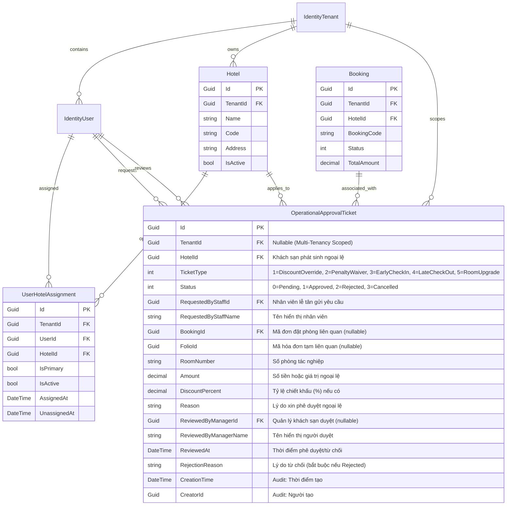
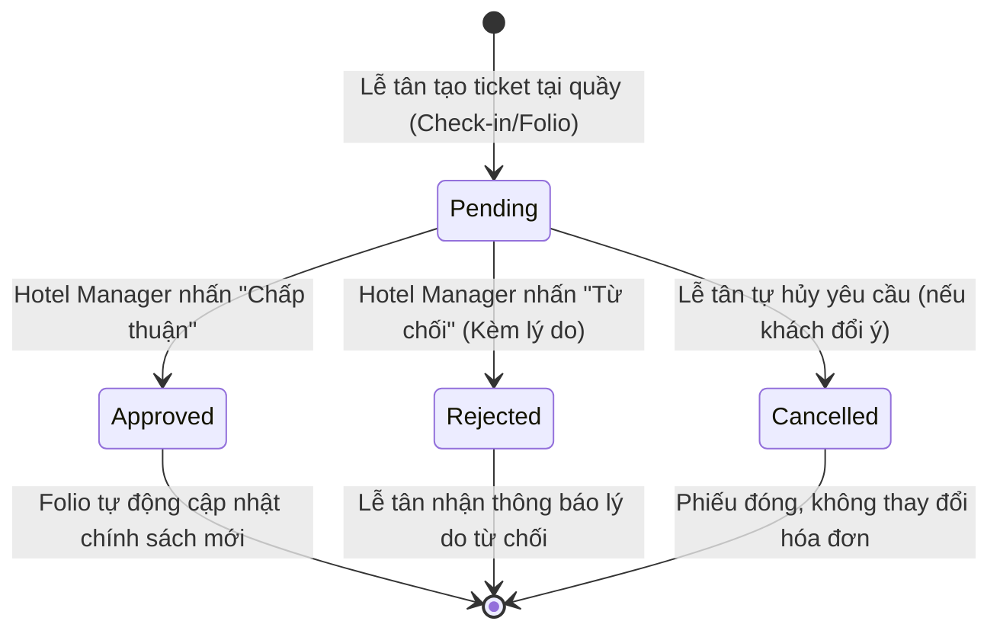
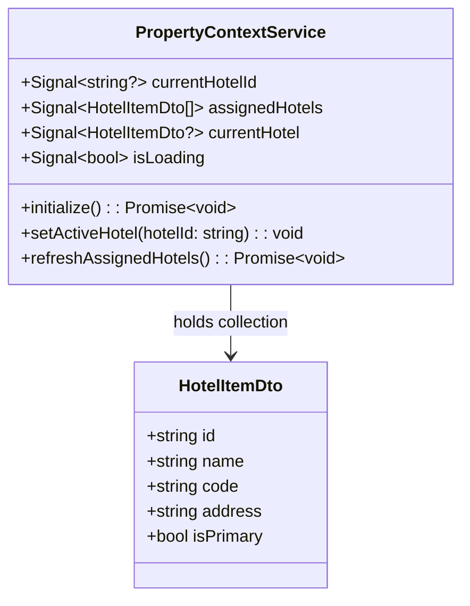
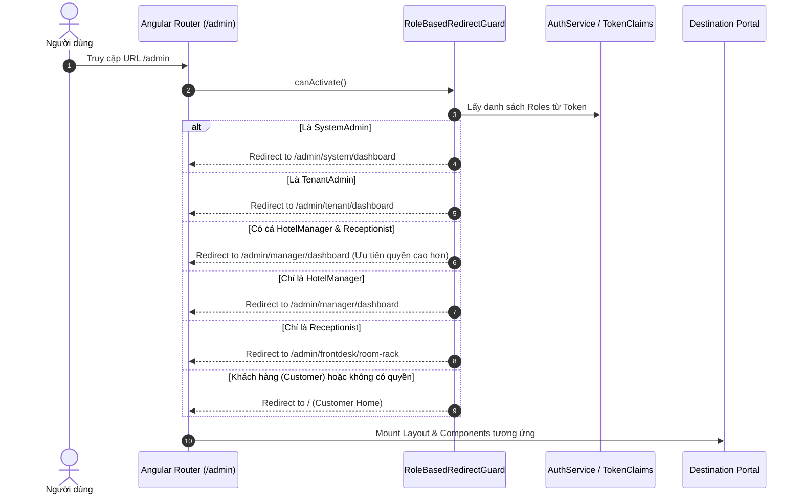
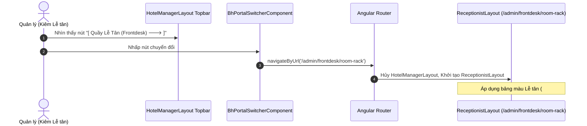
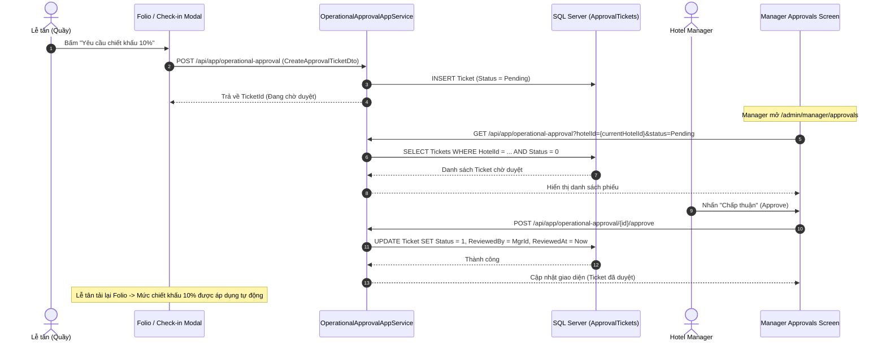

# Data Model: RM-006 - Phân Tách Không Gian & Thiết Kế Giao Diện Quản Lý Theo 4 Vai Trò

**Feature Branch**: `006-role-based-management`  
**Date**: 2026-11-13  
**Status**: Completed  
**Spec**: [specs/006-role-based-management/spec.md](spec.md)

---

## 1. Sơ Đồ Thực Thể Quan Hệ (Entity-Relationship Diagram)

---

## 2. Chi Tiết Thực Thể `OperationalApprovalTicket`

Thực thể kế thừa `FullAuditedEntity<Guid>` và triển khai giao diện `IMultiTenant`:

| Tên trường | Kiểu dữ liệu | Ràng buộc | Mô tả |
| :--- | :--- | :--- | :--- |
| `Id` | `Guid` | Primary Key | Định danh duy nhất của phiếu yêu cầu phê duyệt. |
| `TenantId` | `Guid?` | Foreign Key (Index) | Định danh Tenant (Multi-Tenancy Isolation). |
| `HotelId` | `Guid` | Foreign Key (Index) | Cơ sở khách sạn xảy ra nghiệp vụ ngoại lệ. |
| `TicketType` | `ApprovalTicketType` | Required, Enum (int) | Loại ngoại lệ: `DiscountOverride` (1), `PenaltyWaiver` (2), `EarlyCheckIn` (3), `LateCheckOut` (4), `RoomUpgrade` (5). |
| `Status` | `ApprovalTicketStatus` | Required, Enum (int) | Trạng thái phiếu: `Pending` (0), `Approved` (1), `Rejected` (2), `Cancelled` (3). |
| `RequestedByStaffId` | `Guid` | Foreign Key (Index) | ID tài khoản Lễ tân gửi yêu cầu. |
| `RequestedByStaffName` | `string` | MaxLen(256) | Họ tên Lễ tân (snapshot để hiển thị nhanh). |
| `BookingId` | `Guid?` | Nullable, Index | ID đơn đặt phòng phát sinh ngoại lệ. |
| `FolioId` | `Guid?` | Nullable | ID bảng kê chi tiêu / hóa đơn buồng phòng. |
| `RoomNumber` | `string?` | MaxLen(32) | Số phòng liên quan đến ngoại lệ. |
| `Amount` | `decimal?` | Precision(18,2) | Số tiền điều chỉnh hoặc giá trị xin miễn giảm. |
| `DiscountPercent` | `decimal?` | Precision(5,2) | Tỷ lệ chiết khấu (%) xin áp dụng. |
| `Reason` | `string` | Required, MaxLen(1000) | Giải trình chi tiết lý do cần phê duyệt ngoại lệ. |
| `ReviewedByManagerId` | `Guid?` | Nullable | ID tài khoản Hotel Manager duyệt hoặc từ chối. |
| `ReviewedByManagerName` | `string?` | MaxLen(256) | Họ tên người quản lý phê duyệt. |
| `ReviewedAt` | `DateTime?` | Nullable | Thời điểm thực hiện hành động duyệt/từ chối. |
| `RejectionReason` | `string?` | MaxLen(1000) | Lý do từ chối (bắt buộc khi trạng thái là `Rejected`). |

### Chỉ Mục & Tối Ưu Hóa (Indexes)
- `IX_OperationalApprovalTickets_TenantId_HotelId_Status`: Phục vụ truy vấn danh sách ticket chờ duyệt theo từng khách sạn của Hotel Manager.
- `IX_OperationalApprovalTickets_RequestedByStaffId_Status`: Phục vụ Lễ tân tra cứu các ticket mình vừa gửi tại quầy.
- `IX_OperationalApprovalTickets_BookingId`: Phục vụ kiểm tra lịch sử ngoại lệ của một đơn đặt phòng.

---

## 3. Máy Trạng Thái Của Phiếu Duyệt Ngoại Lệ (State Machine)

---

## 4. Mô Hình Quản Lý Ngữ Cảnh Cơ Sở (`PropertyContextService` State Model)

- **Lưu trữ Persistent**:
  - Khóa: `bh_active_hotel_id`.
  - Cơ chế đồng bộ: Khi `setActiveHotel(id)` được gọi, Signal `currentHotelId` phát tín hiệu thay đổi đến toàn bộ component đang lắng nghe và cập nhật giá trị mới vào `localStorage`.

---

## 5. Sơ Đồ Tuần Hoàn Tác Nghiệp (Sequence Diagrams)

### 5.1. Định Tuyến Tự Động Sau Đăng Nhập (`RoleBasedRedirectGuard`)

### 5.2. Chuyển Đổi Không Gian Cho Nhân Sự Kiêm Nhiệm (Dual-Role Switcher)

### 5.3. Quy Trình Tạo & Phê Duyệt Phiếu Ngoại Lệ (Approval Ticket Workflow)

