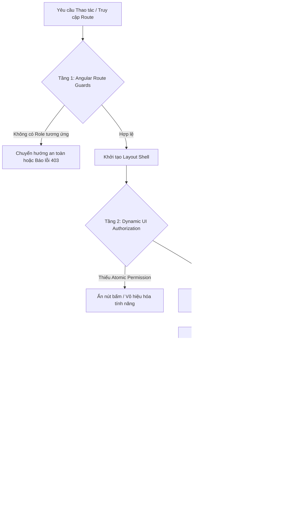

# Technical Research & Architecture Decisions: RM-006 - Phân Tách Không Gian & Thiết Kế Giao Diện Quản Lý Theo 4 Vai Trò

**Feature Branch**: `006-role-based-management`  
**Date**: 2026-11-13  
**Status**: Completed  
**Spec**: [specs/006-role-based-management/spec.md](spec.md)

---

## 1. Kiến Trúc 4 Layout Shells Độc Lập vs. 1 Layout Dùng Chung (Layout Shell Architecture)

### Bối cảnh & Vấn đề
Hệ thống Booking Hotel có 4 vai trò quản lý với mục tiêu công việc, thẩm quyền và tần suất thao tác hoàn toàn khác biệt:
- **Admin System**: Giám sát hạ tầng nền tảng, quản lý tenant, mở khóa tài khoản Host.
- **Admin Tenant**: Điều hành chuỗi khách sạn, phân bổ nhân sự, xem báo cáo tổng hợp.
- **Hotel Manager**: Quản lý giá phòng, phòng trống, duyệt ngoại lệ, giám sát ca trực tại các chi nhánh được phân công.
- **Receptionist**: Tác nghiệp tốc độ cao tại quầy lễ tân (check-in, check-out, sơ đồ buồng phòng).

*Câu hỏi kỹ thuật*: Nên sử dụng 1 component layout chung (như `ManagementLayoutComponent`) và dùng `*ngIf` để ẩn hiện menu, hay phân tách thành 4 Route Namespaces và 4 Layout Shells độc lập?

### Quyết định Kiến trúc (Theo Clarifications Q1)
- **Giải pháp**: **Phân tách thành 4 Route Namespaces và 4 Layout Shells độc lập**:
  - `/admin/system/*` $\rightarrow$ `SystemAdminLayoutComponent`
  - `/admin/tenant/*` $\rightarrow$ `TenantAdminLayoutComponent`
  - `/admin/manager/*` $\rightarrow$ `HotelManagerLayoutComponent`
  - `/admin/frontdesk/*` $\rightarrow$ `ReceptionistLayoutComponent`
- **Lý do lựa chọn**:
  1. **Tách biệt ranh giới giao diện (Clean Separation of Concerns)**: Mỗi layout có cấu trúc DOM, sidebar, topbar và menu con hoàn toàn riêng biệt. Không chứa code thừa hoặc logic điều kiện lồng nhau.
  2. **Tối ưu hóa Bundle & Lazy Loading**: Trình duyệt của lễ tân chỉ tải bundle liên quan đến quầy lễ tân (`receptionist-layout`), hoàn toàn không tải các bundle quản trị phức tạp như Quản lý Tenant hay Identity của Host.
  3. **Ngăn ngừa rò rỉ trạng thái giao diện (Zero State Leakage)**: Khi người dùng chuyển đổi vai trò hoặc đăng nhập lại, Angular Router mount layout mới nguyên vẹn, loại bỏ triệt để nguy cơ hiển thị sót menu cũ do cache template.
  4. **Áp dụng bảng màu và trải nghiệm thị giác chuyên biệt**: Cho phép scoped SCSS riêng cho Concept Quản trị (Đen/Cyan) và Concept Lễ tân (Xanh lá/Xám) mà không xung đột CSS toàn cục.

---

## 2. Quản Lý Ngữ Cảnh Cơ Sở (`PropertyContextService`) Bằng Angular Signal

### Bối cảnh & Vấn đề
Hotel Manager có thể được phân công quản lý nhiều chi nhánh trong cùng một chuỗi (`1-n`). Khi di chuyển giữa các trang quản lý (Sơ đồ buồng phòng, Cấu hình giá bán, Phê duyệt ngoại lệ), người dùng cần giữ nguyên khách sạn đang chọn mà không phải chọn lại.
*Câu hỏi kỹ thuật*: Nên nhúng `hotelId` vào URL (`/admin/manager/:hotelId/rooms`) hay sử dụng State Service Signal kết hợp `LocalStorage` với URL phẳng (`/admin/manager/rooms`)?

### Quyết định Kiến trúc (Theo Clarifications Session 2 - Q1)
- **Giải pháp**: **Xây dựng `PropertyContextService` sử dụng Angular 19 Signals và đồng bộ `LocalStorage`**.
- **Cơ chế hoạt động**:
  1. `PropertyContextService` duy trì:
     - `currentHotelId = signal<string | null>(null)`: ID khách sạn đang chọn.
     - `assignedHotels = signal<HotelItemDto[]>([])`: Danh sách khách sạn mà người dùng được phân công phụ trách.
     - `currentHotel = computed(() => ...)`: Thông tin chi tiết khách sạn đang hoạt động.
  2. **Khởi tạo (Lifecycle Initialization)**:
     - Khi `HotelManagerLayoutComponent` khởi tạo, service đọc danh sách cơ sở phân công từ thông tin người dùng / API phân bổ.
     - Kiểm tra `localStorage.getItem('bh_active_hotel_id')`:
       - Nếu có và hợp lệ trong danh sách phân công $\rightarrow$ Chọn khách sạn đó.
       - Nếu không có hoặc không hợp lệ $\rightarrow$ Tự động chọn khách sạn đầu tiên (hoặc khách sạn chính `IsPrimary = true`) và ghi vào `LocalStorage`.
  3. **Phản ứng bất đồng bộ (Reactive Filtering)**:
     - Khi Manager đổi cơ sở trên Topbar Dropdown, `PropertyContextService.setActiveHotel(newId)` cập nhật Signal và `LocalStorage`.
     - Tất cả các component con (Rooms, Rates, Approvals) inject `PropertyContextService` và lắng nghe Signal qua `effect()` hoặc computed state để tự động reload dữ liệu tương ứng mà không làm gián đoạn điều hướng hay thay đổi URL.

---

## 3. Chiến Lược Màu Sắc & Tiếp Cận Chuẩn WCAG 2.1 AA Cho Phân Hệ Lễ Tân

### Bối cảnh & Vấn đề
Hiến pháp Điều khoản VII và Clarifications Q2 quy định Phân hệ Lễ tân sử dụng Concept *Frontdesk Speed Operation*:
- Gam màu chủ đạo: Xanh lá tươi nhạt `#99FF99`, Xám `#808080`, Chữ Đen `#000000`.
- Thách thức: Màu xanh lá tươi nhạt `#99FF99` và màu xám `#808080` nếu phối màu văn bản không cẩn thận sẽ dễ vi phạm tỷ lệ tương phản tiếp cận WCAG 2.1 AA ($\ge 4.5:1$ cho body text và $\ge 3:1$ cho large text/UI components).

### Phân tích Độ tương phản & Quyết định Kỹ thuật
1. **Màu Xanh lá tươi nhạt `#99FF99`**:
   - Giá trị độ chói tương đối (*Relative Luminance*): $\approx 0.78$ (rất sáng).
   - Khi hiển thị chữ Đen `#000000` trên nền `#99FF99`:
     $$\text{Contrast Ratio} = \frac{0.78 + 0.05}{0.00 + 0.05} = \frac{0.83}{0.05} = 16.6:1$$
     $\rightarrow$ **Đạt xuất sắc chuẩn WCAG AAA** (vượt xa ngưỡng $7:1$).
   - *Quy tắc áp dụng*: Bắt buộc 100% văn bản hoặc icon nằm trên nền `#99FF99` phải dùng màu chữ Đen đậm `#000000` (hoặc Dark Charcoal `#111827`). Tuyệt đối không dùng chữ Trắng `#FFFFFF` trên nền `#99FF99` (tỷ lệ tương phản chỉ đạt $1.26:1$ - vi phạm nghiêm trọng).
2. **Màu Xám `#808080`**:
   - Sử dụng `#808080` cho: Viền thẻ (Card Borders), Đường phân cách (Dividers), Trạng thái phòng bẩn/chờ dọn (Dirty/Maintenance State).
   - Khi dùng làm nền thẻ phòng bẩn: Dùng màu nền xám nhạt (`#F3F4F6` hoặc `#E5E7EB`) kết hợp viền `#808080` và chữ Đen `#000000` ($\text{Contrast Ratio} \ge 11:1$).
3. **Bảng màu trạng thái phòng trực quan (Room State Visual Palette)**:
   - **Phòng Trống / Sẵn sàng**: Nền `#99FF99`, Viền `#22C55E`, Chữ `#000000`.
   - **Phòng Chờ dọn / Bẩn**: Nền `#F3F4F6`, Viền `#808080`, Chữ `#1F2937`.
   - **Phòng Đang có khách (Occupied)**: Nền `#FEE2E2`, Viền `#EF4444`, Chữ `#7F1D1D`.
   - **Phòng Đã đặt trước (Reserved)**: Nền `#FEF3C7`, Viền `#F59E0B`, Chữ `#78350F`.

---

## 4. Mô Hình Duyệt Ngoại Lệ Tác Nghiệp Bất Đồng Bộ (Operational Exception Approvals)

### Bối cảnh & Vấn đề
Trong nghiệp vụ khách sạn, lễ tân thường gặp các tình huống cần linh hoạt:
- Khách yêu cầu chiết khấu tiền phòng vượt hạn mức lễ tân (ví dụ > 5%).
- Khách hủy phòng đột xuất do sự cố bất khả kháng muốn được miễn phạt cọc.
- Khách yêu cầu check-in sớm mà không tính thêm phí.

Nếu cấp quyền cho lễ tân tự điều chỉnh sẽ dễ nảy sinh rủi ro thất thoát thu ngân. Nếu bắt Manager phải ra tận quầy để nhập mật khẩu override sẽ làm tắc nghẽn quầy tiếp đón.

### Quyết định Kiến trúc (Theo Clarifications Session 2 - Q3)
- **Giải pháp**: Xây dựng phân hệ **Phiếu Yêu Cầu Phê Duyệt Bất Đồng Bộ (Operational Approval Ticket Workflow)**:
  1. **Khởi tạo**: Lễ tân bấm nút "Yêu cầu ngoại lệ" trên giao diện Check-in / Folio. Hệ thống mở Modal nhập lý do và thông số đề xuất.
  2. **Lưu trữ**: Tạo bản ghi `OperationalApprovalTicket` với trạng thái `Pending`, liên kết với `HotelId`, `RequestedByStaffId`, `FolioId`.
  3. **Thông báo & Phê duyệt**: Phiếu xuất hiện trên màn hình `/admin/manager/approvals` của Hotel Manager phụ trách khách sạn đó. Manager có thể:
     - **Chấp thuận (Approve)**: Hệ thống chuyển trạng thái ticket sang `Approved`, lưu `ReviewedByManagerId`, và tự động cập nhật mức chiết khấu / miễn phạt lên Folio tương ứng.
     - **Từ chối (Reject)**: Manager bắt buộc nhập lý do từ chối. Lễ tân nhận thông báo phản hồi trên màn hình Folio.
  4. **Audit Trail**: Mọi hành động đều ghi nhận đầy đủ thời gian, người gửi, người duyệt để phục vụ thanh tra và đối soát doanh thu.

---

## 5. Cơ Chế Chuyển Đổi Không Gian Cho Nhân Sự Kiêm Nhiệm (Dual-Role Persona Switcher)

### Bối cảnh & Vấn đề
Tại một số khách sạn quy mô vừa và nhỏ, người quản lý có thể trực tiếp đứng quầy lễ tân vào ca đêm hoặc giờ cao điểm (sở hữu cả 2 vai trò `HotelManager` và `Receptionist`).
*Câu hỏi kỹ thuật*: Khi đăng nhập, hệ thống điều hướng về đâu và làm thế nào để người dùng chuyển đổi qua lại giữa giao diện Quản lý và Lễ tân mà không cần đăng xuất?

### Quyết định Kiến trúc (Theo Clarifications Session 2 - Q4)
- **Giải pháp**:
  1. **Điều hướng mặc định**: `RoleBasedRedirectGuard` ưu tiên vai trò cấp cao hơn $\rightarrow$ Tự động vào `/admin/manager/dashboard`.
  2. **Nút chuyển đổi nhanh (`BhPortalSwitcherComponent`)**:
     - Khi `AuthService` phát hiện người dùng sở hữu đồng thời cả 2 vai trò `HotelManager` và `Receptionist`:
     - Trên Topbar hiển thị một nút gạt nhỏ (*Portal Switcher Pill*):
       - Đang ở Manager: Hiển thị nút `[ Quầy Lễ Tân (Frontdesk) 🡒 ]` (Nền `#99FF99`, Chữ Đen). Bấm vào chuyển ngay sang `/admin/frontdesk/room-rack`.
       - Đang ở Lễ tân: Hiển thị nút `[ 🡐 Bàn Quản Lý (Manager) ]` (Nền Đen `#000000`, Viền Cyan `#00FFFF`, Chữ Trắng). Bấm vào chuyển ngay về `/admin/manager/dashboard`.
     - Giữ nguyên phiên đăng nhập (JWT Token không đổi), chỉ chuyển đổi Layout Shell và Router View.

---

## 6. Mô Hình Phòng Thủ 3 Tầng & Chính Sách Không Can Thiệp Quyền (Non-Interference Defense)

### Các quy tắc cốt lõi:
1. **Admin System là ngoại lệ duy nhất**: Có toàn quyền với hạ tầng Host. Tuy nhiên, 5 vai trò chuẩn luôn có cờ `IsStatic = true` để không một ai (kể cả Host Admin) có thể vô tình xóa bỏ hoặc làm thay đổi logic mã nguồn.
2. **Admin Tenant bị cô lập**: Chỉ được quản lý tài khoản nhân sự trong Tenant của mình, không thể sửa vai trò, không thể xem Tenant khác.
3. **Hotel Manager & Receptionist bị khóa cứng**: Hoàn toàn không có quyền truy cập vào phân hệ Quản trị Định danh (`IdentityUser`, `IdentityRole`), không thể can thiệp quyền của các vai trò khác.

