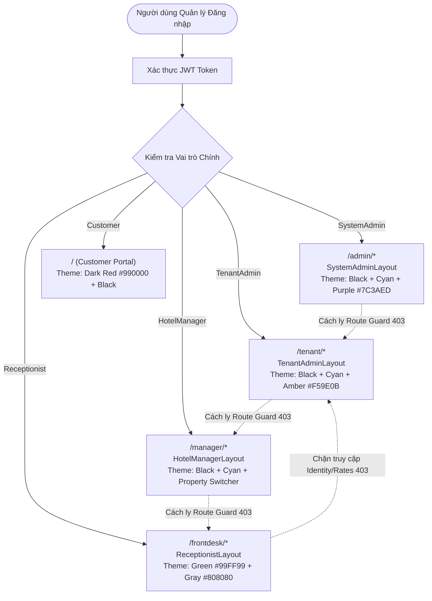

# Feature Specification: RM-006 - Phân Tách Không Gian & Thiết Kế Giao Diện Quản Lý Theo 4 Vai Trò

**Feature Branch**: `006-role-based-management`  
**Created**: 2026-11-13  
**Status**: Ready for Planning  
**Input**: User description: "Thêm vào Roadmap RM-006, thiết kế design quản lý theo role, sử dụng concept đã được định trước đó, chia rõ ràng các trang riêng biệt đối với 4 role quản lý (Admin System, Admin Tenant, Hotel Manager và Receptionist), đánh dấu rõ ràng quyền, khả năng truy cập và quyền được thao tác rõ ràng với các role. Đảm bảo các role không có khả năng can thiệp hay sửa đổi các quyền của các role khác(Admin System là ngoại lệ). ĐỊnh nghĩa quyền rõ ràng để tránh sau này gặp rắc rối"

---

## 1. Quyết Định Kiến Trúc & Làm Rõ (Clarifications & Architectural Decisions)

### Session 2026-11-13

- **Q1: Cơ chế phân tách không gian giao diện giữa 4 vai trò quản lý**: Hệ thống sẽ dùng chung 1 layout quản trị và ẩn/hiện menu qua `ngIf` hay phân tách thành 4 Route Namespaces và 4 Layout Shells độc lập?  
  $\rightarrow$ **A (Chốt - Best Practice)**: **Phân tách 4 Route Namespaces và 4 Layout Shells độc lập**.
  - `/admin/*` $\rightarrow$ `SystemAdminLayoutComponent` (Host Admin).
  - `/tenant/*` $\rightarrow$ `TenantAdminLayoutComponent` (Tenant Admin).
  - `/manager/*` $\rightarrow$ `HotelManagerLayoutComponent` (Hotel Manager).
  - `/frontdesk/*` $\rightarrow$ `ReceptionistLayoutComponent` (Receptionist).  
  *Lý do*: Cách ly triệt để mã nguồn giao diện, tối ưu hóa kích thước bundle (lazy loading), bảo vệ chống rò rỉ layout state giữa các vai trò và ngăn ngừa hoàn toàn nguy cơ hiển thị nhầm component khi người dùng chuyển đổi phiên làm việc.

- **Q2: Kế thừa Concept màu sắc theo Hiến pháp và RM-004**: Từng vai trò quản lý sẽ áp dụng bảng màu và điểm nhấn thị giác như thế nào?  
  $\rightarrow$ **A (Chốt)**: Kế thừa 100% tokens từ `RM-004` kết hợp phân cấp màu nhận diện chuyên biệt:
  - **Admin System**: Concept *Platform Dark Control* — Sidebar Đen `#000000`, Điểm nhấn Cyan `#00FFFF`, Nền Trắng `#FFFFFF`, Badge Host Tím chàm `#7C3AED`.
  - **Admin Tenant**: Concept *Corporate Executive Dashboard* — Sidebar Đen `#000000`, Điểm nhấn Cyan `#00FFFF`, Nền Trắng `#FFFFFF`, Badge Chuỗi Vàng hổ phách `#F59E0B`.
  - **Hotel Manager**: Concept *Operational Manager Console* — Sidebar Đen `#000000`, Điểm nhấn Cyan `#00FFFF`, Nền Trắng `#FFFFFF`, Bộ chọn chi nhánh (*Property Selector*) trên Topbar.
  - **Receptionist**: Concept *Frontdesk Speed Operation* — Gam màu chủ đạo Xanh lá tươi nhạt `#99FF99` (Nút hành động chính Check-in, Sơ đồ phòng sẵn sàng), Xám `#808080` (Viền thẻ, bộ lọc, phòng chờ dọn), Chữ Đen `#000000` tương phản cao ($\ge 4.5:1$).

- **Q3: Nguyên tắc chống sửa đổi quyền và bảo vệ ranh giới vai trò (Non-Interference Policy)**: Thẩm quyền can thiệp vai trò và cấp quyền được giới hạn ra sao?  
  $\rightarrow$ **A (Chốt)**:
  - **Admin System là ngoại lệ duy nhất**: Có toàn quyền quản trị hạ tầng nền tảng, quản lý tenant, mở khóa tài khoản Host. Tuy nhiên, 5 vai trò chuẩn (*Standard Roles*) vẫn được khóa cố định (`IsStatic = true`) để không phá vỡ mô hình phân quyền hệ thống.
  - **Admin Tenant**: Chỉ quản lý nhân sự nội bộ (`HotelManager` và `Receptionist`) thuộc Tenant của mình; KHÔNG THỂ can thiệp System Admin, KHÔNG THỂ tạo Custom Roles, KHÔNG THỂ sửa cây quyền hạt nhân (*Atomic Permissions*), KHÔNG THỂ xem hoặc can thiệp dữ liệu Tenant khác.
  - **Hotel Manager**: HOÀN TOÀN KHÔNG CÓ quyền quản lý tài khoản (`IdentityUser`) hay phân quyền (`IdentityRole`); không thể tạo/sửa tài khoản lễ tân; chỉ được phân công ca trực và điều hành buồng phòng trong các cơ sở được phân công.
  - **Receptionist**: HOÀN TOÀN BỊ CHẶN khỏi các phân hệ Identity, Cấu hình giá gốc, Khách sạn hay Báo cáo tài chính (403 Forbidden); khóa cứng với 1 cơ sở duy nhất; mọi ngoại lệ hoàn hủy/chiết khấu bắt buộc phải qua phê duyệt của Hotel Manager.

- **Q4: Xử lý định tuyến điều hướng sau khi đăng nhập (Post-Login Redirection)**: Người dùng thuộc các vai trò khác nhau sẽ được chuyển hướng về đâu sau khi đăng nhập thành công?  
  $\rightarrow$ **A (Chốt)**: Xây dựng `RoleBasedRedirectGuard` tại tuyến đường `/admin` gốc:
  - Có vai trò `SystemAdmin` $\rightarrow$ Tự động chuyển hướng về `/admin/dashboard`.
  - Có vai trò `TenantAdmin` $\rightarrow$ Tự động chuyển hướng về `/tenant/dashboard`.
  - Có vai trò `HotelManager` $\rightarrow$ Tự động chuyển hướng về `/manager/dashboard`.
  - Có vai trò `Receptionist` $\rightarrow$ Tự động chuyển hướng về `/frontdesk/room-rack`.
  - Có vai trò `Customer` $\rightarrow$ Chuyển hướng về `/` (Customer Portal).

### Session 2 (Interactive Clarification Loop - 2026-11-13)

- **Q1: Cơ chế chọn khách sạn (Property Selection) cho Hotel Manager**: Hotel Manager quản lý nhiều khách sạn sẽ chuyển đổi ngữ cảnh cơ sở như thế nào trên URL và State giao diện?  
  $\rightarrow$ **A (Chốt - Option A)**: **`PropertyContextService` với Angular Signal + `LocalStorage` lưu trữ cơ sở đang chọn**. Tuyến đường giữ nguyên dạng `/admin/manager/rooms`, `/admin/manager/rates`, v.v. Tất cả các trang thuộc Portal Hotel Manager tự động inject `PropertyContextService` và phản ứng (reactive filtering) khi người dùng chọn cơ sở khác từ Dropdown trên Topbar. Tránh làm cồng kềnh URL và tăng tính tiện dụng khi điều hướng.

- **Q2: Cơ chế hiển thị Room Rack (Sơ đồ buồng phòng) cho Lễ tân**: Giao diện sơ đồ buồng phòng `/admin/frontdesk/room-rack` thể hiện dạng ô lưới trực quan hay dạng bảng dữ liệu?  
  $\rightarrow$ **A (Chốt - Option C)**: **Mặc định hiển thị Lưới trực quan (Visual Matrix Grid)** với màu sắc nhận diện trạng thái phòng (`#99FF99` Phòng sẵn sàng, `#808080` Phòng bẩn/chờ dọn, `#FF6B6B` Phòng có khách/Occupied, `#FFD166` Đặt trước/Reserved), đồng thời **cung cấp nút chuyển đổi (Toggle Switch) sang Dạng bảng dữ liệu phân trang (`BhDataTableComponent`)** có bộ lọc nâng cao dành cho việc tra cứu nhanh và thao tác hàng loạt.

- **Q3: Cơ chế xử lý phê duyệt ngoại lệ tác nghiệp (Operational Exception Approvals)**: Khi lễ tân cần chiết khấu vượt trần hoặc hủy phạt cọc, quy trình phê duyệt giữa Lễ tân và Hotel Manager diễn ra thế nào?  
  $\rightarrow$ **A (Chốt - Option A)**: **Phiếu yêu cầu phê duyệt bất đồng bộ (Approval Ticket Workflow)**. Lễ tân nhấn nút "Yêu cầu duyệt ngoại lệ" ngay trên form Check-in / Check-out / Folio, hệ thống tạo ticket ở trạng thái `Pending`. Yêu cầu này lập tức xuất hiện tại màn hình `/admin/manager/approvals` của Hotel Manager kèm thông báo tức thời. Khi Manager nhấn Duyệt, Folio lễ tân tự động áp dụng chính sách mới.

- **Q4: Xử lý nhân sự kiêm nhiệm nhiều vai trò (Dual-Role Personnel)**: Nếu một nhân sự vừa có vai trò `HotelManager` vừa có `Receptionist` thì giao diện và định tuyến xử lý ra sao?  
  $\rightarrow$ **A (Chốt - Option A)**: **Ưu tiên Portal cấp cao hơn khi đăng nhập (`/admin/manager/dashboard`)**, đồng thời **trên Topbar hiển thị nút chuyển đổi không gian (Portal Switcher Pill)** cho phép nhảy nhanh sang `/admin/frontdesk/room-rack` mà không cần đăng xuất. Trạng thái và giao diện tự động thích ứng với vai trò tác nghiệp tương ứng.

---

## 2. Kịch Bản Người Dùng & Tiêu Chí Chấp Nhận (User Scenarios & Testing)



---

### User Story 1 - Không Gian Quản Trị Nền Tảng Đa Khách Thuê (System Admin Portal) (Priority: P1)

Là Quản trị viên Hệ thống (System Admin / Host Admin), tôi muốn truy cập không gian `/admin/system/*` độc lập với giao diện *Platform Dark Control* để giám sát toàn bộ hạ tầng đa khách thuê, quản lý vòng đời đối tác chuỗi khách sạn (Tenants), cấu hình thông số kỹ thuật toàn cục và mở khóa tài khoản Host khi có sự cố brute-force.

**Why this priority**: Đây là lớp quản trị gốc cao nhất của toàn bộ hệ thống SaaS Booking Hotel. Ranh giới này phải độc lập tuyệt đối với dữ liệu kinh doanh của từng khách sạn.

**Independent Test**:
1. Đăng nhập bằng tài khoản Quản trị viên hệ thống (Host scope).
2. Hệ thống chuyển hướng vào `/admin/system/dashboard`.
3. Kiểm tra Sidebar: Nền đen sâu `#000000`, điểm nhấn Cyan `#00FFFF`, hiển thị Huy hiệu Host màu tím chàm `#7C3AED`.
4. Truy cập `/admin/system/tenants`: Thực hiện tạo mới, cấu hình connection string riêng, tạm khóa (`Suspend`) và kích hoạt lại Tenant.
5. Truy cập `/admin/system/audit-logs`: Tra cứu lịch sử truy cập và nhật ký brute-force trên toàn nền tảng.
6. Cố tình truy cập vào URL của quầy lễ tân `/admin/frontdesk/room-rack` $\rightarrow$ Hệ thống cảnh báo không đúng phân hệ tác nghiệp và điều hướng trở lại `/admin/system/dashboard`.

**Acceptance Scenarios**:
1. **Quản lý Vòng Đời Doanh Nghiệp Đối Tác (Tenants)**:
   - **Given** System Admin truy cập màn hình `/admin/system/tenants`.
   - **When** Tạo mới hoặc cập nhật một Tenant.
   - **Then** Hệ thống phân bổ không gian dữ liệu riêng biệt, gán trạng thái `Active` và lưu vết vào Audit Logs.
2. **Khóa Tạm Ngưng Tenant Vi Phạm**:
   - **Given** Một chuỗi đối tác hết hạn hợp đồng hoặc có vi phạm an ninh.
   - **When** System Admin chọn lệnh `Suspend`.
   - **Then** Tenant lập tức bị chuyển sang trạng thái tạm khóa; mọi tài khoản thuộc Tenant đó (Tenant Admin, Hotel Manager, Receptionist) bị chặn truy cập ngay lập tức.
3. **Mở Khóa Tài Khoản Cấp Host**:
   - **Given** Một tài khoản quản trị cấp Host bị khóa do Brute-force.
   - **When** System Admin thực hiện lệnh `UnlockUser` tại `/admin/system/users`.
   - **Then** Tài khoản được mở khóa thành công, xóa bộ đếm vi phạm và ghi nhật ký an ninh.

---

### User Story 2 - Không Gian Quản Trị Doanh Nghiệp Chuỗi Khách Sạn (Tenant Admin Portal) (Priority: P1)

Là Quản trị viên Doanh nghiệp (Tenant Admin / Đối tác Chuỗi Khách Sạn), tôi muốn làm việc tại không gian `/admin/tenant/*` với giao diện *Corporate Executive Dashboard* để quản lý danh mục chi nhánh khách sạn, cấu hình chính sách vận hành chung, phân bổ nhân sự (Manager & Receptionist), và xem báo cáo hợp nhất toàn chuỗi mà không bị lộ dữ liệu sang chuỗi khác hay can thiệp vào cấp Host.

**Why this priority**: Đảm bảo tính tự chủ kinh doanh cho các chuỗi khách sạn đối tác trên nền tảng, trao đúng quyền quản lý nhân sự nội bộ nhưng ngăn chặn triệt để hành vi leo thang đặc quyền.

**Independent Test**:
1. Đăng nhập với tài khoản Tenant Admin của Chuỗi A.
2. Hệ thống chuyển hướng vào `/admin/tenant/dashboard`.
3. Kiểm tra Sidebar: Nền đen `#000000`, điểm nhấn Cyan `#00FFFF`, Huy hiệu Chuỗi màu vàng hổ phách `#F59E0B`.
4. Truy cập `/admin/tenant/hotels`: Thêm mới một chi nhánh khách sạn trực thuộc chuỗi.
5. Truy cập `/admin/tenant/staff`:
   - Tạo mới nhân viên, gán vai trò `HotelManager` và chỉ định danh sách 2 chi nhánh phụ trách.
   - Tạo nhân viên thứ hai, gán vai trò `Receptionist` và chỉ định cố định 1 chi nhánh làm việc.
   - Mở khóa một tài khoản nhân viên nội bộ bị khóa brute-force (`UnlockUser`).
6. Kiểm tra dropdown vai trò: Chỉ hiển thị duy nhất 2 lựa chọn (`HotelManager`, `Receptionist`); tuyệt đối không có lựa chọn `SystemAdmin` hay `TenantAdmin`.
7. Cố tình truy vấn ID dữ liệu của Chuỗi B $\rightarrow$ Hệ thống chặn 403 / 404.

**Acceptance Scenarios**:
1. **Phân Quyền Nhân Sự Nội Bộ An Toàn (Anti-Privilege Escalation)**:
   - **Given** Tenant Admin đang tạo tài khoản cho nhân sự mới tại `/admin/tenant/staff`.
   - **When** Chọn vai trò cho người dùng.
   - **Then** Form chỉ cho phép chọn `HotelManager` hoặc `Receptionist`. Mọi yêu cầu gửi kèm vai trò ngoài danh mục này đều bị backend chặn ngay lập tức.
2. **Phân Bổ Chi Nhánh Cho Quản Lý Khách Sạn (Multi-Property Assignment)**:
   - **Given** Chuỗi khách sạn có 5 chi nhánh.
   - **When** Tenant Admin gán 2 chi nhánh cụ thể cho tài khoản Hotel Manager.
   - **Then** Bản ghi liên kết `UserHotelAssignment` được lưu lại; Hotel Manager đó chỉ có quyền điều hành trên đúng 2 chi nhánh được gán.
3. **Cố Định Chi Nhánh Cho Nhân Viên Lễ Tân (Single-Property Locked)**:
   - **Given** Tenant Admin tạo tài khoản cho Lễ tân.
   - **When** Gán chi nhánh làm việc.
   - **Then** Hệ thống bắt buộc chọn duy nhất 1 chi nhánh cố định; Lễ tân không thể chuyển đổi chi nhánh khi tác nghiệp.

---

### User Story 3 - Không Gian Điều Hành Cơ Sở Khách Sạn (Hotel Manager Portal) (Priority: P2)

Là Quản lý Khách sạn (Hotel Manager), tôi muốn làm việc tại không gian `/admin/manager/*` với giao diện *Operational Manager Console* có bộ chọn cơ sở (*Property Selector*) trên Topbar để quản lý danh mục buồng phòng, thiết lập bảng giá phòng động theo mùa, phân ca trực cho lễ tân, xem báo cáo hiệu suất chi nhánh và phê duyệt các yêu cầu ngoại lệ từ quầy tiếp tân.

**Why this priority**: Phân hệ này là trái tim của hoạt động kinh doanh buồng phòng tại từng cơ sở. Phân quyền chặt chẽ giúp Quản lý tập trung tối đa vào doanh thu và chất lượng dịch vụ mà không thể can thiệp sai lệch cấu hình nhân sự cấp Tenant.

**Independent Test**:
1. Đăng nhập với tài khoản Hotel Manager phụ trách Khách sạn 1 và Khách sạn 2.
2. Hệ thống chuyển hướng vào `/admin/manager/dashboard`.
3. Kiểm tra Topbar: Xuất hiện dropdown "Chọn Cơ sở Phụ trách", chỉ chứa Khách sạn 1 và Khách sạn 2 (không thấy Khách sạn 3, 4, 5 của chuỗi).
4. Truy cập `/admin/manager/rooms`: Tạo hạng phòng mới (Deluxe Ocean View), thêm danh sách phòng thực tế và gán tiện ích.
5. Truy cập `/admin/manager/rates`: Cài đặt giá phòng ngày thường, giá cuối tuần và phụ thu nhận phòng sớm.
6. Truy cập `/admin/manager/approvals`: Xem và phê duyệt một yêu cầu hủy phòng hoàn tiền ngoại lệ gửi lên từ Lễ tân.
7. Cố gắng truy cập `/admin/tenant/staff` hoặc `/identity/users` $\rightarrow$ Bị chặn ngay lập tức (403 Forbidden).

**Acceptance Scenarios**:
1. **Lọc Dữ Liệu Theo Cơ Sở Được Phân Công (Data Scoping)**:
   - **Given** Hotel Manager được phân công quản lý 2 chi nhánh.
   - **When** Chuyển đổi qua lại giữa 2 chi nhánh trên bộ lọc Topbar.
   - **Then** Toàn bộ dữ liệu buồng phòng, bảng giá, danh sách đơn đặt phòng và chỉ số RevPAR tự động cập nhật tương ứng theo cơ sở đang chọn.
2. **Quản Lý Bảng Giá & Danh Mục Dịch Vụ**:
   - **Given** Quản lý cần kích cầu mùa thấp điểm.
   - **When** Cập nhật đơn giá phòng và bảng giá minibar.
   - **Then** Giá mới có hiệu lực ngay lập tức cho cổng đặt phòng khách hàng và quầy tiếp tân; lễ tân không thể sửa đơn giá này.
3. **Phê Duyệt Ngoại Lệ Nghiệp Vụ Vận Hành**:
   - **Given** Khách hàng VIP gặp sự cố đột xuất cần hủy phòng sát giờ (ngoài chính sách miễn phí).
   - **When** Lễ tân gửi yêu cầu ngoại lệ kèm lý do, Quản lý nhấn "Phê duyệt" tại `/admin/manager/approvals`.
   - **Then** Hệ thống ghi nhận lý do phê duyệt, cho phép hoàn tiền theo thẩm quyền và lưu vết kiểm toán an toàn.

---

### User Story 4 - Không Gian Tác Nghiệp Quầy Lễ Tân Tốc Độ Cao (Receptionist Frontdesk Portal) (Priority: P2)

Là Nhân viên Lễ tân (Receptionist), tôi muốn làm việc tại không gian `/admin/frontdesk/*` chuyên biệt với giao diện *Frontdesk Speed Operation* tông màu Xanh lá tươi `#99FF99` và Xám `#808080`, gắn cố định với cơ sở khách sạn của mình để ngay khi mở lên, hệ thống hiển thị trực tiếp Sơ đồ buồng phòng ma trận thời gian thực (Visual Room Rack Matrix), giúp tôi Check-in, Check-out, tạo đặt phòng tại quầy, cập nhật Folio thu ngân và điều phối dọn phòng với tốc độ nhanh nhất mà không phải thao tác rườm rà.

**Why this priority**: Lễ tân tác nghiệp trực tiếp với khách hàng tại quầy. Bất kỳ sự chậm trễ hay nhầm lẫn nào về trạng thái phòng và thanh toán đều ảnh hưởng trực tiếp đến uy tín của khách sạn. Không gian riêng biệt giúp tối đa hóa tốc độ phục vụ và loại bỏ hoàn toàn nguy cơ bấm nhầm vào các trang quản trị nhạy cảm.

**Independent Test**:
1. Đăng nhập với tài khoản Receptionist tại Chi nhánh Đà Nẵng.
2. Hệ thống chuyển hướng trực tiếp vào `/admin/frontdesk/room-rack`.
3. Kiểm tra giao diện:
   - Nút tác vụ chính "Check-in Nhanh", "Tạo Đặt Phòng Tại Quầy", và các Thẻ phòng sẵn sàng mang màu Xanh lá tươi `#99FF99` với chữ đen sắc nét `#000000`.
   - Các nút lọc, chi tiết phòng bẩn mang màu Xám `#808080`.
   - Khóa cứng chi nhánh Đà Nẵng, không có dropdown chuyển đổi cơ sở.
4. Nhấp vào 1 phòng trống sạch trên Room Rack $\rightarrow$ Mở popup Check-in nhanh cho khách.
5. Truy cập `/admin/frontdesk/check-out`: Tìm phòng khách đang ở, thêm đồ uống minibar vào Folio, thanh toán quyết toán và chuyển phòng sang trạng thái Bẩn (`Dirty`).
6. Thử gõ trực tiếp URL `/admin/manager/rates` hoặc `/admin/tenant/staff` trên trình duyệt $\rightarrow$ Router Guard lập tức chặn lại và giữ chân tại `/admin/frontdesk/room-rack`.

**Acceptance Scenarios**:
1. **Tác Nghiệp Sơ Đồ Buồng Phòng Ma Trận Thời Gian Thực**:
   - **Given** Lễ tân đang ở màn hình `/admin/frontdesk/room-rack`.
   - **When** Khách bước tới quầy nhận phòng.
   - **Then** Lễ tân nhìn thấy ngay các ô phòng màu Xanh lá `#99FF99` (Sẵn sàng), nhấp chọn phòng, nhập mã đặt phòng, kiểm tra giấy tờ và hoàn tất Check-in trong dưới 30 giây.
2. **Quyết Toán Hóa Đơn Folio & Đổi Trạng Thái Dọn Buồng**:
   - **Given** Khách hàng làm thủ tục trả phòng tại `/admin/frontdesk/check-out`.
   - **When** Lễ tân nhập 2 chai nước khoáng tiêu thụ, in hóa đơn tạm tính và thu tiền.
   - **Then** Hệ thống chốt Folio thanh toán thành công và tự động đổi trạng thái phòng sang màu Xám `#808080` (Bẩn/Chờ dọn).
3. **Cấm Can Thiệp Bảng Giá Gốc & Báo Cáo Tài Chính**:
   - **Given** Lễ tân đang tạo đơn đặt phòng tại quầy (`/admin/frontdesk/walk-in`).
   - **When** Lễ tân muốn giảm giá đặc biệt cho người quen.
   - **Then** Ô đơn giá bị khóa (read-only); nếu muốn chiết khấu, lễ tân bắt buộc phải nhập lý do và gửi yêu cầu phê duyệt ngoại lệ tới Quản lý khách sạn.

---

### User Story 5 - Cơ Chế Bất Khả Xâm Phạm & Bảo Vệ Biên Giới Vai Trò (Non-Interference & Tamper-Proofing) (Priority: P1)

Là Kiến trúc sư Hệ thống và Đội ngũ An ninh, tôi muốn các vai trò cấp dưới hoàn toàn không có khả năng can thiệp, xem trộm, sửa đổi hoặc leo thang quyền hạn của các vai trò khác (với Admin System là ngoại lệ duy nhất ở cấp Host), để hệ thống luôn đảm bảo tính an toàn dữ liệu, chống gian lận nội bộ và loại bỏ rủi ro bảo mật trong tương lai.

**Why this priority**: Đây là cam kết sống còn của hệ thống SaaS phân cấp. Thiếu rào chắn bảo vệ biên giới quyền lực sẽ dẫn đến việc nhân viên quầy có thể tự nâng quyền quản lý hoặc đối tác chuỗi can thiệp trái phép vào hệ thống nền tảng.

**Independent Test**:
1. Dùng tài khoản Tenant Admin gửi request HTTP POST/PUT trực tiếp tới API phân quyền (`/api/permission-management/permissions`) để tự cấp thêm quyền cấp Host (`BookingHotel.Tenants.*`) $\rightarrow$ Backend trả về mã lỗi 403 Forbidden.
2. Dùng tài khoản Hotel Manager gửi request tạo tài khoản nhân viên mới $\rightarrow$ Backend từ chối với lỗi 403 Forbidden.
3. Dùng tài khoản Receptionist gửi request sửa bảng giá phòng $\rightarrow$ Backend từ chối với lỗi 403 Forbidden.
4. Xác minh cả 5 vai trò chuẩn trong hệ thống đều có cờ `IsStatic = true`, không thể bị xóa hoặc sửa đổi tập quyền cốt lõi.

**Acceptance Scenarios**:
1. **Ngăn Chặn Tấn Công Leo Thang Đặc Quyền (Anti-Privilege Escalation)**:
   - **Given** Một tài khoản có vai trò cấp dưới cố tình gửi request giả mạo JWT hoặc request body để tự gán vai trò cao hơn.
   - **When** Request đi qua tầng Application Service.
   - **Then** Hệ thống phát hiện vi phạm thẩm quyền, từ chối thực thi ngay lập tức, ghi nhật ký an ninh vào `AuditLogs` với mức độ `Warning`.
2. **Bảo Vệ Tính Toàn Vẹn Của Các Vai Trò Chuẩn**:
   - **Given** Tenant Admin muốn sửa ma trận quyền mặc định của vai trò `Receptionist`.
   - **When** Tenant Admin tìm kiếm chức năng sửa quyền vai trò.
   - **Then** Hệ thống không cung cấp màn hình sửa quyền hạt nhân; mọi vai trò chuẩn đều đóng gói bất biến.

---

## 3. Các Trường Hợp Biên & Tình Huống Ngoại Lệ (Edge Cases)

1. **Nhân Sự Kiêm Nhiệm Đa Vai Trò (Multi-Role Assignment)**:
   - Một nhân sự được Tenant Admin gán cả 2 vai trò `HotelManager` và `Receptionist` (ví dụ: Quản lý khách sạn kiêm trực ca đêm).
   - *Cách xử lý*: Khi đăng nhập, Topbar hiển thị bộ chuyển đổi không gian làm việc (*Portal Switcher*): "Không gian Quản lý" $\leftrightarrow$ "Không gian Quầy Lễ tân". Quyền hạn áp dụng nguyên tắc cộng dồn quyền (*Additive Permissions*), nhưng giao diện mỗi không gian hiển thị độc lập đúng layout chuẩn để tránh rối mắt.
2. **Tenant Bị Tạm Khóa (`Suspended`)**:
   - Khi System Admin chuyển trạng thái của một Tenant sang `Suspended`.
   - *Cách xử lý*: Toàn bộ các phiên làm việc của người dùng thuộc Tenant đó (Tenant Admin, Hotel Manager, Receptionist) bị vô hiệu hóa ngay lập tức. Mọi request tiếp theo đều bị chặn với thông báo song ngữ: *"Tổ chức của bạn đang tạm ngưng dịch vụ. Vui lòng liên hệ Quản trị viên hệ thống."*
3. **Cố Tình Nhập Trực Tiếp URL (Deep Linking Manipulation)**:
   - Một Lễ tân mở trình duyệt và gõ đường dẫn `/admin/tenant/staff` hoặc `/admin/manager/rates`.
   - *Cách xử lý*: Angular `CanActivate` Route Guard kiểm tra quyền tương ứng trong JWT token. Nếu thiếu quyền, Guard hủy điều hướng ngay lập tức, kích hoạt thông báo Toast lỗi qua `BhToastrService` và chuyển hướng về `/admin/frontdesk/room-rack`.
4. **Khách Hàng Cố Tình Truy Cập Khu Vực Quản Trị**:
   - Người dùng đăng nhập bằng tài khoản Customer thông thường và gõ `/admin/*`.
   - *Cách xử lý*: Guard phát hiện người dùng chỉ có vai trò `Customer`, lập tức điều hướng về trang chủ Cổng đặt phòng `/` kèm thông báo không đủ thẩm quyền.
5. **Mất Phiên Làm Việc Hoặc Token Hết Hạn Tại Quầy Lễ Tân**:
   - Lễ tân đang thao tác trên Room Rack nhưng token JWT hết hạn.
   - *Cách xử lý*: Hệ thống tự động kích hoạt luồng Refresh Token ngầm; nếu refresh thất bại, mở modal đăng nhập nhanh tại chỗ để không làm mất dữ liệu hóa đơn Folio đang nhập dở.

---

## 4. Yêu Cầu Chức Năng Chi Tiết (Functional Requirements)

### Nhóm 1: Phân Tách Không Gian Định Tuyến & Layout Shells
- **FR-001**: Hệ thống PHẢI phân tách không gian giao diện thành 4 Route Namespaces và 4 Layout Shells độc lập tương ứng với 4 vai trò quản lý:
  - `/admin/system/*` $\rightarrow$ `SystemAdminLayoutComponent`
  - `/admin/tenant/*` $\rightarrow$ `TenantAdminLayoutComponent`
  - `/admin/manager/*` $\rightarrow$ `HotelManagerLayoutComponent`
  - `/admin/frontdesk/*` $\rightarrow$ `ReceptionistLayoutComponent`
- **FR-002**: Mỗi Layout Shell PHẢI được lazy-load độc lập, có sidebar danh mục điều hướng riêng biệt, và không được dùng chung biến trạng thái giao diện (layout state) để chống rò rỉ ngữ cảnh giữa các vai trò.
- **FR-003**: Topbar của `HotelManagerLayoutComponent` PHẢI tích hợp bộ chọn chi nhánh cơ sở (*Property Selector*) dạng dropdown, chỉ hiển thị danh sách các khách sạn mà người dùng đó được phân công (`UserHotelAssignment`).

### Nhóm 2: Hệ Thống Concept Màu Sắc & Nhận Diện Thương Hiệu
- **FR-004**: Không gian **Admin System** PHẢI áp dụng Concept *Platform Dark Control*: Sidebar Đen sâu `#000000`, Điểm nhấn Electric Cyan `#00FFFF`, Nền nội dung Trắng sáng `#FFFFFF`, Huy hiệu Host Tím chàm `#7C3AED`.
- **FR-005**: Không gian **Admin Tenant** PHẢI áp dụng Concept *Corporate Executive Dashboard*: Sidebar Đen `#000000`, Điểm nhấn Cyan `#00FFFF`, Nền nội dung Trắng sáng `#FFFFFF`, Huy hiệu Chuỗi Vàng hổ phách `#F59E0B`.
- **FR-006**: Không gian **Hotel Manager** PHẢI áp dụng Concept *Operational Manager Console*: Sidebar Đen `#000000`, Điểm nhấn Cyan `#00FFFF`, Nền nội dung Trắng sáng `#FFFFFF`, Bộ chọn chi nhánh nổi bật trên thanh điều hướng.
- **FR-007**: Không gian **Receptionist** PHẢI áp dụng Concept *Frontdesk Speed Operation*: Tông màu chủ đạo Xanh lá tươi nhạt `#99FF99` cho nút hành động chính (Check-in, Thẻ phòng sạch sẵn sàng), màu Xám `#808080` cho viền thẻ, phòng bẩn chờ dọn và các bộ lọc phụ; chữ đen `#000000` tương phản cao.
- **FR-008**: Toàn bộ các cặp màu hiển thị trên cả 4 không gian giao diện PHẢI đạt tỷ lệ tương phản tối thiểu **$\ge 4.5:1$** theo chuẩn **WCAG 2.1 AA**.

### Nhóm 3: Ranh Giới Quyền Hạn & Bảo Vệ Bất Khả Xâm Phạm (Non-Interference)
- **FR-009**: Hệ thống PHẢI áp dụng nguyên tắc cấm can thiệp chéo: Không một vai trò nào được phép can thiệp, sửa đổi, gán hoặc thu hồi quyền hạn của các vai trò khác, ngoại trừ `Admin System` ở cấp Host.
- **FR-010**: Cả 5 vai trò chuẩn (*Standard Roles*: `SystemAdmin`, `TenantAdmin`, `HotelManager`, `Receptionist`, `Customer`) PHẢI được khóa cố định (`IsStatic = true`); hệ thống PHẢI chặn đứng mọi hành vi xóa vai trò hoặc sửa đổi ma trận quyền mặc định.
- **FR-011**: Tenant Admin CHỈ ĐƯỢC PHÉP quản lý nhân sự nội bộ (`HotelManager`, `Receptionist`) thuộc Tenant của mình; Backend PHẢI từ chối với lỗi 403 Forbidden nếu Tenant Admin cố tình gán vai trò ngoài Whitelist hoặc can thiệp cấp Host.
- **FR-012**: Hotel Manager và Receptionist HOÀN TOÀN KHÔNG CÓ quyền truy cập phân hệ Quản lý tài khoản (`IdentityUser`), Danh mục vai trò (`IdentityRole`), hay Bảng phân quyền (`PermissionGrant`).
- **FR-013**: Receptionist HOÀN TOÀN BỊ CHẶN khỏi việc sửa đổi bảng giá phòng niêm yết (`Rooms.SetRates`), tạo mã khuyến mại, sửa thông tin chi nhánh, hoặc xem báo cáo tài chính toàn chuỗi; mọi ngoại lệ hoàn tiền/chiết khấu bắt buộc phải qua phê duyệt của Hotel Manager (`Bookings.ApproveException`).

### Nhóm 4: Điều Hướng Sau Đăng Nhập & Route Guards
- **FR-014**: Tuyến đường `/admin` gốc PHẢI tích hợp `RoleBasedRedirectGuard` tự động kiểm tra vai trò chính trong JWT Token và điều hướng tức thì (< 200ms) về đúng không gian làm việc của vai trò đó.
- **FR-015**: Tất cả các tuyến đường con thuộc 4 không gian PHẢI được bảo vệ bởi `PermissionGuard` và `FirstLoginPasswordChangeGuard`; nếu người dùng cố tình nhập URL trực tiếp (Deep Linking) vào không gian không có thẩm quyền, Guard PHẢI chặn lại, kích hoạt thông báo cảnh báo `BhToastrService` và giữ người dùng tại không gian hợp lệ của họ.

### Nhóm 5: Bản Địa Hóa Song Ngữ (vi/en i18n)
- **FR-016**: Toàn bộ danh mục menu sidebar, tiêu đề trang, nhãn bảng dữ liệu, nút bấm và thông báo cảnh báo trên cả 4 không gian quản lý PHẢI được đồng bộ 100% song ngữ tại `vi.json` và `en.json`.

---

## 5. Ma Trận Phân Quyền & Khả Năng Thao Tác Chi Tiết (Permission & Access Matrix)

Bảng dưới đây định nghĩa chi tiết quyền hạn, khả năng truy cập và quyền thao tác rõ ràng cho 4 vai trò quản lý.

| Phân hệ / Màn hình | Route URL | Admin System (Host) | Admin Tenant | Hotel Manager | Receptionist | Dữ liệu hiển thị (Data Scope) |
| :--- | :--- | :---: | :---: | :---: | :---: | :--- |
| **Hạ Tầng Nền Tảng (Host Dashboard)** | `/admin/system/dashboard` | **Toàn quyền (CRUD)** | ❌ Cấm (403) | ❌ Cấm (403) | ❌ Cấm (403) | Toàn bộ nền tảng SaaS |
| **Quản lý Khách thuê (Tenants)** | `/admin/system/tenants` | **Toàn quyền (CRUD)** | ❌ Cấm (403) | ❌ Cấm (403) | ❌ Cấm (403) | Danh sách tất cả Tenants |
| **Nhật ký Kiểm toán Toàn cầu** | `/admin/system/audit-logs` | **Xem & Lọc** | ❌ Cấm (403) | ❌ Cấm (403) | ❌ Cấm (403) | Toàn bộ hệ thống |
| **Cấu hình Hệ thống Toàn cục** | `/admin/system/settings` | **Toàn quyền** | ❌ Cấm (403) | ❌ Cấm (403) | ❌ Cấm (403) | Thông số nền tảng Host |
| **Quản trị Tài khoản Host** | `/admin/system/users` | **Toàn quyền** (mở khóa Host) | ❌ Cấm (403) | ❌ Cấm (403) | ❌ Cấm (403) | Chỉ tài khoản cấp Host |
| **Báo cáo Hợp nhất Chuỗi** | `/admin/tenant/dashboard` | ❌ Cấm (Tránh lẫn) | **Xem toàn bộ** | ❌ Cấm (403) | ❌ Cấm (403) | Tổng hợp chuỗi của Tenant |
| **Danh mục Khách sạn Chi nhánh** | `/admin/tenant/hotels` | ❌ Cấm | **Toàn quyền (CRUD)** | 👁️ Chỉ xem thông tin cơ sở mình | ❌ Cấm (403) | Danh mục cơ sở của Tenant |
| **Quản lý Nhân sự & Phân công** | `/admin/tenant/staff` | ❌ Cấm | **Toàn quyền** (gán Manager/Lễ tân, mở khóa) | ❌ Cấm (403) | ❌ Cấm (403) | Nhân sự thuộc Tenant |
| **Chính sách Chuỗi Doanh nghiệp** | `/admin/tenant/policies` | ❌ Cấm | **Toàn quyền** | 👁️ Chỉ xem chính sách | ❌ Cấm (403) | Chính sách thuộc Tenant |
| **Báo cáo Tài chính Chuỗi** | `/admin/tenant/reports` | ❌ Cấm | **Xem & Xuất báo cáo** | ❌ Cấm (403) | ❌ Cấm (403) | Toàn chuỗi thuộc Tenant |
| **Điều hành Cơ sở (Manager Dashboard)**| `/admin/manager/dashboard`| ❌ Cấm | 👁️ Xem được | **Toàn quyền điều hành** | ❌ Cấm (403) | Cơ sở được phân công |
| **Danh mục Buồng phòng & Hạng phòng** | `/admin/manager/rooms` | ❌ Cấm | 👁️ Xem được | **Toàn quyền (CRUD)** | 👁️ Chỉ xem + đổi trạng thái dọn | Cơ sở được phân công |
| **Thiết lập Bảng giá & Phụ thu** | `/admin/manager/rates` | ❌ Cấm | 👁️ Xem được | **Toàn quyền thiết lập** | ❌ Cấm (Chỉ áp dụng giá niêm yết) | Cơ sở được phân công |
| **Dịch vụ Bổ sung & Minibar** | `/admin/manager/services` | ❌ Cấm | 👁️ Xem được | **Toàn quyền (CRUD)** | 👁️ Chỉ xem để ghi nhận Folio | Cơ sở được phân công |
| **Mã Khuyến Mại & Voucher** | `/admin/manager/promotions` | ❌ Cấm | 👁️ Xem được | **Toàn quyền (CRUD)** | 👁️ Chỉ xem để áp dụng cho khách | Cơ sở được phân công |
| **Lịch Trực & Ca Phục Vụ Lễ Tân** | `/admin/manager/shifts` | ❌ Cấm | 👁️ Xem được | **Toàn quyền phân ca** | 👁️ Chỉ xem lịch trực của mình | Cơ sở được phân công |
| **Phê duyệt Ngoại lệ Vận hành** | `/admin/manager/approvals` | ❌ Cấm | 👁️ Xem được | **Toàn quyền Phê duyệt** | 📝 Chỉ gửi yêu cầu ngoại lệ | Cơ sở được phân công |
| **Báo cáo Hiệu suất Cơ sở** | `/admin/manager/reports` | ❌ Cấm | 👁️ Xem được | **Xem & Xuất báo cáo** | ❌ Cấm (403) | Cơ sở được phân công |
| **Sơ đồ Buồng phòng (Room Rack)** | `/admin/frontdesk/room-rack` | ❌ Cấm | 👁️ Xem được | 👁️ Xem được | **Tác nghiệp chính thời gian thực**| 1 Cơ sở cố định của Lễ tân |
| **Tiếp đón Check-in** | `/admin/frontdesk/check-in` | ❌ Cấm | ❌ Không tác nghiệp | 👁️ Giám sát được | **Thực hiện Check-in, gán phòng** | 1 Cơ sở cố định của Lễ tân |
| **Quyết toán Check-out** | `/admin/frontdesk/check-out`| ❌ Cấm | ❌ Không tác nghiệp | 👁️ Giám sát được | **Quyết toán & Check-out** | 1 Cơ sở cố định của Lễ tân |
| **Đặt phòng tại quầy (Walk-in)** | `/admin/frontdesk/walk-in` | ❌ Cấm | ❌ Không tác nghiệp | 👁️ Giám sát được | **Tạo đơn đặt phòng theo giá niêm yết**| 1 Cơ sở cố định của Lễ tân |
| **Hóa đơn Folio & Thu ngân Quầy** | `/admin/frontdesk/folios` | ❌ Cấm | ❌ Không tác nghiệp | 👁️ Giám sát & Duyệt refund | **Ghi nhận dịch vụ & Thu tiền** | 1 Cơ sở cố định của Lễ tân |
| **Điều phối Dọn phòng (Housekeeping)**| `/admin/frontdesk/housekeeping`| ❌ Cấm | ❌ Không tác nghiệp | 👁️ Giám sát được | **Cập nhật Bẩn $\leftrightarrow$ Sạch** | 1 Cơ sở cố định của Lễ tân |

---

## 6. Cây Quyền Hạt Nhân Chuẩn Hóa (Atomic Permissions Reference)

Để tránh bất kỳ sự nhầm lẫn hay rắc rối nào trong quá trình phát triển tiếp theo, toàn bộ cây phân quyền `BookingHotelPermissions` được chuẩn hóa và ánh xạ rõ ràng như sau:

```csharp
namespace BookingHotel.Permissions;

public static class BookingHotelPermissions
{
    public const string GroupName = "BookingHotel";

    // 1. Phân hệ Quản trị Nền tảng (Dành riêng Host System Admin)
    public static class Tenants
    {
        public const string Default = GroupName + ".Tenants";
        public const string Create = Default + ".Create";
        public const string Edit = Default + ".Edit";
        public const string Delete = Default + ".Delete";
        public const string Suspend = Default + ".Suspend";
    }

    // 2. Phân hệ Khách sạn / Chi nhánh (Tenant Admin & Hotel Manager)
    public static class Hotels
    {
        public const string Default = GroupName + ".Hotels";
        public const string Create = Default + ".Create";              // Chỉ Tenant Admin
        public const string Edit = Default + ".Edit";                  // Chỉ Tenant Admin
        public const string Delete = Default + ".Delete";              // Chỉ Tenant Admin
        public const string ManageBranches = Default + ".ManageBranches"; // Chỉ Tenant Admin
        public const string AssignStaff = Default + ".AssignStaff";    // Chỉ Tenant Admin
    }

    // 3. Phân hệ Buồng phòng & Bảng giá
    public static class Rooms
    {
        public const string Default = GroupName + ".Rooms";            // Tenant Admin, Hotel Manager, Receptionist
        public const string Create = Default + ".Create";              // Tenant Admin, Hotel Manager
        public const string Edit = Default + ".Edit";                  // Tenant Admin, Hotel Manager
        public const string Delete = Default + ".Delete";              // Tenant Admin, Hotel Manager
        public const string SetRates = Default + ".SetRates";          // Chỉ Hotel Manager (và Tenant Admin)
        public const string UpdateStatus = Default + ".UpdateStatus";  // Hotel Manager, Receptionist
    }

    // 4. Phân hệ Đặt phòng & Vận hành Tiếp đón
    public static class Bookings
    {
        public const string Default = GroupName + ".Bookings";
        public const string Create = Default + ".Create";              // Both (Customer & Staff)
        public const string CheckIn = Default + ".CheckIn";            // Receptionist, Hotel Manager, Tenant Admin
        public const string CheckOut = Default + ".CheckOut";          // Receptionist, Hotel Manager, Tenant Admin
        public const string Cancel = Default + ".Cancel";              // Both (Customer theo chính sách, Staff)
        public const string ApproveException = Default + ".ApproveException"; // Chỉ Hotel Manager (và Tenant Admin)
    }

    // 5. Phân hệ Hóa đơn Folio & Thu ngân
    public static class Folios
    {
        public const string Default = GroupName + ".Folios";
        public const string View = Default + ".View";                  // Both
        public const string AddCharge = Default + ".AddCharge";        // Receptionist, Hotel Manager
        public const string Settle = Default + ".Settle";              // Receptionist, Hotel Manager
        public const string Refund = Default + ".Refund";              // Chỉ Hotel Manager (và Tenant Admin)
    }

    // 6. Phân hệ An ninh & Mở khóa tài khoản
    public static class Identity
    {
        public const string Default = GroupName + ".Identity";
        public const string UnlockUser = Default + ".UnlockUser";      // System Admin (Host users), Tenant Admin (Tenant staff)
    }

    // 7. Phân hệ Báo cáo & Thống kê
    public static class Reports
    {
        public const string Default = GroupName + ".Reports";
        public const string Consolidated = Default + ".Consolidated";  // Chỉ Tenant Admin
        public const string HotelPerformance = Default + ".HotelPerformance"; // Tenant Admin, Hotel Manager
    }
}
```

---

## 7. Kiến Trúc Kỹ Thuật Bảo Vệ 3 Lớp (Triple-Defense Implementation Architecture)

```
[Người dùng / Trình duyệt]
           │
           ▼
┌────────────────────────────────────────────────────────┐
│ Lớp 1: Giao diện Angular (Client-side Protection)      │
│  - 4 Custom Layout Shells độc lập                      │
│  - AuthGuard & PermissionGuard kiểm tra JWT claims     │
│  - Sidebar Navigation Menu hiển thị cách ly            │
│  - Chặn deep-linking & điều hướng an toàn              │
└──────────────────────────┬─────────────────────────────┘
                           │ (HTTP REST Request + Bearer JWT)
                           ▼
┌────────────────────────────────────────────────────────┐
│ Lớp 2: Tầng Ứng dụng Backend (Application Services)    │
│  - [Authorize(BookingHotelPermissions...)] trên API    │
│  - Whitelist gán vai trò: chỉ [HotelManager, Recp]     │
│  - Chống leo thang đặc quyền (Anti-Privilege Escalation│
│  - Kiểm tra thẩm quyền phê duyệt ngoại lệ              │
└──────────────────────────┬─────────────────────────────┘
                           │ (Database Query Context)
                           ▼
┌────────────────────────────────────────────────────────┐
│ Lớp 3: Tầng Dữ liệu (EF Core Global Scoping Filters)   │
│  - IMultiTenant tự động lọc theo CurrentTenant.Id      │
│  - UserHotelAssignment Scoping cho Hotel Manager       │
│  - Single-Property Locked Scoping cho Receptionist     │
│  - Tuyệt đối không rò rỉ dữ liệu chéo giữa các bên     │
└────────────────────────────────────────────────────────┘
```

1. **Lớp 1: Giao diện Angular**:
   - `SystemAdminLayoutComponent`: Sidebar đen `#000000`, highlight Cyan `#00FFFF`, badge tím Host `#7C3AED`.
   - `TenantAdminLayoutComponent`: Sidebar đen `#000000`, highlight Cyan `#00FFFF`, badge vàng Chuỗi `#F59E0B`.
   - `HotelManagerLayoutComponent`: Sidebar đen `#000000`, highlight Cyan `#00FFFF`, Topbar Property Selector.
   - `ReceptionistLayoutComponent`: Tông màu chuyên biệt Xanh lá tươi `#99FF99`, Xám `#808080`, Chữ Đen `#000000`.
   - `RoleBasedRedirectGuard`: Điều hướng đúng phân hệ sau đăng nhập.
   - `PermissionGuard`: Chặn truy cập trái phép cấp router.

2. **Lớp 2: Tầng Ứng dụng Backend**:
   - Mọi phương thức trong Application Service đều được kiểm tra quyền hạn nghiêm ngặt qua `[Authorize(BookingHotelPermissions...)]`.
   - API gán vai trò của Tenant Admin có bộ lọc kiểm tra:
     ```csharp
     if (input.RoleName != BookingHotelRoleConsts.HotelManager && 
         input.RoleName != BookingHotelRoleConsts.Receptionist)
     {
         throw new BusinessException("BookingHotel:CannotAssignUnauthorizedRole");
     }
     ```
   - 5 vai trò chuẩn có thuộc tính `IsStatic = true`, ngăn chặn hoàn toàn việc xóa vai trò hoặc sửa ma trận quyền mặc định.

3. **Lớp 3: Tầng Dữ liệu & Scoping**:
   - `IMultiTenant` lọc tự động theo `CurrentTenant.Id`, ngăn chặn truy vấn chéo giữa các chuỗi đối tác.
   - Cơ chế `UserHotelAssignment`: Hotel Manager chỉ được truy vấn buồng phòng, bảng giá và báo cáo thuộc các chi nhánh mà mình được phân công.
   - Cơ chế `AssignedHotelId`: Receptionist chỉ được truy vấn buồng phòng và đơn đặt phòng của đúng 1 chi nhánh cố định.

---

## 8. Tiêu Chí Thành Công Đo Lường Được (Measurable Success Criteria)

- **SC-001**: **100%** các màn hình quản trị thuộc 4 vai trò quản lý được phân tách thành 4 không gian định tuyến độc lập (`/admin/system/*`, `/admin/tenant/*`, `/admin/manager/*`, `/admin/frontdesk/*`) với 4 Layout Shells chuyên biệt.
- **SC-002**: **0%** rò rỉ dữ liệu hoặc vượt quyền chéo giữa các vai trò: 100% các nỗ lực truy cập trái phép qua URL hoặc gọi API sai thẩm quyền đều bị chặn với mã lỗi 403 Forbidden.
- **SC-003**: **0%** khả năng leo thang quyền hạn (Privilege Escalation): Tenant Admin tuyệt đối không thể tự cấp quyền Host; Hotel Manager và Receptionist hoàn toàn không có quyền thao tác trên phân hệ Identity / Quản trị tài khoản.
- **SC-004**: Tỷ lệ tương phản màu sắc trên toàn bộ giao diện quản trị và lễ tân đạt chuẩn **WCAG 2.1 AA ($\ge 4.5:1$)**, đặc biệt đảm bảo chữ đen sâu `#000000` trên nền Xanh lá tươi `#99FF99` và Cyan `#00FFFF`.
- **SC-005**: Tốc độ điều hướng và chuyển đổi không gian làm việc sau khi xác thực diễn ra tức thì trong **dưới 200ms**.
- **SC-006**: Đầy đủ tài nguyên hiển thị song ngữ **100%** (Tiếng Việt `vi.json` và English `en.json`) cho tất cả các menu, tiêu đề trang và thông báo của cả 4 không gian quản lý.

---

## 9. Các Giả Định & Ràng Buộc (Assumptions & Constraints)

- **Kế thừa Nền tảng**: RM-006 kế thừa trực tiếp cơ chế quản lý phân quyền và phân công chi nhánh đã hoàn tất tại RM-003, RM-004 và RM-005.
- **Hiến pháp Thiết kế Giao diện**: Tuân thủ tuyệt đối quy định Concept màu sắc theo Hiến pháp (Concept Quản trị: Đen `#000000`, Cyan `#00FFFF`, Trắng `#FFFFFF`; Concept Lễ tân: Xanh lá tươi `#99FF99`, Xám `#808080`, Chữ Đen `#000000`).
- **An toàn Đa Khách Thuê (Multi-Tenancy)**: Mọi truy vấn dữ liệu kinh doanh của Tenant Admin, Hotel Manager và Receptionist đều chịu sự chi phối tự động của bộ lọc `IMultiTenant` (`CurrentTenant.Id`), ngoại trừ tài khoản cấp Host của System Admin (`TenantId == null`).
- **Ràng buộc Chi nhánh Phân công**: Lễ tân bắt buộc gắn với 1 cơ sở duy nhất; Hotel Manager được gắn với danh sách 1 hoặc nhiều cơ sở thông qua `UserHotelAssignment`.
- **Bảo toàn Vai trò Cố định**: 5 vai trò chuẩn có cờ `IsStatic = true`, không cho phép sửa đổi tập quyền cơ sở hay xóa vai trò trong toàn bộ phạm vi Wave 0.
- **Zero Credential Pre-filling**: Tuân thủ Điều khoản IX của Hiến pháp, không bao giờ điền sẵn hoặc lưu trữ mật khẩu nhạy cảm ở các biểu mẫu giao diện.


