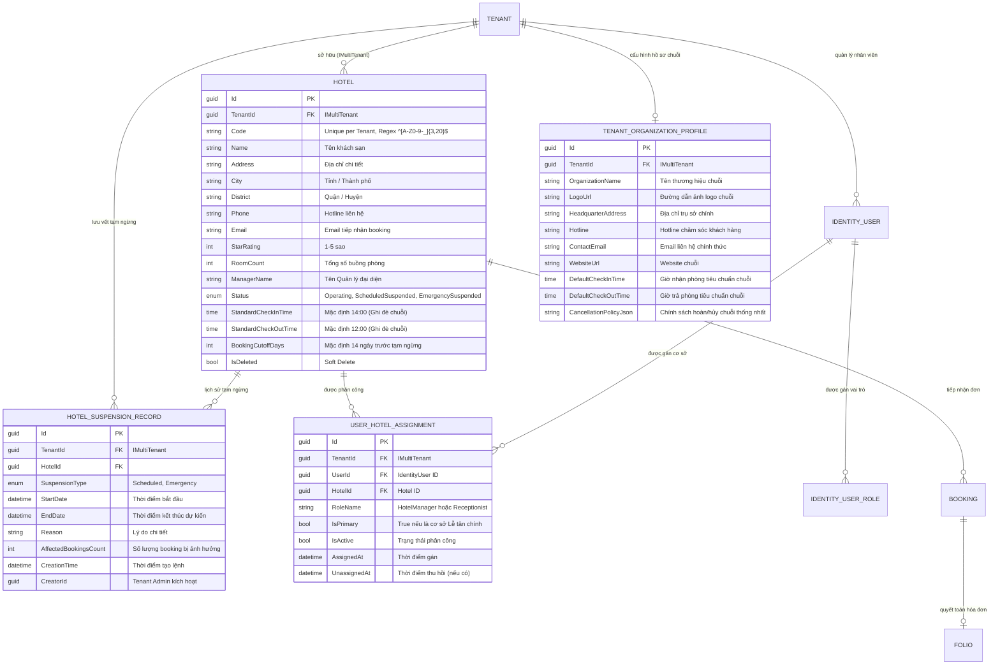
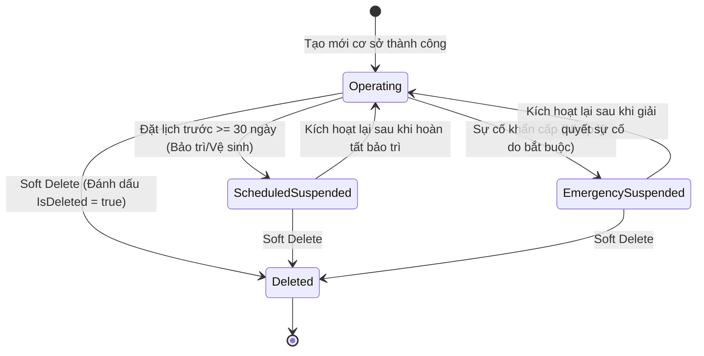

# Data Model: RM-007 - Quản Trị Vận Hành Chuỗi & Phân Quyền Tenant Admin

**Feature**: `007-tenant-admin-management` | **Date**: 2026-11-18  
**Spec Reference**: [specs/007-tenant-admin-management/spec.md](spec.md)

---

## 1. Sơ Đồ Thực Thể Quan Hệ (Entity-Relationship Diagram)

---

## 2. Chi Tiết Thực Thể (Entity Definitions)

### 2.1. `Hotel` (Cơ Sở Khách Sạn)
- **Tầng**: `Domain/Hotels/Hotel.cs`
- **Kế thừa**: `FullAuditedAggregateRoot<Guid>, IMultiTenant`
- **Mục đích**: Đại diện cho một chi nhánh/khách sạn lưu trú trực thuộc chuỗi của Tenant.
- **Thuộc tính**:
  - `Id`: Khóa chính (Guid).
  - `TenantId`: Khóa ngoại Tenant (`IMultiTenant`, tự động lọc qua EF Core Global Query Filter).
  - `Code`: Mã định danh cơ sở (string, 3-20 ký tự, in hoa/số/gạch nối, duy nhất trong Tenant).
  - `Name`: Tên cơ sở khách sạn (string, tối đa 256 ký tự).
  - `Address`: Địa chỉ đường/phố cụ thể.
  - `City`: Tỉnh/Thành phố.
  - `Phone`: Số điện thoại liên hệ chính thức.
  - `Email`: Hòm thư điện tử của lễ tân/bộ phận đặt phòng.
  - `StarRating`: Xếp hạng tiêu chuẩn (int, từ 1 đến 5 sao).
  - `RoomCount`: Tổng số lượng buồng phòng hiện có của cơ sở.
  - `ManagerName`: Tên hiển thị của Quản lý phụ trách chính (đồng bộ tự động từ `UserHotelAssignment`).
  - `Status`: Trạng thái hoạt động (`HotelStatus`: `Operating = 1`, `ScheduledSuspended = 2`, `EmergencySuspended = 3`).
  - `StandardCheckInTime`: Giờ nhận phòng tiêu chuẩn (TimeSpan, mặc định `14:00`, cho phép ghi đè cấu hình chuỗi).
  - `StandardCheckOutTime`: Giờ trả phòng tiêu chuẩn (TimeSpan, mặc định `12:00`, cho phép ghi đè cấu hình chuỗi).
  - `BookingCutoffDays`: Số ngày ngừng nhận đặt phòng trước mốc tạm ngừng định kỳ (int, mặc định 14).

### 2.2. `HotelSuspensionRecord` (Nhật Ký Tạm Ngừng Khách Sạn)
- **Tầng**: `Domain/Hotels/HotelSuspensionRecord.cs`
- **Kế thừa**: `CreationAuditedEntity<Guid>, IMultiTenant`
- **Mục đích**: Lưu vết kiểm toán và thông tin các lần tạm ngừng hoạt động cơ sở (định kỳ hoặc khẩn cấp).
- **Thuộc tính**:
  - `Id`: Khóa chính (Guid).
  - `TenantId`: Khóa ngoại Tenant (`IMultiTenant`).
  - `HotelId`: Khóa ngoại trỏ đến `Hotel`.
  - `SuspensionType`: Phân loại (`SuspensionType`: `Scheduled = 1`, `Emergency = 2`).
  - `StartDate`: Thời điểm bắt đầu tạm ngừng.
  - `EndDate`: Thời điểm kết thúc dự kiến (cho phép null nếu là sự cố khẩn cấp chưa xác định).
  - `Reason`: Lý do giải trình chi tiết (string, bắt buộc đối với Emergency Suspension).
  - `AffectedBookingsCount`: Tổng số lượng đơn đặt phòng bị tác động trong khoảng thời gian này.

### 2.3. `UserHotelAssignment` (Liên Kết Nhân Sự - Chi Nhánh)
- **Tầng**: `Domain/Identity/UserHotelAssignment.cs`
- **Kế thừa**: `FullAuditedEntity<Guid>, IMultiTenant`
- **Mục đích**: Quản lý lịch sử và trạng thái phân bổ nhân sự vào các chi nhánh khách sạn.
- **Thuộc tính**:
  - `Id`: Khóa chính (Guid).
  - `TenantId`: Khóa ngoại Tenant (`IMultiTenant`).
  - `UserId`: Khóa ngoại trỏ đến `IdentityUser`.
  - `HotelId`: Khóa ngoại trỏ đến `Hotel`.
  - `RoleName`: Vai trò đảm nhiệm (`HotelManager` hoặc `Receptionist`).
  - `IsPrimary`: Đánh dấu cơ sở tác nghiệp chính (bắt buộc duy nhất = true đối với `Receptionist`).
  - `IsActive`: Trạng thái hiệu lực của phân công (`true` = đang công tác, `false` = đã thu hồi/điều chuyển).
  - `AssignedAt`: Thời điểm phân công.
  - `UnassignedAt`: Thời điểm kết thúc phân công.

### 2.4. `TenantOrganizationProfile` (Hồ Sơ Tổ Chức Chuỗi)
- **Tầng**: `Domain/Organization/TenantOrganizationProfile.cs` (hoặc cấu hình `TenantSettings`)
- **Kế thừa**: `FullAuditedEntity<Guid>, IMultiTenant`
- **Mục đích**: Lưu trữ thông tin nhận diện thương hiệu và chính sách chuỗi cấp cao nhất.
- **Thuộc tính**:
  - `TenantId`: Khóa chính / Khóa ngoại Tenant.
  - `OrganizationName`: Tên thương hiệu chuỗi khách sạn.
  - `LogoUrl`: Đường dẫn lưu trữ logo thương hiệu.
  - `HeadquarterAddress`: Địa chỉ trụ sở chính doanh nghiệp.
  - `Hotline`, `ContactEmail`, `WebsiteUrl`: Kênh liên lạc chính thức.
  - `DefaultCheckInTime`: Giờ Check-in tiêu chuẩn chuỗi (`14:00`).
  - `DefaultCheckOutTime`: Giờ Check-out tiêu chuẩn chuỗi (`12:00`).
  - `CancellationPolicyJson`: Cấu hình chính sách hoàn/hủy phòng thống nhất 100% toàn chuỗi.

---

## 3. Vòng Đời & Chuyển Đổi Trạng Thái (State Transition Diagrams)

### 3.1. Vòng Đời Trạng Thái Khách Sạn (Hotel Status Lifecycle)

---

## 4. Bảng Phân Quyền & Ràng Buộc Thẩm Quyền (Authorization Matrix)

| Chức Năng / Nghiệp Vụ | Quyền Hạt Nhân (Atomic Permission) | MultiTenancySide | Role Được Phép |
| :--- | :--- | :---: | :--- |
| **Xem Dashboard Chuỗi** | `BookingHotelPermissions.Reports.Consolidated` | Tenant | `TenantAdmin` |
| **Danh Sách & Xem Chi Tiết Khách Sạn** | `BookingHotelPermissions.Hotels.Default` | Tenant | `TenantAdmin`, `HotelManager` |
| **Thêm Mới Khách Sạn Chi Nhánh** | `BookingHotelPermissions.Hotels.Create` | Tenant | `TenantAdmin` |
| **Chỉnh Sửa Thông Tin Khách Sạn** | `BookingHotelPermissions.Hotels.Edit` | Tenant | `TenantAdmin` |
| **Tạm Ngừng / Kích Hoạt Khách Sạn** | `BookingHotelPermissions.Hotels.ManageBranches` | Tenant | `TenantAdmin` |
| **Phân Công Quản Lý Khách Sạn** | `BookingHotelPermissions.Hotels.AssignStaff` | Tenant | `TenantAdmin` |
| **Tạo Nhân Viên Mới Thuộc Chuỗi** | `IdentityPermissions.Users.Create` | Tenant | `TenantAdmin` |
| **Cập Nhật Thông Tin Nhân Viên** | `IdentityPermissions.Users.Update` | Tenant | `TenantAdmin` |
| **Khóa / Mở Khóa Tài Khoản Nhân Viên** | `BookingHotelPermissions.Identity.UnlockUser` | Both | `TenantAdmin`, `SystemAdmin` (Host) |
| **Điều Chuyển / Thu Hồi Cơ Sở Nhân Sự** | `BookingHotelPermissions.Hotels.AssignStaff` | Tenant | `TenantAdmin` |
| **Giám Sát Đặt Phòng Chuỗi (Read-Only)** | `BookingHotelPermissions.Bookings.Default` | Both | `TenantAdmin`, `HotelManager`, `Receptionist` |
| **Xem Báo Cáo Doanh Thu / Hiệu Suất Chuỗi** | `BookingHotelPermissions.Reports.Consolidated` | Tenant | `TenantAdmin` |
| **Cấu Hình Hồ Sơ & Chính Sách Chuỗi** | `BookingHotelPermissions.Hotels.ManageBranches` | Tenant | `TenantAdmin` |

---

## 5. Ràng Buộc Bất Biến & Quy Tắc An Ninh (Invariants & Security Guardrails)

1. **Ranh giới Multi-Tenancy**: Mọi câu lệnh truy vấn và thay đổi dữ liệu của `TenantAdmin` bắt buộc phải áp dụng bộ lọc `CurrentTenant.Id`. Tuyệt đối không để lộ dữ liệu chéo Tenant (`Cross-Tenant Leakage = 0%`).
2. **Chống Leo Thang Đặc Quyền (Anti-Privilege Escalation)**:
   - `TenantAdmin` chỉ được phép gán 2 role chuẩn: `HotelManager` và `Receptionist` (hoặc cả hai).
   - Backend từ chối với mã lỗi HTTP 403 Forbidden nếu request gán role có chứa `SystemAdmin` hoặc bất kỳ role nào ngoài phạm vi Tenant.
3. **Tính Toàn Vẹn Lịch Sử Giao Dịch (Non-Destructive Audit History)**:
   - Khi điều chuyển hoặc thu hồi nhân sự, bảng `UserHotelAssignment` cập nhật `IsActive = false` và `UnassignedAt = Clock.Now`. Tuyệt đối không xóa cứng (`Hard Delete`) để bảo toàn nhật ký ca trực và báo cáo doanh thu quá khứ.
   - Khi xóa khách sạn, hệ thống áp dụng `Soft Delete` (`IsDeleted = true`), toàn bộ dữ liệu buồng phòng và giao dịch đặt phòng trước đó được giữ nguyên vẹn phục vụ kế toán.
4. **Mô Hình Chính Sách Hybrid**:
   - `Hotel.StandardCheckInTime` và `Hotel.StandardCheckOutTime` có thể ghi đè chính sách chuỗi.
   - `CancellationPolicy` bắt buộc kế thừa 100% từ hồ sơ tổ chức chuỗi, không cho phép cấp cơ sở ghi đè.
