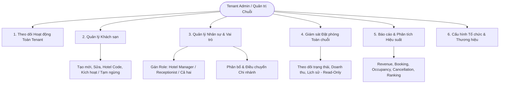

# Feature Specification: RM-007 - Quản Trị Vận Hành Chuỗi & Phân Quyền Tenant Admin (Tenant Operations & Management Portal)

**Feature Branch**: `007-tenant-admin-management`  
**Created**: 2026-11-18  
**Status**: Draft  
**Input**: User description: "RM-007 Tenant Admin sẽ có các chức năng sau đây: Theo dõi tình hình hoạt động của toàn bộ Tenant (Tổng số khách sạn, hoạt động/tạm ngừng, nhân viên, booking, doanh thu, lấp đầy phòng, so sánh hiệu suất). Quản lý khách sạn (Tạo mới, sửa, mã Hotel Code, địa chỉ, liên hệ, kích hoạt/tạm ngừng, phân công Hotel Manager, xem trạng thái). Quản lý nhân sự (Tạo tài khoản, cập nhật, khóa/mở khóa, phân công khách sạn, điều chuyển, thu hồi quyền, danh sách toàn tổ chức). Quản lý vai trò (Hotel Manager, Receptionist, gán role, thay đổi role, gán nhiều role/kiêm nhiệm, thu hồi role; không tự cấp Platform Admin hoặc vượt phạm vi Tenant). Giám sát đặt phòng (Danh sách booking, booking mới/xác nhận/hủy, lịch sử, trạng thái thanh toán - chức năng giám sát, không thay thế lễ tân). Báo cáo (Revenue, Booking, Occupancy, Cancellation, Hotel Performance). Cấu hình tổ chức (Tên tổ chức, logo, địa chỉ trụ sở, liên hệ, cấu hình chung)."

---

## 1. Quyết Định Kiến Trúc & Làm Rõ (Clarifications & Architectural Decisions)

### Session 2026-11-18 (Interactive Clarification Loop)

- **Q1: Ranh giới quyền hạn màn hình Giám sát Đặt phòng toàn chuỗi**: Tại màn hình Giám sát Đặt phòng toàn chuỗi, Tenant Admin sẽ thao tác ở chế độ chỉ xem (Read-Only) thuần túy hay có được phép thực hiện thao tác can thiệp khẩn cấp như hủy đơn đặt phòng? (FR-020)  
  $\rightarrow$ **A (Chốt - Option A)**: **Chỉ xem thuần túy (Read-Only 100%)**. Tenant Admin chỉ tra cứu, lọc, xem chi tiết và đối soát thanh toán; mọi thao tác hủy hoặc thay đổi trạng thái phải do Hotel Manager hoặc Lễ tân cơ sở thực hiện. Màn hình không cung cấp bất kỳ nút thay đổi trạng thái hay can thiệp tác nghiệp quầy nào.

- **Q2: Quy trình và điều kiện tạm ngừng hoạt động (Suspend) khách sạn**: Khi Tenant Admin tạm ngừng hoạt động một cơ sở khách sạn, hệ thống xử lý các đơn đặt phòng và thông báo nhân sự/khách hàng theo quy tắc nào? (FR-006)  
  $\rightarrow$ **A (Chốt - Phân định 2 trường hợp cụ thể)**:
  - **Trường hợp 1 (Tạm ngừng định kỳ - Scheduled Suspension)**: Áp dụng cho kế hoạch kiểm tra định kỳ, vệ sinh, bảo dưỡng, nâng cấp cơ sở vật chất. Bắt buộc Tenant Admin phải đặt lịch trước ít nhất từ 1 tháng trở lên ($\ge 30$ ngày). Thời điểm bắt đầu ngừng tiếp nhận đặt phòng (booking cutoff) phụ thuộc vào cấu hình của cơ sở (`BookingCutoffDays`).
  - **Trường hợp 2 (Tạm ngừng khẩn cấp - Emergency Suspension)**: Chỉ được phép thực hiện khi xảy ra các vấn đề đặc biệt nghiêm trọng (sự cố an toàn, thiên tai, lệnh từ cơ quan chức năng). Tenant Admin bắt buộc phải ghi rõ lý do chi tiết. Hệ thống sẽ tự động gửi thông báo đến toàn bộ khách hàng có booking bị ảnh hưởng, đồng thời phát thông báo khẩn cấp tới toàn bộ nhân sự để kích hoạt quy trình hỗ trợ đổi khách sạn trong chuỗi hoặc hoàn tiền theo chính sách của hệ thống.

- **Q3: Cơ chế kế thừa và ghi đè chính sách chuỗi tại các chi nhánh**: Các chính sách chung do Tenant Admin thiết lập (khung giờ Check-in/Check-out, chính sách hoàn hủy phòng) sẽ áp dụng bắt buộc cho toàn bộ các cơ sở hay từng khách sạn chi nhánh được phép tùy biến ghi đè? (FR-028)  
  $\rightarrow$ **A (Chốt - Option C - Phân cấp linh hoạt / Hybrid)**:
  - **Khung giờ Check-in / Check-out**: Cho phép từng cơ sở khách sạn tùy biến ghi đè (Override) để phù hợp với đặc thù vận hành thực tế tại địa phương (nghỉ dưỡng, công vụ, sân bay).
  - **Chính sách Hoàn / Hủy phòng (Cancellation Policy)**: Bắt buộc tuân thủ đồng nhất 100% trên toàn chuỗi theo thiết lập của Tenant Admin, các chi nhánh không được phép tự ý thay đổi chính sách hoàn/hủy này nhằm bảo vệ quyền lợi thương hiệu và trải nghiệm nhất quán cho khách hàng.

- **Q4: Nguyên tắc ghi nhận doanh thu trên Dashboard và Báo cáo chuỗi**: Trong Bảng điều khiển (Dashboard) và Báo cáo Doanh thu (Revenue Report) toàn chuỗi, hệ thống sẽ ghi nhận doanh thu theo nguyên tắc kế toán nào? (FR-021)  
  $\rightarrow$ **A (Chốt - Option A - Cash / Settlement Basis)**: Doanh thu chuỗi được ghi nhận dựa trên dòng tiền thực thu từ các giao dịch thanh toán hoặc quyết toán hóa đơn Folio thành công (`SettledFolios`). Các khoản hoàn tiền (Refunds) do hủy phòng sẽ được đối trừ tương ứng vào doanh thu thực tế của kỳ báo cáo. Phương án này đảm bảo tính minh bạch tài chính, khớp 100% với dòng tiền thực tế qua cổng thanh toán.

- **Q5: Chỉ số trọng tâm để xếp hạng và so sánh hiệu suất giữa các khách sạn**: Trong Bảng điều khiển (Dashboard) và Báo cáo so sánh hiệu suất giữa các khách sạn, hệ thống sẽ áp dụng chỉ số trọng tâm nào để xếp hạng và đánh giá cơ sở? (FR-003, FR-025)  
  $\rightarrow$ **A (Chốt - Option A - RevPAR chuẩn quốc tế)**: Hệ thống sử dụng chỉ số **RevPAR (Revenue Per Available Room = Doanh thu phòng / Tổng số phòng sẵn có)** làm thước đo và tiêu chí sắp xếp mặc định để đánh giá và xếp hạng hiệu suất giữa các khách sạn trong chuỗi. Chỉ số này bảo đảm tính công bằng tuyệt đối giữa các cơ sở có quy mô số lượng buồng phòng khác nhau (khách sạn 200 phòng so với khách sạn 30 phòng).

### Kiến Trúc Nền Tảng Đã Xác Lập (Baseline Decisions)

- **Q: Ranh giới thẩm quyền & Cơ chế giám sát Đặt phòng (Surveillance vs Operations Boundary)**: Giám sát đặt phòng của Tenant Admin có bao gồm các thao tác trực tiếp tại quầy (Check-in, Check-out, gán phòng thực tế, đổi trạng thái buồng phòng) không?  
  $\rightarrow$ **A (Chốt - Best Practice)**: **Phân định ranh giới nghiêm ngặt giữa Giám sát (Surveillance/Audit) và Tác nghiệp quầy (Frontdesk Operations)**:
  - Phân hệ Giám sát Đặt phòng (`/tenant/bookings`) của Tenant Admin là **Read-Only / Monitoring View**: Cho phép tra cứu danh sách booking toàn chuỗi, theo dõi luồng trạng thái (`New` $\rightarrow$ `Confirmed` $\rightarrow$ `CheckedIn` $\rightarrow$ `Completed` / `Cancelled`), kiểm tra tình trạng thanh toán và dòng tiền Folio, xem lịch sử sửa đổi (Audit Trail).
  - Tenant Admin **không thực hiện Check-in / Check-out trực tiếp thay cho Lễ tân** trên phân hệ này để đảm bảo tính toàn vẹn của ca trực và trách nhiệm bàn giao chìa khóa vật lý tại quầy. Nếu Tenant Admin muốn tác nghiệp, họ phải gán kiêm nhiệm vai trò `Receptionist` cho tài khoản của mình và chuyển sang Portal `/frontdesk/` như đã quy định tại RM-006.

- **Q2: Cơ chế Phân bổ Nhân sự Kiêm nhiệm (Dual-Role Personnel Assignment)**: Một nhân sự được gán đồng thời 2 vai trò `HotelManager` và `Receptionist` sẽ được phân bổ chi nhánh làm việc theo quy tắc nào?  
  $\rightarrow$ **A (Chốt)**:
  - Khi một nhân viên được cấp cả hai vai trò (`HotelManager` + `Receptionist`):
    - Đối với vai trò `HotelManager`: Được phân bổ quản lý 1 hoặc nhiều cơ sở khách sạn trong chuỗi.
    - Đối với vai trò `Receptionist`: Bắt buộc chỉ định **1 cơ sở tác nghiệp chính (Primary Frontdesk Hotel)** để cố định phạm vi ca trực và sơ đồ buồng phòng khi họ chuyển sang không gian Lễ tân.
  - Trên thanh điều hướng Topbar, hệ thống kích hoạt nút chuyển đổi không gian (`Portal Switcher Pill`) giúp nhân viên chuyển nhanh giữa `/manager/dashboard` và `/frontdesk/room-rack`.

- **Q3: Cơ chế Điều chuyển Nhân sự & Thu hồi Quyền Truy cập (Staff Transfer & Revocation Model)**: Khi Tenant Admin điều chuyển nhân viên sang cơ sở khác hoặc thu hồi quyền truy cập, dữ liệu lịch sử tác nghiệp cũ xử lý ra sao?  
  $\rightarrow$ **A (Chốt)**: Kế thừa mô hình Audit-tracked assignment từ RM-005:
  - Bản ghi phân bổ cũ tại bảng `UserHotelAssignment` được cập nhật `IsActive = false`, `UnassignedAt = Clock.Now`.
  - Hệ thống tạo bản ghi `UserHotelAssignment` mới cho cơ sở được điều chuyển đến.
  - Quyền truy cập vào dữ liệu cơ sở cũ lập tức bị ngắt, nhưng 100% dữ liệu lịch sử giao dịch (hóa đơn, lịch sử check-in, nhật ký kiểm toán) mà nhân viên đã thực hiện tại cơ sở cũ được bảo toàn trọn vẹn phục vụ đối soát tài chính.

- **Q4: Chống Leo Thang Đặc Quyền (Anti-Privilege Escalation Enforcement)**: Bảo đảm Tenant Admin không thể tự cấp quyền Platform Admin hoặc can thiệp dữ liệu ngoài Tenant?  
  $\rightarrow$ **A (Chốt - 3 Lớp Bảo Vệ Cứng)**:
  - **Lớp 1 (Backend Whitelist)**: API gán vai trò của Tenant Admin kiểm tra cứng danh sách Role hợp lệ: Chỉ chấp nhận `BookingHotelRoleConsts.HotelManager` và `BookingHotelRoleConsts.Receptionist`. Bất kỳ yêu cầu nào chứa role `SystemAdmin` hoặc role cấp Host đều bị ném ngoại lệ `BusinessException` (HTTP 403 Forbidden).
  - **Lớp 2 (Data Isolation)**: Toàn bộ truy vấn và lệnh ghi dữ liệu của Tenant Admin bắt buộc áp dụng bộ lọc `CurrentTenant.Id` qua giao diện `IMultiTenant`. Cấm tuyệt đối truy xuất dữ liệu có `TenantId == null` (Host) hoặc `TenantId != CurrentTenant.Id`.
  - **Lớp 3 (UI Guard)**: Giao diện Angular `/tenant/*` ẩn hoàn toàn và vô hiệu hóa các thành phần quản trị Host/System Admin.

---

## 2. Kịch Bản Người Dùng & Tiêu Chí Chấp Nhận (User Scenarios & Testing)

---

### User Story 1 - Quản Lý Danh Sách & Cơ Sở Khách Sạn Trực Thuộc Chuỗi (Priority: P1)

Là Quản trị viên Tenant (Tenant Admin / Đại diện Chuỗi Khách Sạn), tôi muốn quản lý danh mục toàn bộ các cơ sở khách sạn trực thuộc tổ chức của mình (tạo mới, chỉnh sửa thông tin, đặt mã cơ sở Hotel Code, cập nhật địa chỉ, thông tin liên hệ, kích hoạt hoặc tạm ngừng hoạt động, phân công Quản lý khách sạn) để chuẩn hóa mạng lưới chi nhánh và sẵn sàng đưa các cơ sở vào vận hành kinh doanh.

**Why this priority**: Cơ sở khách sạn là đơn vị cấu thành cốt lõi của toàn bộ hệ thống; không có cơ sở khách sạn thì không thể phân công nhân sự, tạo phòng hay nhận đặt phòng.

**Independent Test**:
1. Đăng nhập bằng tài khoản Quản trị viên Tenant (`TenantAdmin`).
2. Điều hướng tới phân hệ Quản lý Khách sạn (`/tenant/hotels`).
3. Nhấn "Thêm mới Khách sạn", nhập đầy đủ thông tin: Tên khách sạn, Mã cơ sở `HotelCode` (ví dụ: `BH-HAN-01`), Địa chỉ, SĐT, Email lễ tân, Xếp hạng sao, Tải ảnh đại diện.
4. Lưu thành công và kiểm tra khách sạn hiển thị trên danh sách bảng `BhDataTableComponent`.
5. Thực hiện phân công Quản lý khách sạn (`HotelManager`) phụ trách cơ sở.
6. Kích hoạt tính năng Tạm ngừng hoạt động (`Suspend`), kiểm tra trạng thái chuyển sang huy hiệu Xám/Cam và cơ sở tạm thời không tiếp nhận đặt phòng mới.

**Acceptance Scenarios**:
1. **Tạo Mới Khách Sạn Hợp Lệ**:
   - **Given** Tenant Admin đang ở màn hình `/tenant/hotels` và mở modal thêm khách sạn.
   - **When** Nhập thông tin đầy đủ, mã `HotelCode` là duy nhất trong chuỗi, nhấn "Lưu".
   - **Then** Khách sạn mới được lưu vào CSDL với `TenantId = CurrentTenant.Id`, trạng thái mặc định là Hoạt động (`Active`), hiển thị thông báo toastr thành công song ngữ.
2. **Xác Thực Mã Cơ Sở (Hotel Code Uniqueness)**:
   - **Given** Một khách sạn trong Tenant đã có mã `BH-SGN-01`.
   - **When** Tenant Admin tạo thêm cơ sở mới với cùng mã `BH-SGN-01`.
   - **Then** Hệ thống chặn lại phía Backend và hiển thị lỗi validation: "Mã cơ sở đã tồn tại trong chuỗi khách sạn của bạn".
3. **Kích Hoạt / Tạm Ngừng Hoạt Động Cơ Sở (Định Kỳ vs Khẩn Cấp)**:
   - **Tạm ngừng định kỳ**:
     - **Given** Một khách sạn đang ở trạng thái Hoạt động (`Active`).
     - **When** Tenant Admin lên lịch tạm ngừng định kỳ (bảo trì/vệ sinh) với ngày bắt đầu cách hiện tại $\ge 30$ ngày.
     - **Then** Hệ thống xác thực hợp lệ, lưu lịch tạm ngừng, tự động kích hoạt cutoff ngừng nhận booking theo cấu hình của cơ sở (`BookingCutoffDays`), và chuyển trạng thái khi đến hẹn.
   - **Tạm ngừng khẩn cấp**:
     - **Given** Một khách sạn gặp sự cố nghiêm trọng cần dừng hoạt động tức thời.
     - **When** Tenant Admin chọn "Tạm ngừng khẩn cấp" và nhập lý do giải trình chi tiết.
     - **Then** Trạng thái cơ sở lập tức chuyển sang `Suspended`, hệ thống tự động phát thông báo hủy/ảnh hưởng đến toàn bộ khách hàng có booking bị tác động, đồng thời gửi thông báo khẩn tới nhân sự để hỗ trợ đổi khách sạn trong chuỗi hoặc hoàn tiền theo chính sách.
4. **Phân Công Quản Lý Cơ Sở (Assign Hotel Manager)**:
   - **Given** Danh sách khách sạn hiển thị trên bảng quản trị.
   - **When** Tenant Admin chọn một hoặc nhiều nhân sự có vai trò `HotelManager` để gán cho cơ sở.
   - **Then** Hệ thống tạo liên kết trong bảng `UserHotelAssignment`, các Quản lý được chỉ định lập tức có quyền truy cập vào phân hệ `/manager/` của chi nhánh này.

---

### User Story 2 - Quản Lý Nhân Sự Toàn Tổ Chức & Phân Bổ Vai Trò Linh Hoạt (Priority: P1)

Là Quản trị viên Tenant, tôi muốn quản lý danh sách toàn bộ nhân viên trong tổ chức (tạo tài khoản, cập nhật thông tin, kích hoạt/khóa tài khoản, phân bổ vào khách sạn, điều chuyển giữa các cơ sở, thu hồi quyền) và phân công vai trò linh hoạt (`HotelManager`, `Receptionist` hoặc gán đồng thời cả hai vai trò) để tối ưu hóa việc bố trí nhân lực theo quy mô và mô hình hoạt động của chuỗi.

**Why this priority**: Cho phép đối tác chuỗi hoàn toàn chủ động xây dựng đội ngũ vận hành tại chỗ, luân chuyển nhân sự giữa các cơ sở mà không cần can thiệp từ quản trị viên nền tảng.

**Independent Test**:
1. Truy cập phân hệ Quản lý Nhân sự (`/tenant/staff`).
2. Tạo tài khoản nhân viên mới: Nhập Họ tên, Email, SĐT, Mật khẩu khởi tạo.
3. Chọn vai trò: Checkbox `HotelManager` và `Receptionist` (chọn cả 2 để kiểm thử kiêm nhiệm).
4. Chọn danh sách khách sạn phụ trách (chọn 2 khách sạn cho quản lý, và chọn 1 khách sạn chính cho lễ tân).
5. Lưu và xác thực: Nhân sự xuất hiện trong danh sách nhân viên với đầy đủ huy hiệu vai trò.
6. Đăng nhập bằng tài khoản vừa tạo: Xác nhận thanh công cụ Topbar hiển thị nút chuyển đổi không gian làm việc (`Portal Switcher`) giữa Manager và Frontdesk.
7. Thực hiện điều chuyển nhân sự từ cơ sở A sang cơ sở B từ tài khoản Tenant Admin và kiểm tra quyền truy cập cập nhật tức thì.

**Acceptance Scenarios**:
1. **Tạo Mới Nhân Viên & Gán Vai Trò Đơn Hoặc Kép**:
   - **Given** Form tạo nhân viên tại `/tenant/staff`.
   - **When** Tenant Admin tích chọn cả 2 vai trò `HotelManager` và `Receptionist`.
   - **Then** Người dùng mới được tạo trong bảng `IdentityUser` thuộc `TenantId`, bảng `IdentityUserRole` lưu trữ cả 2 vai trò chuẩn, cờ `ShouldChangePasswordOnNextLogin` được bật `true`.
2. **Ngăn Chặn Tự Cấp Quyền Platform Admin**:
   - **Given** Form tạo/sửa vai trò nhân viên.
   - **When** Bất kỳ request nào gửi lên chứa `Role = "SystemAdmin"` hoặc các role cấp Host.
   - **Then** Hệ thống từ chối dứt khoát với mã lỗi 403 Forbidden, ghi log cảnh báo an ninh.
3. **Điều Chuyển Cơ Sở Làm Việc**:
   - **Given** Nhân viên đang được phân công tại Khách sạn A.
   - **When** Tenant Admin cập nhật phân công sang Khách sạn B.
   - **Then** Hệ thống đóng bản ghi phân bổ tại Khách sạn A (`IsActive = false`), mở bản ghi mới tại Khách sạn B, nhân viên chuyển vùng làm việc ngay trong phiên tiếp theo.
4. **Khóa & Mở Khóa Tài Khoản Nhân Viên**:
   - **Given** Nhân viên nghỉ việc hoặc vi phạm quy chế.
   - **When** Tenant Admin chuyển trạng thái sang "Khóa tài khoản" (`Deactivate`).
   - **Then** Cờ `IsActive = false`, nhân viên bị từ chối đăng nhập ngay lập tức. Khi cần mở khóa (kể cả khóa do brute-force), Tenant Admin có thể kích hoạt lại tức thì.

---

### User Story 3 - Theo Dõi Tình Hình Hoạt Động & Dashboard Toàn Tenant (Priority: P2)

Là Quản trị viên Tenant, tôi muốn có một Bảng điều khiển Tổng quan (Executive Dashboard) hiển thị các chỉ số kinh doanh và vận hành hợp nhất của toàn bộ chuỗi khách sạn (Tổng số khách sạn đang hoạt động/tạm ngừng, tổng nhân viên, tổng số booking, tổng doanh thu thực tế, tỷ lệ lấp đầy phòng trung bình và biểu đồ so sánh hiệu suất giữa các cơ sở) để nắm bắt sức khỏe kinh doanh tức thời và ra quyết định điều hành chính xác.

**Why this priority**: Giúp lãnh đạo chuỗi khách sạn có góc nhìn toàn cảnh về hiệu quả khai thác tài sản mà không phải tổng hợp thủ công từ từng cơ sở riêng lẻ.

**Independent Test**:
1. Truy cập trang chủ phân hệ Tenant (`/tenant/dashboard`).
2. Kiểm tra các thẻ chỉ số KPI tổng hợp:
   - Tổng số khách sạn (phân tách rõ: Đang hoạt động vs Tạm ngừng).
   - Tổng số nhân viên nội bộ trong chuỗi.
   - Tổng số đơn đặt phòng (Booking count) theo khoảng thời gian (Hôm nay, Tuần này, Tháng này).
   - Tổng doanh thu ghi nhận hợp nhất (VND).
   - Tỷ lệ lấp đầy phòng bình quân (Average Occupancy Rate %).
3. Kiểm tra Biểu đồ/Bảng xếp hạng So sánh Hiệu suất giữa các khách sạn (Doanh thu, Tỷ lệ lấp đầy, Điểm đánh giá).
4. Thay đổi bộ lọc khoảng thời gian (`DateRangePicker`), toàn bộ dữ liệu phản ứng cập nhật chính xác từ API Backend.

**Acceptance Scenarios**:
1. **Hiển Thị Chỉ Số Hợp Nhất Chính Xác**:
   - **Given** Tenant Admin truy cập `/tenant/dashboard`.
   - **When** Dashboard tải dữ liệu từ `TenantDashboardAppService`.
   - **Then** Các thẻ KPI hiển thị số liệu tính toán từ Backend, tuân thủ nguyên tắc Backend-Authoritative, định dạng tiền tệ và phần trăm chuẩn hóa song ngữ.
2. **So Sánh Hiệu Suất Giữa Các Cơ Sở Theo RevPAR**:
   - **Given** Chuỗi khách sạn có từ 2 cơ sở trở lên với quy mô buồng phòng khác nhau.
   - **When** Xem khối "So sánh Hiệu suất Khách sạn" (*Hotel Performance Comparison*).
   - **Then** Hệ thống xếp hạng các cơ sở chuẩn hóa theo chỉ số RevPAR (kèm Doanh thu thực thu, Tỷ lệ lấp đầy, ADR), hiển thị biểu đồ so sánh trực quan với màu sắc điểm nhấn Cyan `#00FFFF` trên nền giao diện chuẩn RM-006.

---

### User Story 4 - Giám Sát Đặt Phòng Hợp Nhất Toàn Chuỗi (Consolidated Booking Surveillance) (Priority: P2)

Là Quản trị viên Tenant, tôi muốn theo dõi và giám sát hoạt động đặt phòng của toàn bộ các khách sạn trong tổ chức (danh sách booking, booking mới tạo, booking đã xác nhận, booking đã hủy, lịch sử chi tiết đặt phòng, trạng thái thanh toán) ở chế độ giám sát độc lập (Read-Only) để kiểm soát chất lượng dịch vụ và ngăn ngừa gian lận mà không can thiệp vào công việc tác nghiệp trực tiếp của nhân viên lễ tân.

**Why this priority**: Đảm bảo tính minh bạch trong luồng giao dịch, hỗ trợ giải quyết khiếu nại của khách hàng cấp chuỗi và kiểm soát doanh thu phòng.

**Independent Test**:
1. Truy cập phân hệ Giám sát Đặt phòng (`/tenant/bookings`).
2. Kiểm tra danh sách booking tổng hợp toàn chuỗi: Hiển thị Mã booking, Khách sạn, Tên khách hàng, Ngày nhận/trả phòng, Loại phòng, Trạng thái đơn, Trạng thái thanh toán, Tổng tiền.
3. Sử dụng bộ lọc đa tiêu chí: Lọc theo cơ sở khách sạn cụ thể, lọc theo trạng thái (`Mới`, `Đã xác nhận`, `Đã hủy`, `Hoàn tất`), lọc theo trạng thái thanh toán (`Chưa thanh toán`, `Đã cọc`, `Đã quyết toán`).
4. Bấm xem chi tiết một đơn đặt phòng: Hiển thị đầy đủ lịch sử thay đổi (Audit Trail: Ai tạo, lúc nào, ai xác nhận, ai hủy, lý do hủy).
5. Xác nhận giao diện KHÔNG hiển thị các nút tác nghiệp quầy như "Nhận phòng / Check-in", "Trả phòng / Check-out" hay "Thêm dịch vụ minibar" (các nút này chỉ có ở portal Lễ tân).

**Acceptance Scenarios**:
1. **Tra Cứu & Lọc Đặt Phòng Toàn Chuỗi**:
   - **Given** Tenant Admin ở trang `/tenant/bookings`.
   - **When** Áp dụng bộ lọc chọn Khách sạn A và trạng thái `Đã hủy`.
   - **Then** Bảng `BhDataTable` chỉ hiển thị các đơn hủy của Khách sạn A, có phân trang, tìm kiếm nhanh theo mã booking hoặc SĐT khách.
2. **Xem Lịch Sử & Minh Bạch Trạng Thái Thanh Toán**:
   - **Given** Một đơn đặt phòng có nhiều lần điều chỉnh hoặc thanh toán từng phần.
   - **When** Tenant Admin mở modal "Chi tiết Đặt phòng & Dòng tiền".
   - **Then** Hệ thống hiển thị dòng thời gian sự kiện đặt phòng, chi tiết thanh toán Folio tương ứng và không cho phép can thiệp chỉnh sửa dữ liệu tiền tệ tại màn hình này.

---

### User Story 5 - Hệ Thống Báo Cáo Hợp Nhất & Phân Tích Chuyên Sâu (Priority: P3)

Là Quản trị viên Tenant, tôi muốn xem và xuất các báo cáo kinh doanh tổng hợp toàn tổ chức bao gồm: Báo cáo Doanh thu (Revenue Report), Báo cáo Đặt phòng (Booking Report), Báo cáo Tỷ lệ Lấp đầy (Occupancy Report), Báo cáo Hủy phòng (Cancellation Report) và Báo cáo Hiệu suất Khách sạn (Hotel Performance Report) để phục vụ công tác kế toán, hoạch định chiến lược kinh doanh và đánh giá hiệu quả từng chi nhánh.

**Why this priority**: Cung cấp tài liệu và số liệu phân tích tài chính chính xác cho ban giám đốc và các cổ đông của chuỗi khách sạn.

**Independent Test**:
1. Truy cập phân hệ Báo cáo (`/tenant/reports`).
2. Chọn từng tab báo cáo:
   - **Revenue Report**: Biểu đồ doanh thu theo ngày/tháng/quý, phân rã theo nguồn thu (tiền phòng, dịch vụ, phụ thu).
   - **Booking Report**: Thống kê số lượt đặt theo kênh (trực tuyến, vãng lai), thời gian lưu trú trung bình.
   - **Occupancy Report**: Biểu đồ công suất buồng phòng theo từng cơ sở và toàn chuỗi.
   - **Cancellation Report**: Tỷ lệ hủy phòng, thời điểm hủy (sớm hay sát ngày), lý do hủy phổ biến.
   - **Hotel Performance**: Bảng so sánh đa chiều giữa các cơ sở (RevPAR, ADR, Doanh thu, Đánh giá sao).
3. Thử nghiệm xuất dữ liệu báo cáo sang định dạng Excel / CSV / PDF.

**Acceptance Scenarios**:
1. **Tính Toán Báo Cáo Doanh Thu Chuẩn Xác**:
   - **Given** Tenant Admin chọn khoảng thời gian từ ngày X đến ngày Y.
   - **When** Yêu cầu tạo Báo cáo Doanh thu.
   - **Then** Backend tính toán dựa trên các hóa đơn Folio đã quyết toán (`Settled`), loại trừ các đơn hủy hoàn tiền 100%, bảo đảm số liệu kế toán đồng nhất.
2. **Phân Tích Tỷ Lệ Lấp Đầy & Hủy Phòng**:
   - **Given** Dữ liệu buồng phòng của tất cả chi nhánh đang hoạt động.
   - **When** Xem Báo cáo Occupancy và Cancellation.
   - **Then** Tỷ lệ lấp đầy được tính theo công thức chuẩn ngành: $\frac{\text{Tổng đêm phòng thực bán}}{\text{Tổng đêm phòng sẵn có}} \times 100\%$, tỷ lệ hủy tính theo $\frac{\text{Số đơn hủy}}{\text{Tổng đơn phát sinh}} \times 100\%$.

---

### User Story 6 - Cấu Hình Hồ Sơ Tổ Chức & Thiết Lập Chung Của Chuỗi (Priority: P3)

Là Quản trị viên Tenant, tôi muốn xem và cập nhật hồ sơ thông tin doanh nghiệp (Tên tổ chức, Logo thương hiệu chuỗi, Địa chỉ trụ sở chính, Thông tin liên hệ Email/Hotline/Website) và cấu hình các quy chuẩn vận hành chung của chuỗi (khung giờ Check-in/Check-out tiêu chuẩn, chính sách hủy phòng mặc định) để đồng bộ nhận diện thương hiệu và tiêu chuẩn phục vụ trên toàn hệ thống.

**Why this priority**: Giúp chuỗi khách sạn khẳng định thương hiệu chuyên nghiệp, mang lại trải nghiệm nhất quán cho khách hàng khi lưu trú tại bất kỳ cơ sở nào trong chuỗi.

**Independent Test**:
1. Truy cập phân hệ Cấu hình Tổ chức (`/tenant/settings` hoặc `/tenant/organization`).
2. Xem thông tin hồ sơ tổ chức hiện tại.
3. Cập nhật Tên hiển thị chuỗi khách sạn, tải lên Logo thương hiệu mới.
4. Cập nhật Địa chỉ trụ sở chính, Hotline chăm sóc khách hàng và Email doanh nghiệp.
5. Thiết lập Giờ Check-in mặc định (ví dụ: `14:00`) và Giờ Check-out mặc định (ví dụ: `12:00`).
6. Lưu cấu hình và kiểm tra logo, tên chuỗi cập nhật tức thì trên Topbar Tenant và các thông tin liên hệ được đồng bộ.

**Acceptance Scenarios**:
1. **Cập Nhật Hồ Sơ Tổ Chức Thành Công**:
   - **Given** Tenant Admin chỉnh sửa thông tin tại trang cấu hình tổ chức.
   - **When** Nhập thông tin hợp lệ và nhấn "Lưu thay đổi".
   - **Then** Dữ liệu hồ sơ Tenant được cập nhật, ảnh logo được lưu trữ an toàn, hiển thị thông báo thành công song ngữ.
2. **Kế Thừa & Ghi Đè Cấu Hình Chính Sách Chuỗi (Mô hình Hybrid)**:
   - **Given** Chuỗi đã thiết lập Giờ Check-in chuẩn `14:00`, Check-out `12:00` và Chính sách hủy phòng chuỗi (ví dụ: Miễn phí hủy trước 48h).
   - **When** Tenant Admin hoặc Hotel Manager xem xét cấu hình tại cơ sở chi nhánh.
   - **Then** Khung giờ Check-in/Check-out cho phép chi nhánh điều chỉnh riêng (Override) nếu có đặc thù vận hành; trong khi Chính sách Hủy phòng bị khóa cứng ở cấp chi nhánh và bắt buộc áp dụng đồng nhất 100% theo quy định chuỗi.

---

### Edge Cases

- **Mã Hotel Code bị trùng lặp**: Nếu Tenant Admin nhập trùng `HotelCode` đã tồn tại trong Tenant, hệ thống hiển thị lỗi validation trước khi submit hoặc Backend chặn với mã lỗi `HotelCodeAlreadyExists`. Nếu mã trùng với một Tenant khác thì vẫn hợp lệ (vì `HotelCode` là duy nhất trong phạm vi từng Tenant - Scope: `TenantId`).
- **Tạm ngừng khách sạn định kỳ vs khẩn cấp**:
  - Đối với tạm ngừng định kỳ (vệ sinh, bảo dưỡng): Hệ thống từ chối nếu thời gian bắt đầu đặt lịch dưới 30 ngày; tự động chặn nhận đặt phòng mới (cutoff) theo cấu hình cơ sở và cho phép hoàn tất các đơn đã xác nhận trước đó.
  - Đối với tạm ngừng khẩn cấp: Bắt buộc nhập lý do chi tiết; hệ thống kích hoạt tự động việc gửi thông báo đến khách hàng có đơn đặt phòng tương lai và thông báo khẩn cấp cho nhân sự chuỗi để kích hoạt quy trình hỗ trợ đổi khách sạn hoặc hoàn tiền cọc theo chính sách.
- **Nhân sự được điều chuyển khi đang xử lý dở ca trực**: Hệ thống yêu cầu xác nhận bàn giao ca hoặc đóng ca trước khi hoàn tất điều chuyển chi nhánh.
- **Tenant Admin cố tình gọi API gán vai trò Host**: Bị Backend chặn đứng qua Custom Authorization Middleware / Service Validation với ngoại lệ `SecurityException` và ghi log cảnh báo an ninh.
- **Xóa cơ sở khách sạn đã phát sinh giao dịch tài chính**: Hệ thống TUYỆT ĐỐI KHÔNG xóa cứng (`Hard Delete`). Mọi thao tác xóa chỉ là đánh dấu ẩn (`Soft Delete` / `IsDeleted = true`), toàn bộ dữ liệu buồng phòng, đơn đặt phòng và hóa đơn quá khứ được giữ nguyên để bảo đảm tính toàn vẹn báo cáo kế toán.
- **Tenant không có cơ sở nào đang hoạt động**: Dashboard hiển thị Empty State trực quan (`BhEmptyStateComponent`) kèm nút hành động chính (CTA) "Thêm cơ sở khách sạn đầu tiên".

---

## 3. Yêu Cầu Chức Năng (Functional Requirements)

### Phân Hệ 1: Bảng Điều Khiển & Giám Sát Hoạt Động (Dashboard)
- **FR-001**: Hệ thống PHẢI cung cấp API và giao diện Dashboard tại `/tenant/dashboard` hiển thị các chỉ số hợp nhất toàn chuỗi: Tổng số khách sạn (phân bổ Hoạt động vs Tạm ngừng), Tổng số nhân viên, Tổng số booking, Tổng doanh thu thực thu (tính theo nguyên tắc Cash / Settlement Basis từ các Folio đã quyết toán trừ tiền hoàn), Tỷ lệ lấp đầy buồng phòng bình quân.
- **FR-002**: Hệ thống PHẢI hỗ trợ bộ lọc thời gian linh hoạt (Hôm nay, 7 ngày qua, Tháng này, Năm nay, Tùy chọn khoảng ngày) để cập nhật động các chỉ số Dashboard.
- **FR-003**: Hệ thống PHẢI cung cấp bảng/biểu đồ so sánh hiệu suất giữa các khách sạn trong chuỗi, xếp hạng mặc định theo chỉ số **RevPAR (Revenue Per Available Room)** chuẩn quốc tế nhằm bảo đảm tính công bằng giữa các cơ sở khác nhau về quy mô số lượng buồng phòng, đồng thời hiển thị kèm Doanh thu thực thu và Tỷ lệ lấp đầy.

### Phân Hệ 2: Quản Lý Khách Sạn (Hotel Management)
- **FR-004**: Hệ thống PHẢI cho phép Tenant Admin tạo mới cơ sở khách sạn với các trường: Tên khách sạn, Mã cơ sở (`HotelCode`), Địa chỉ chi tiết (Tỉnh/Thành, Quận/Huyện, Địa chỉ cụ thể), Số điện thoại liên hệ, Email, Xếp hạng sao (1-5 sao), Ảnh đại diện/Thư viện ảnh, Tiện ích chung, Giờ Check-in/Check-out.
- **FR-005**: Hệ thống PHẢI bảo đảm tính duy nhất của `HotelCode` trong phạm vi từng Tenant (`TenantId`).
- **FR-006**: Hệ thống PHẢI cho phép Tenant Admin cập nhật trạng thái hoạt động cơ sở theo 2 quy trình chuẩn:
  - *Tạm ngừng định kỳ (Scheduled Suspension)*: Bắt buộc đặt lịch trước tối thiểu 1 tháng ($\ge 30$ ngày), tự động kích hoạt mốc dừng nhận đặt phòng (cutoff) dựa theo cấu hình của cơ sở (`BookingCutoffDays`).
  - *Tạm ngừng khẩn cấp (Emergency Suspension)*: Bắt buộc nhập lý do chi tiết; hệ thống tự động gửi thông báo đến toàn bộ khách hàng có booking bị ảnh hưởng và gửi thông báo khẩn cấp đến đội ngũ nhân sự để kích hoạt quy trình hỗ trợ đổi khách sạn trong chuỗi hoặc hoàn tiền theo chính sách.
  - *Kích hoạt lại (`Activate`)*: Cho phép Tenant Admin mở lại cơ sở hoạt động bình thường khi hoàn thành bảo trì hoặc khắc phục xong sự cố.
- **FR-007**: Hệ thống PHẢI hỗ trợ phân công một hoặc nhiều `HotelManager` quản lý cơ sở khách sạn trực tiếp từ màn hình quản lý khách sạn hoặc chi tiết khách sạn.

### Phân Hệ 3: Quản Lý Nhân Sự (Staff Management)
- **FR-008**: Hệ thống PHẢI cho phép Tenant Admin tạo mới tài khoản nhân viên nội bộ (`IdentityUser`) thuộc phạm vi Tenant, tự động kích hoạt cờ `ShouldChangePasswordOnNextLogin = true`.
- **FR-009**: Hệ thống PHẢI cho phép cập nhật thông tin nhân viên, kích hoạt hoặc khóa tài khoản (`IsActive = true/false`), và mở khóa tài khoản nhân viên bị khóa do brute-force qua quyền `BookingHotelPermissions.Identity.UnlockUser`.
- **FR-010**: Hệ thống PHẢI hỗ trợ phân bổ nhân viên vào một hoặc nhiều cơ sở khách sạn thông qua thực thể `UserHotelAssignment`.
- **FR-011**: Hệ thống PHẢI hỗ trợ điều chuyển nhân viên giữa các cơ sở khách sạn trong chuỗi, đồng thời lưu vết lịch sử phân công phục vụ kiểm toán.
- **FR-012**: Hệ thống PHẢI cho phép thu hồi quyền truy cập của nhân viên vào một cơ sở cụ thể mà không làm mất lịch sử các giao dịch mà nhân viên đó đã thực hiện trước đây.

### Phân Hệ 4: Phân Bổ Vai Trò & Chống Leo Thang Đặc Quyền (Role Governance)
- **FR-013**: Hệ thống PHẢI cho phép Tenant Admin gán vai trò cho nhân viên với danh sách Whitelist cố định: `HotelManager` và `Receptionist`.
- **FR-014**: Hệ thống PHẢI cho phép gán ĐỒNG THỜI CẢ HAI VAI TRÒ (`HotelManager` + `Receptionist`) cho cùng một nhân viên để hỗ trợ mô hình kiêm nhiệm quản lý kiêm lễ tân.
- **FR-015**: Hệ thống PHẢI chặn đứng hoàn toàn việc Tenant Admin gán hoặc nâng cấp tài khoản lên vai trò `SystemAdmin` (Platform Admin) hoặc các quyền cấp Host. Bất kỳ nỗ lực nào đều phải bị Backend từ chối với lỗi 403 Forbidden.
- **FR-016**: Hệ thống PHẢI ngăn chặn Tenant Admin tự tạo các vai trò tùy chỉnh (`Custom Roles`) hoặc can thiệp vào các quyền hạt nhân tĩnh đã định sẵn trong hệ thống.

### Phân Hệ 5: Giám Sát Đặt Phòng Hợp Nhất (Consolidated Booking Surveillance)
- **FR-017**: Hệ thống PHẢI cung cấp màn hình giám sát đặt phòng toàn chuỗi tại `/tenant/bookings` ở chế độ Read-Only, hiển thị danh sách đơn đặt phòng từ tất cả các cơ sở trực thuộc Tenant.
- **FR-018**: Hệ thống PHẢI hỗ trợ lọc đặt phòng đa tiêu chí: Theo cơ sở khách sạn, theo trạng thái booking (`New`, `Confirmed`, `CheckedIn`, `Completed`, `Cancelled`), theo trạng thái thanh toán (`Unpaid`, `PartiallyPaid`, `FullyPaid`, `Refunded`), và theo khoảng ngày lưu trú.
- **FR-019**: Hệ thống PHẢI hiển thị chi tiết đơn đặt phòng, lịch sử thay đổi trạng thái (Audit Trail) và thông tin thanh toán Folio tương ứng.
- **FR-020**: Hệ thống PHẢI vận hành màn hình Giám sát Đặt phòng toàn chuỗi (`/tenant/bookings`) ở chế độ CHỈ XEM (Read-Only 100%). Tenant Admin tuyệt đối không có quyền can thiệp thay đổi trạng thái booking (không Check-in, Check-out, không Hủy hay Xác nhận đơn từ màn hình này); mọi thao tác thay đổi trạng thái đặt phòng bắt buộc phải do nhân sự vận hành tại cơ sở (Hotel Manager hoặc Receptionist) xử lý theo thẩm quyền nghiệp vụ.

### Phân Hệ 6: Báo Cáo Hợp Nhất (Reports & Analytics)
- **FR-021**: Hệ thống PHẢI cung cấp Báo cáo Doanh thu toàn tổ chức (`Revenue Report`) theo nguyên tắc Dòng tiền thực thu (Cash / Settlement Basis): Tổng hợp doanh thu từ các giao dịch thanh toán và hóa đơn Folio đã quyết toán (`Settled`), tự động đối trừ các khoản hoàn tiền/hoàn cọc do hủy phòng (`Refunded`), phân rã chi tiết theo cơ sở khách sạn và theo thời gian (ngày, tháng, quý).
- **FR-022**: Hệ thống PHẢI cung cấp Báo cáo Đặt phòng (`Booking Report`), thống kê số lượng đơn theo trạng thái và kênh phân phối.
- **FR-023**: Hệ thống PHẢI cung cấp Báo cáo Tỷ lệ Lấp đầy (`Occupancy Report`), tính toán công suất buồng phòng bình quân của từng cơ sở và toàn chuỗi.
- **FR-024**: Hệ thống PHẢI cung cấp Báo cáo Hủy phòng (`Cancellation Report`), theo dõi tỷ lệ hủy và lý do hủy phòng.
- **FR-025**: Hệ thống PHẢI cung cấp Báo cáo So sánh Hiệu suất Khách sạn (`Hotel Performance Report`), xếp hạng hiệu quả kinh doanh giữa các chi nhánh dựa trên chỉ số **RevPAR** làm chuẩn đo lường cốt lõi, kết hợp phân tích các chỉ số bổ trợ: ADR (Average Daily Rate), Occupancy Rate (%), Tổng doanh thu phòng và Điểm đánh giá dịch vụ.
- **FR-026**: Hệ thống PHẢI hỗ trợ xuất các báo cáo trên ra định dạng Excel / CSV.

### Phân Hệ 7: Cấu Hình Tổ Chức (Organization Settings)
- **FR-027**: Hệ thống PHẢI cho phép Tenant Admin xem và cập nhật hồ sơ tổ chức: Tên chuỗi/doanh nghiệp, Logo thương hiệu, Địa chỉ trụ sở chính, Thông tin liên hệ (Email, Hotline, Website).
- **FR-028**: Hệ thống PHẢI cho phép Tenant Admin cấu hình các quy chuẩn vận hành chung của chuỗi bao gồm Giờ Check-in/Check-out chuẩn và Chính sách hoàn/hủy phòng. Hệ thống áp dụng cơ chế phân cấp linh hoạt (Hybrid):
  - *Khung giờ Check-in/Check-out*: Áp dụng làm giá trị mặc định cho toàn chuỗi, nhưng cho phép từng cơ sở khách sạn tùy biến ghi đè (Override) để phù hợp với đặc thù vận hành tại địa phương.
  - *Chính sách Hoàn/Hủy phòng (Cancellation Policy)*: Bắt buộc áp dụng đồng nhất 100% trên toàn bộ các cơ sở trực thuộc chuỗi của Tenant; các cơ sở chi nhánh không được phép tự ý thay đổi chính sách này.

---

## 4. Thực Thể Cốt Lõi (Key Entities)

- **Hotel (Cơ sở Khách sạn)**:
  - Đại diện cho một chi nhánh / cơ sở lưu trú trực thuộc chuỗi của Tenant.
  - Các thuộc tính chính: `Id` (Guid), `TenantId` (Guid), `HotelCode` (string, unique per tenant), `Name` (string), `Description` (string), `Address` (string), `City` (string), `District` (string), `PhoneNumber` (string), `Email` (string), `StarRating` (int), `CoverImageUrl` (string), `Status` (enum: `Active`, `Suspended`), `StandardCheckInTime` (TimeSpan), `StandardCheckOutTime` (TimeSpan), `IsDeleted` (bool).
  - Quan hệ: Thuộc về 1 Tenant (`IMultiTenant`); có 1-nhiều Phòng (`Room`), 1-nhiều Phân công nhân sự (`UserHotelAssignment`), 1-nhiều Đặt phòng (`Booking`).
- **IdentityUser (Nhân viên Nội bộ Tenant)**:
  - Kế thừa `Volo.Abp.Identity.IdentityUser`.
  - Các thuộc tính bổ sung: `TenantId` (Guid), `ShouldChangePasswordOnNextLogin` (bool).
  - Quan hệ: Được gán các vai trò trong `IdentityUserRole` (`HotelManager`, `Receptionist`); liên kết với khách sạn qua `UserHotelAssignment`.
- **UserHotelAssignment (Phân bổ Nhân sự - Khách sạn)**:
  - Đại diện cho mối quan hệ phân công công tác giữa nhân viên và chi nhánh khách sạn.
  - Các thuộc tính chính: `Id` (Guid), `TenantId` (Guid), `UserId` (Guid), `HotelId` (Guid), `RoleName` (string: `HotelManager` hoặc `Receptionist`), `IsPrimary` (bool - dùng cho Receptionist), `IsActive` (bool), `AssignedAt` (DateTime), `UnassignedAt` (DateTime?).
- **TenantOrganizationProfile / TenantSettings (Hồ Sơ Tổ Chức Chuỗi)**:
  - Lưu trữ cấu hình và thông tin nhận diện thương hiệu của Tenant.
  - Các thuộc tính: `TenantId` (Guid), `OrganizationName` (string), `LogoUrl` (string), `HeadquarterAddress` (string), `ContactEmail` (string), `Hotline` (string), `WebsiteUrl` (string), `DefaultCheckInTime` (TimeSpan), `DefaultCheckOutTime` (TimeSpan).

---

## 5. Tiêu Chí Chấp Nhận & Đo Lường (Success Criteria)

### Kết Quả Đo Lường Được (Measurable Outcomes)
- **SC-001**: Tenant Admin có thể tạo mới một cơ sở khách sạn và kích hoạt sẵn sàng vận hành trong thời gian dưới 2 phút.
- **SC-002**: Thao tác tạo nhân viên mới, gán vai trò kép (`HotelManager` + `Receptionist`) và phân bổ chi nhánh hoàn thành trong dưới 90 giây.
- **SC-003**: 100% các request vượt cấp (cố tình gán vai trò `SystemAdmin` hoặc truy vấn dữ liệu ngoài `TenantId`) bị hệ thống chặn đứng với mã lỗi 403 Forbidden.
- **SC-004**: Bảng điều khiển Dashboard và các trang báo cáo tải dữ liệu hợp nhất cho chuỗi có từ 10 cơ sở trở lên với thời gian phản hồi dưới 1.5 giây.
- **SC-005**: 100% văn bản giao diện, thông báo lỗi, toastr, nhãn và modal tuân thủ nghiêm ngặt chính sách Zero Hardcoded Text (có đầy đủ bản dịch tại cả `vi.json` và `en.json`).
- **SC-006**: Toàn bộ thao tác chuyển đổi chi nhánh và phân bổ nhân sự bảo toàn 100% dữ liệu lịch sử giao dịch và nhật ký kiểm toán trong quá khứ.

---

## 6. Giả Định & Ràng Buộc (Assumptions & Constraints)

- **Phạm vi Tenancy**: Tính năng hoàn toàn vận hành trong ngữ cảnh đa khách thuê (`CurrentTenant.Id != null`). Không áp dụng cho người dùng cấp Host.
- **Khóa cố định vai trò**: Áp dụng 2 vai trò chuẩn cho nhân sự Tenant: `HotelManager` và `Receptionist`. Không cho phép tự tạo Custom Roles trong giai đoạn này.
- **Mã Hotel Code**: Quy định định dạng chuỗi ký tự viết hoa không dấu, chữ số và dấu gạch ngang (ví dụ: `BH-HAN-01`, độ dài 3-20 ký tự), duy nhất trong cùng 1 Tenant.
- **Lưu trữ Logo & Ảnh khách sạn**: Sử dụng giải pháp lưu trữ đường dẫn ảnh tĩnh/CDN tiêu chuẩn của hệ thống.
- **Tuân thủ Concept Quản trị RM-004 / RM-006**: Toàn bộ giao diện áp dụng Concept *Corporate Executive Dashboard* (Sidebar Đen `#000000`, Điểm nhấn Cyan `#00FFFF`, Huy hiệu Chuỗi Vàng `#F59E0B`, Nền Trắng `#FFFFFF`).
- **Nguyên tắc Backend-Authoritative**: Mọi phép tính tổng hợp số liệu Dashboard, doanh thu và tỷ lệ lấp đầy phòng được tính toán tập trung tại Backend Domain/AppService, Frontend chỉ hiển thị kết quả.
