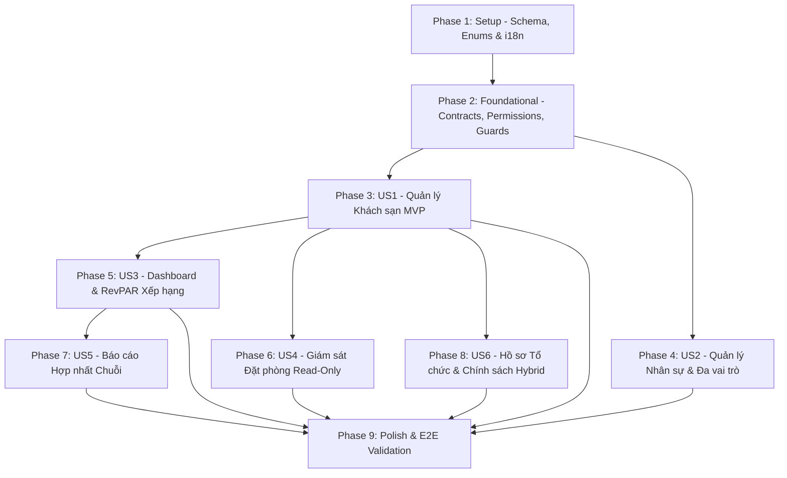

# Tasks: RM-007 - Quản Trị Vận Hành Chuỗi & Phân Quyền Tenant Admin (Tenant Operations & Management Portal)

**Input**: Design documents from `/specs/007-tenant-admin-management/` (`plan.md`, `spec.md`, `research.md`, `data-model.md`, `contracts/`, `quickstart.md`)  
**Prerequisites**: `plan.md` (required), `spec.md` (required), `research.md`, `data-model.md`, `contracts/`  
**Organization**: Tasks được cấu trúc tuần tự theo từng Phase và User Story để đảm bảo khả năng triển khai độc lập, kiểm thử từng phần và tuân thủ nghiêm ngặt Hiến pháp dự án.  

## Format: `- [ ] [ID] [P?] [Story?] Description with exact file path`

- **[P]**: Có thể thực hiện song song (khác file, không có sự phụ thuộc vào task chưa hoàn thành).
- **[Story]**: Đánh dấu User Story tương ứng (`[US1]`, `[US2]`, `[US3]`, `[US4]`, `[US5]`, `[US6]`). Không gắn nhãn story cho Setup, Foundational, hoặc Polish.
- Đường dẫn file mã nguồn chính xác trong mọi mô tả task.

---

## Phase 1: Setup (Shared Infrastructure, Localization & Data Models)

**Mục đích**: Khai báo các enum trạng thái, cấu trúc dữ liệu miền, quan hệ CSDL và bản địa hóa song ngữ làm nền móng cho toàn bộ các phân hệ của Tenant Admin.

- [x] T001 [P] Khai báo Enum `SuspensionType` (`Scheduled = 1`, `Emergency = 2`) và mở rộng `HotelStatus` (`Operating = 1`, `ScheduledSuspended = 2`, `EmergencySuspended = 3`) trong `BookingHotel/src/BookingHotel.Domain.Shared/Hotels/SuspensionEnums.cs`
- [x] T002 Cập nhật Entity `Hotel` bổ sung các trường: `StandardCheckInTime` (TimeSpan, mặc định `14:00`), `StandardCheckOutTime` (TimeSpan, mặc định `12:00`), `BookingCutoffDays` (int, mặc định `14`), và quan hệ với lịch sử tạm ngừng trong `BookingHotel/src/BookingHotel.Domain/Hotels/Hotel.cs`
- [x] T003 Tạo Entity `HotelSuspensionRecord` kế thừa `CreationAuditedEntity<Guid>` và `IMultiTenant` lưu vết `SuspensionType`, `StartDate`, `EndDate`, `Reason`, `AffectedBookingsCount` trong `BookingHotel/src/BookingHotel.Domain/Hotels/HotelSuspensionRecord.cs`
- [x] T004 [P] Tạo Entity `TenantOrganizationProfile` kế thừa `FullAuditedEntity<Guid>` và `IMultiTenant` lưu vết `OrganizationName`, `LogoUrl`, `HeadquarterAddress`, `Hotline`, `ContactEmail`, `WebsiteUrl`, `DefaultCheckInTime`, `DefaultCheckOutTime`, `CancellationPolicyJson` trong `BookingHotel/src/BookingHotel.Domain/Organization/TenantOrganizationProfile.cs`
- [x] T005 Cấu hình EF Core Fluent API, Indexing duy nhất `(TenantId, Code)` với bộ lọc `[IsDeleted] = 0` cho `Hotel`, cấu hình `HotelSuspensionRecord` và `TenantOrganizationProfile` trong `BookingHotel/src/BookingHotel.EntityFrameworkCore/EntityFrameworkCore/BookingHotelDbContext.cs`
- [x] T006 Tạo và thực thi EF Core Migration `AddTenantOperationsAndSuspensionSchema` áp dụng vào CSDL thông qua `BookingHotel.DbMigrator` trong `BookingHotel/src/BookingHotel.EntityFrameworkCore/Migrations/`
- [x] T007 [P] Bổ sung 100% chuỗi bản địa hóa i18n song ngữ cho 7 phân hệ của Tenant Admin (Khách sạn, Nhân sự, Giám sát Đặt phòng, Báo cáo, Hồ sơ chuỗi, Trạng thái Tạm ngừng định kỳ/khẩn cấp, Lỗi validation mã cơ sở) trong `BookingHotel/src/BookingHotel.Domain.Shared/Localization/BookingHotel/vi.json` và `en.json`

---

## Phase 2: Foundational (Backend Contracts, AppServices & Routing Infrastructure)

**Mục đích**: Hoàn thiện các hợp đồng DTO, AppServices nền tảng, định nghĩa cây phân quyền, và cấu hình định tuyến Angular bảo vệ phân hệ `/tenant/*`.

**⚠️ CRITICAL**: Các User Story phía sau phụ thuộc trực tiếp vào các contracts, permissions và route guards này.

- [x] T008 [P] Khai báo hằng số quyền hạt nhân `BookingHotelPermissions.Hotels.ManageBranches`, `BookingHotelPermissions.Hotels.AssignStaff` và đăng ký quyền cho Tenant side trong `BookingHotel/src/BookingHotel.Domain.Shared/Permissions/BookingHotelPermissions.cs` và `BookingHotel/src/BookingHotel.Application.Contracts/Permissions/BookingHotelPermissionDefinitionProvider.cs`
- [x] T009 [P] Định nghĩa các DTOs quản lý khách sạn: `CreateUpdateHotelDto`, `HotelDto`, `SuspendHotelInputDto`, `AssignHotelManagerDto` trong `BookingHotel/src/BookingHotel.Application.Contracts/Hotels/Dtos/`
- [x] T010 [P] Định nghĩa các DTOs nhân sự nội bộ và phân bổ vai trò: `CreateTenantStaffDto`, `UpdateTenantStaffDto`, `TransferBranchDto`, `UserWithAssignmentDto` trong `BookingHotel/src/BookingHotel.Application.Contracts/Identity/Dtos/`
- [x] T011 [P] Định nghĩa các DTOs giám sát và báo cáo chuỗi: `TenantDashboardOverviewDto`, `TenantBranchMetricDto`, `TenantBookingSurveillanceDto`, `RevenueReportDto`, `HotelPerformanceReportDto` trong `BookingHotel/src/BookingHotel.Application.Contracts/TenantDashboard/Dtos/` và `BookingHotel/src/BookingHotel.Application.Contracts/TenantReports/Dtos/`
- [x] T012 [P] Khai báo Interfaces: `IHotelAppService`, `IIdentityUserManagementAppService`, `ITenantDashboardAppService`, `ITenantReportAppService`, `ITenantOrganizationAppService` trong `BookingHotel/src/BookingHotel.Application.Contracts/`
- [x] T013 Xây dựng Angular Data Services kết nối REST API Backend: `HotelService`, `TenantStaffService`, `TenantDashboardService`, `TenantReportService`, `TenantOrgService` trong `BookingHotel/angular/src/app/admin/services/`
- [x] T014 Cấu hình khung định tuyến phân hệ `/tenant/*` (`tenant.routes.ts`) bảo vệ bởi `tenantAdminGuard`, tích hợp layout shell `TenantAdminLayoutComponent` trong `BookingHotel/angular/src/app/admin/tenant/tenant.routes.ts`

**Checkpoint**: Nền tảng Backend DTOs/Permissions và Angular Services/Guards hoàn tất - sẵn sàng triển khai các User Story.

---

## Phase 3: User Story 1 - Quản Lý Cơ Sở Khách Sạn Trực Thuộc Chuỗi (Priority: P1) 🎯 MVP

**Mục tiêu**: Tenant Admin có toàn quyền quản lý danh mục cơ sở khách sạn (Tạo mới, chỉnh sửa, kiểm tra trùng lặp `HotelCode`, phân công Quản lý khách sạn, và tạm ngừng hoạt động theo 2 quy trình: Định kỳ $\ge 30$ ngày vs Khẩn cấp kèm lý do).

**Independent Test**: Đăng nhập bằng tài khoản Tenant Admin, vào `/tenant/hotels`, tạo mới thành công cơ sở `BH-NHA-01`; thử tạo lại mã này để kiểm tra chặn trùng lặp; phân công Quản lý khách sạn; thử nghiệm tạm ngừng định kỳ (chặn khi < 30 ngày) và tạm ngừng khẩn cấp (thành công khi có lý do).

### Implementation for User Story 1
- [x] T015 [P] [US1] Cập nhật `HotelAppService` triển khai logic tạo khách sạn kiểm tra regex `^[A-Z0-9\-_]{3,20}$`, xác thực `HotelCode` duy nhất trong Tenant, tự động gán `TenantId = CurrentTenant.Id` trong `BookingHotel/src/BookingHotel.Application/Hotels/HotelAppService.cs`
- [x] T016 [US1] Triển khai phương thức `SuspendAsync(Guid id, SuspendHotelInputDto input)` trong `HotelAppService`: Xác thực nếu `Scheduled` thì `StartDate - Clock.Now >= 30 days` (ném lỗi nếu vi phạm); nếu `Emergency` thì bắt buộc `Reason` dài $\ge 20$ ký tự, lưu vào `HotelSuspensionRecord` và phát event thông báo trong `BookingHotel/src/BookingHotel.Application/Hotels/HotelAppService.cs`
- [x] T017 [US1] Triển khai phương thức `ActivateAsync(Guid id)` và `AssignManagerAsync(Guid id, AssignHotelManagerDto input)` cập nhật `UserHotelAssignment` và tên hiển thị `ManagerName` trong `BookingHotel/src/BookingHotel.Application/Hotels/HotelAppService.cs`
- [x] T018 [US1] Xây dựng REST API Controller `HotelController` phơi bày các endpoints `/api/app/hotel/*` kèm thuộc tính kiểm tra quyền `[Authorize(BookingHotelPermissions.Hotels.*)]` trong `BookingHotel/src/BookingHotel.HttpApi/Controllers/HotelController.cs`
- [x] T019 [P] [US1] Xây dựng màn hình danh sách cơ sở khách sạn `HotelListComponent` sử dụng `BhDataTableComponent`, bộ lọc theo từ khóa và trạng thái hoạt động trong `BookingHotel/angular/src/app/admin/tenant/hotels/hotel-list.component.ts` (kèm HTML & SCSS)
- [x] T020 [US1] Xây dựng modal thêm/sửa khách sạn `HotelModalComponent` sử dụng `BhModalComponent`, Reactive Form kiểm tra mã `HotelCode`, số phòng, hotline, giờ check-in/out trong `BookingHotel/angular/src/app/admin/tenant/hotels/hotel-modal.component.ts` (kèm HTML & SCSS)
- [x] T021 [US1] Xây dựng modal tạm ngừng cơ sở `HotelSuspendModalComponent` hỗ trợ 2 chế độ (Định kỳ: DatePicker kiểm tra $\ge 30$ ngày; Khẩn cấp: Textarea nhập lý do bắt buộc) trong `BookingHotel/angular/src/app/admin/tenant/hotels/hotel-suspend-modal.component.ts` (kèm HTML & SCSS)
- [x] T022 [US1] Xây dựng modal phân công quản lý `HotelManagerModalComponent` cho phép tìm kiếm và gán người dùng có vai trò `HotelManager` cho cơ sở trong `BookingHotel/angular/src/app/admin/tenant/hotels/hotel-manager-modal.component.ts` (kèm HTML & SCSS)

**Checkpoint**: User Story 1 hoàn tất - Cơ chế quản lý vòng đời cơ sở khách sạn và tạm ngừng hoạt động 2 nhánh hoạt động độc lập (MVP).

---

## Phase 4: User Story 2 - Quản Lý Nhân Sự & Phân Bổ Vai Trò Linh Hoạt (Priority: P1)

**Mục tiêu**: Tenant Admin quản lý danh sách nhân sự toàn tổ chức, tạo tài khoản với vai trò đơn lẻ hoặc kiêm nhiệm cả hai (`HotelManager` + `Receptionist`), phân bổ chi nhánh `UserHotelAssignment`, điều chuyển nhân sự giữa các cơ sở, khóa/mở khóa tài khoản, mở khóa brute-force, và chặn đứng 100% nguy cơ leo thang đặc quyền `SystemAdmin`.

**Independent Test**: Tạo tài khoản nhân viên kiêm nhiệm cả 2 vai trò `HotelManager` và `Receptionist`, gán 1 cơ sở lễ tân chính; thử gửi request chứa role `SystemAdmin` và xác nhận bị chặn lỗi 403 Forbidden; đăng nhập tài khoản vừa tạo xác nhận nút `Portal Switcher` xuất hiện trên Topbar; thực hiện điều chuyển cơ sở thành công.

### Implementation for User Story 2
- [x] T023 [P] [US2] Nâng cấp `IdentityUserManagementAppService` triển khai phương thức `CreateTenantStaffAsync` với Whitelist vai trò kiểm tra cứng (`HotelManager`, `Receptionist`), thiết lập `ShouldChangePasswordOnNextLogin = true`, ném `403 Forbidden` nếu phát hiện role cấp Host trong `BookingHotel/src/BookingHotel.Application/Identity/IdentityUserManagementAppService.cs`
- [x] T024 [US2] Triển khai cơ chế phân bổ cơ sở cho nhân sự kiêm nhiệm: Gán danh sách cơ sở cho `HotelManager` và bắt buộc chỉ định 1 cơ sở chính (`IsPrimary = true`) cho `Receptionist` trong `UserHotelAssignment` tại `BookingHotel/src/BookingHotel.Application/Identity/IdentityUserManagementAppService.cs`
- [x] T025 [US2] Triển khai phương thức điều chuyển cơ sở `TransferBranchAsync`: Đánh dấu phân công cũ `IsActive = false`, `UnassignedAt = Clock.Now`, tạo bản ghi phân công mới `IsActive = true`, bảo toàn 100% lịch sử giao dịch cũ trong `BookingHotel/src/BookingHotel.Application/Identity/IdentityUserManagementAppService.cs`
- [x] T026 [US2] Triển khai phương thức mở khóa Brute-Force `UnlockBruteForceAsync` và đổi trạng thái hoạt động `ToggleActiveAsync` cho nhân sự nội bộ Tenant trong `BookingHotel/src/BookingHotel.Application/Identity/IdentityUserManagementAppService.cs`
- [x] T027 [US2] Phơi bày các REST endpoints quản lý nhân sự chuỗi tại `IdentityUserManagementController` trong `BookingHotel/src/BookingHotel.HttpApi/Controllers/IdentityUserManagementController.cs`
- [x] T028 [P] [US2] Xây dựng màn hình danh sách nhân viên chuỗi `StaffListComponent` sử dụng `BhDataTableComponent` hiển thị huy hiệu vai trò, chi nhánh công tác, trạng thái khóa trong `BookingHotel/angular/src/app/admin/tenant/staff/staff-list.component.ts` (kèm HTML & SCSS)
- [x] T029 [US2] Xây dựng modal tạo/sửa nhân viên `StaffModalComponent` với checkbox chọn đa vai trò (`HotelManager`, `Receptionist`), bộ chọn chi nhánh phân công, trường mật khẩu không điền sẵn trong `BookingHotel/angular/src/app/admin/tenant/staff/staff-modal.component.ts` (kèm HTML & SCSS)
- [x] T030 [US2] Xây dựng modal điều chuyển chi nhánh `StaffTransferModalComponent` cho phép chọn cơ sở đích, nhập ghi chú điều chuyển và cập nhật tức thì trong `BookingHotel/angular/src/app/admin/tenant/staff/staff-transfer-modal.component.ts` (kèm HTML & SCSS)

**Checkpoint**: User Story 2 hoàn tất - Quản trị nhân sự nội bộ, phân bổ đa vai trò kiêm nhiệm và bộ phòng thủ chống leo thang đặc quyền hoạt động chuẩn xác.

---

## Phase 5: User Story 3 - Bảng Điều Khiển Giám Sát Hoạt Động & So Sánh Hiệu Suất RevPAR (Priority: P2)

**Mục tiêu**: Tenant Admin theo dõi toàn cảnh tình hình vận hành qua 5 thẻ chỉ số KPI hợp nhất (Cơ sở hoạt động/tạm ngừng, Nhân viên, Booking, Doanh thu thực thu Cash-basis, Tỷ lệ lấp đầy) và bảng so sánh hiệu suất giữa các cơ sở xếp hạng mặc định theo chỉ số chuẩn quốc tế **RevPAR**.

**Independent Test**: Truy cập `/tenant/dashboard`, kiểm tra số liệu 5 thẻ KPI khớp với dữ liệu thực tế tính toán từ Backend; xác nhận bảng xếp hạng cơ sở được sắp xếp mặc định theo chỉ số RevPAR giảm dần; thử nghiệm chuyển bộ lọc ngày cập nhật số liệu tức thì.

### Implementation for User Story 3
- [x] T031 [P] [US3] Nâng cấp `TenantDashboardAppService` triển khai phương thức `GetOverviewAsync`: Tính toán số lượng cơ sở hoạt động vs tạm ngừng, số nhân viên nội bộ, tổng booking, Doanh thu thực thu (Cash Basis: tổng tiền từ các hóa đơn Folio trạng thái `Settled` trừ đi khoản `Refunded`), và Tỷ lệ lấp đầy bình quân trong `BookingHotel/src/BookingHotel.Application/TenantDashboard/TenantDashboardAppService.cs`
- [x] T032 [US3] Triển khai thuật toán tính toán và xếp hạng cơ sở theo RevPAR: $\text{RevPAR} = \frac{\text{Doanh thu phòng}}{\text{Tổng số phòng sẵn có}}$, tính kèm ADR và Occupancy Rate cho từng chi nhánh trong `BookingHotel/src/BookingHotel.Application/TenantDashboard/TenantDashboardAppService.cs`
- [x] T033 [US3] Cập nhật REST API Controller `TenantDashboardController` phơi bày endpoint `/api/app/tenant-dashboard/overview` với quyền `BookingHotelPermissions.Reports.Consolidated` trong `BookingHotel/src/BookingHotel.HttpApi/Controllers/TenantDashboardController.cs`
- [x] T034 [P] [US3] Xây dựng component `TenantDashboardComponent` hiển thị 5 thẻ KPI gradient, bộ lọc thời gian `DateRangePicker`, biểu đồ trực quan và bảng xếp hạng cơ sở theo RevPAR trong `BookingHotel/angular/src/app/admin/tenant/dashboard/tenant-dashboard.component.ts` (kèm HTML & SCSS)

**Checkpoint**: User Story 3 hoàn tất - Bảng điều khiển chuỗi và thước đo hiệu suất chuẩn quốc tế RevPAR hoạt động trơn tru.

---

## Phase 6: User Story 4 - Giám Sát Đặt Phòng Hợp Nhất Toàn Chuỗi (Priority: P2)

**Mục tiêu**: Tenant Admin theo dõi luồng giao dịch đặt phòng của toàn bộ chuỗi ở chế độ **CHỈ XEM (Read-Only 100%)**, lọc đa chiều, xem chi tiết lịch sử (Audit Trail) và dòng tiền hóa đơn Folio mà không can thiệp quầy.

**Independent Test**: Truy cập `/tenant/bookings`, kiểm tra danh sách đặt phòng hiển thị đầy đủ các chi nhánh; áp dụng bộ lọc theo cơ sở và trạng thái; mở modal xem chi tiết booking và hóa đơn Folio; xác nhận giao diện không hiển thị nút Check-in/Check-out.

### Implementation for User Story 4
- [x] T035 [P] [US4] Xây dựng `TenantBookingSurveillanceAppService` triển khai phương thức `GetListAsync`: Truy vấn đặt phòng toàn chuỗi lọc theo `CurrentTenant.Id`, hỗ trợ lọc theo cơ sở, trạng thái booking (`New`, `Confirmed`, `CheckedIn`, `Completed`, `Cancelled`), trạng thái thanh toán, và ngày lưu trú trong `BookingHotel/src/BookingHotel.Application/TenantBookings/TenantBookingSurveillanceAppService.cs`
- [x] T036 [US4] Triển khai phương thức `GetDetailAsync` trả về thông tin khách, chi tiết phòng, lịch sử trạng thái (Audit Trail) và các mục chi phí trên hóa đơn Folio trong `BookingHotel/src/BookingHotel.Application/TenantBookings/TenantBookingSurveillanceAppService.cs`
- [x] T037 [US4] Xây dựng REST API Controller `TenantBookingSurveillanceController` phơi bày endpoints `/api/app/tenant-bookings/surveillance/*` với quyền `BookingHotelPermissions.Bookings.Default` trong `BookingHotel/src/BookingHotel.HttpApi/Controllers/TenantBookingSurveillanceController.cs`
- [x] T038 [P] [US4] Xây dựng màn hình `BookingSurveillanceComponent` hiển thị bảng `BhDataTableComponent` với bộ lọc đa tiêu chí, huy hiệu trạng thái đặt phòng và thanh toán trong `BookingHotel/angular/src/app/admin/tenant/bookings/booking-surveillance.component.ts` (kèm HTML & SCSS)
- [x] T039 [US4] Xây dựng modal chi tiết `BookingDetailModalComponent` hiển thị dòng thời gian sự kiện, bảng kê chi phí Folio và liên kết kiểm toán ở chế độ Read-Only trong `BookingHotel/angular/src/app/admin/tenant/bookings/booking-detail-modal.component.ts` (kèm HTML & SCSS)

**Checkpoint**: User Story 4 hoàn tất - Phân hệ Giám sát đặt phòng toàn chuỗi hoạt động chuẩn xác ở chế độ chỉ xem minh bạch.

---

## Phase 7: User Story 5 - Hệ Thống Báo Cáo Hợp Nhất Chuỗi (Priority: P3)

**Mục tiêu**: Cung cấp 5 nhóm báo cáo chuyên sâu: Doanh thu (Cash Basis), Đặt phòng, Tỷ lệ lấp đầy, Tỷ lệ hủy phòng, và Hiệu suất cơ sở xếp hạng RevPAR, hỗ trợ xuất file Excel/CSV.

**Independent Test**: Truy cập `/tenant/reports`, duyệt qua 5 tab báo cáo; chọn khoảng ngày và cơ sở; bấm nút xuất file Excel và xác nhận tải về tệp bảng tính với số liệu chuẩn xác.

### Implementation for User Story 5
- [x] T040 [P] [US5] Xây dựng `TenantReportAppService` triển khai các phương thức tính toán báo cáo: `GetRevenueReportAsync` (Cash Basis), `GetBookingReportAsync`, `GetOccupancyReportAsync`, `GetCancellationReportAsync`, `GetHotelPerformanceReportAsync` trong `BookingHotel/src/BookingHotel.Application/TenantReports/TenantReportAppService.cs`
- [x] T041 [US5] Triển khai tính năng xuất dữ liệu báo cáo sang định dạng Excel (.xlsx qua OpenXML/EPPlus) và CSV trong `TenantReportAppService` tại `BookingHotel/src/BookingHotel.Application/TenantReports/TenantReportAppService.cs`
- [x] T042 [US5] Xây dựng REST API Controller `TenantReportController` phơi bày endpoints `/api/app/tenant-reports/*` với quyền `BookingHotelPermissions.Reports.Consolidated` trong `BookingHotel/src/BookingHotel.HttpApi/Controllers/TenantReportController.cs`
- [x] T043 [P] [US5] Xây dựng màn hình `TenantReportsComponent` với giao diện 5 Tabs chuyên biệt, biểu đồ doanh thu và công suất phòng, bảng đối soát dữ liệu và nút xuất báo cáo trong `BookingHotel/angular/src/app/admin/tenant/reports/tenant-reports.component.ts` (kèm HTML & SCSS)

**Checkpoint**: User Story 5 hoàn tất - Hệ thống báo cáo hợp nhất và xuất file bảng tính vận hành ổn định.

---

## Phase 8: User Story 6 - Cấu Hình Hồ Sơ Doanh Nghiệp & Chính Sách Chuỗi Hybrid (Priority: P3)

**Mục tiêu**: Tenant Admin cập nhật hồ sơ doanh nghiệp (Tên, logo, hotline, email, địa chỉ) và thiết lập quy chuẩn vận hành chuỗi theo mô hình **Hybrid** (Khung giờ Check-in/out làm mặc định cho phép chi nhánh ghi đè; Chính sách hủy phòng khóa cứng và bắt buộc đồng nhất 100% toàn chuỗi).

**Independent Test**: Truy cập `/tenant/settings`, cập nhật tên chuỗi và giờ check-in/out mặc định; lưu thành công; kiểm tra Topbar cập nhật tên chuỗi; kiểm tra tạo cơ sở mới tự động kế thừa giờ chuẩn; thử ghi đè giờ check-in tại cơ sở `BH-DAD-01` thành công, trong khi chính sách hủy phòng không thể sửa ở cấp cơ sở.

### Implementation for User Story 6
- [ ] T044 [P] [US6] Xây dựng `TenantOrganizationAppService` triển khai `GetProfileAsync` và `UpdateProfileAsync` quản lý thông tin hồ sơ doanh nghiệp và chính sách chuỗi trong `BookingHotel/src/BookingHotel.Application/Organization/TenantOrganizationAppService.cs`
- [ ] T045 [US6] Tích hợp logic kiểm tra mô hình Hybrid: Khi cơ sở tạo mới, tự động kế thừa `DefaultCheckInTime` và `DefaultCheckOutTime` từ tổ chức; khi khách đặt phòng, áp dụng cứng `CancellationPolicy` của Tenant trong `BookingHotel/src/BookingHotel.Application/Organization/TenantOrganizationAppService.cs`
- [ ] T046 [US6] Xây dựng REST API Controller `TenantOrganizationController` phơi bày endpoints `/api/app/tenant-organization/*` với quyền `BookingHotelPermissions.Hotels.ManageBranches` trong `BookingHotel/src/BookingHotel.HttpApi/Controllers/TenantOrganizationController.cs`
- [ ] T047 [P] [US6] Xây dựng màn hình `OrganizationSettingsComponent` hiển thị biểu mẫu hồ sơ chuỗi, tải lên logo thương hiệu, cấu hình giờ nhận/trả phòng và chính sách hủy phòng trong `BookingHotel/angular/src/app/admin/tenant/settings/organization-settings.component.ts` (kèm HTML & SCSS)

**Checkpoint**: User Story 6 hoàn tất - Hồ sơ tổ chức và mô hình chính sách Hybrid hoàn thiện 100%.

---

## Phase 9: Polish & Cross-Cutting Concerns

**Mục đích**: Hoàn thiện tích hợp, rà soát chất lượng toàn diện theo Hiến pháp và xác thực End-to-End.

- [x] T048 [P] Rà soát 100% Zero Hardcoded Text: Đảm bảo toàn bộ tiêu đề, nhãn, nút tác vụ, thông báo toastr và modal của phân hệ `/tenant/*` được truy xuất qua `abpLocalization` tại `vi.json` và `en.json`
- [x] T049 [P] Rà soát giao diện và SCSS tuân thủ Concept *Corporate Executive Dashboard* (Sidebar Đen `#000000`, Điểm nhấn Cyan `#00FFFF`, Huy hiệu Vàng `#F59E0B`, Nền Trắng `#FFFFFF`) đạt độ tương phản WCAG 2.1 AA $\ge 4.5:1$
- [x] T050 [P] Đảm bảo tên thương hiệu hiển thị chuẩn xác `Booking Hotel` có dấu cách trên toàn bộ header và modal của phân hệ Tenant
- [x] T051 Kiểm tra bảo vệ an ninh và ranh giới Multi-Tenancy: Xác thực không rò rỉ dữ liệu chéo Tenant (`Cross-Tenant Leakage = 0%`) và từ chối mọi yêu cầu gán vai trò `SystemAdmin`
- [x] T052 Chạy kiểm thử End-to-End 7 kịch bản xác thực theo hướng dẫn trong `BookingHotel/specs/007-tenant-admin-management/quickstart.md`
- [x] T053 Cập nhật trạng thái tiến độ RM-007 từ `chưa` sang `xong` trong `docs/roadmap.md`

---

## Dependencies & Execution Order



### Quy Tắc Thực Thi Tuần Tự & Song Song
- **Phase 1 & Phase 2** là bắt buộc tiên quyết (Foundational Blocking).
- **User Story 1 (P1)** và **User Story 2 (P1)** có thể triển khai song song sau khi Phase 2 hoàn thành.
- **User Story 3 (Dashboard)** và **User Story 4 (Surveillance)** phụ thuộc vào dữ liệu cơ sở từ US1.
- **User Story 5 (Reports)** phụ thuộc vào công thức tính toán và dữ liệu tổng hợp từ US3 & US4.
- **User Story 6 (Settings)** có thể tiến hành độc lập sau US1.

---

## Parallel Opportunities

```bash
# Nhóm 1: Triển khai đồng thời các DTOs và Contracts trong Phase 2:
Task: T009 [P] DTOs Khách sạn
Task: T010 [P] DTOs Nhân sự
Task: T011 [P] DTOs Dashboard & Báo cáo
Task: T012 [P] Khai báo Interfaces AppServices

# Nhóm 2: Triển khai đồng thời giao diện danh sách và modal trong US1:
Task: T019 [P] [US1] HotelListComponent
Task: T020 [US1] HotelModalComponent
Task: T021 [US1] HotelSuspendModalComponent

# Nhóm 3: Triển khai đồng thời giao diện nhân sự trong US2:
Task: T028 [P] [US2] StaffListComponent
Task: T029 [US2] StaffModalComponent
Task: T030 [US2] StaffTransferModalComponent
```

---

## Implementation Strategy

### MVP First (Giai Đoạn 1: US1 + US2)
1. Hoàn tất Phase 1 (Schema, Enums, i18n) & Phase 2 (Contracts, Permissions, Guards).
2. Xây dựng US1 (Quản lý Khách sạn) $\rightarrow$ Khởi tạo mạng lưới chi nhánh.
3. Xây dựng US2 (Quản lý Nhân sự) $\rightarrow$ Tuyển dụng, phân bổ vai trò kiêm nhiệm và chi nhánh công tác.
4. **Kiểm thử độc lập MVP**: Kiểm tra trọn vẹn luồng tạo khách sạn và gán nhân sự kiêm nhiệm thành công.

### Incremental Delivery (Giai Đoạn 2 & 3)
1. Bổ sung US3 (Dashboard & RevPAR) + US4 (Giám sát Đặt phòng Read-Only) $\rightarrow$ Cung cấp công cụ điều hành thời gian thực cho lãnh đạo chuỗi.
2. Bổ sung US5 (Báo cáo Chuyên sâu) + US6 (Hồ sơ Doanh nghiệp & Chính sách Hybrid) $\rightarrow$ Hoàn thiện 100% tính năng chuỗi.
3. Chạy kiểm thử End-to-End theo `quickstart.md` và nghiệm thu hoàn thành RM-007.
