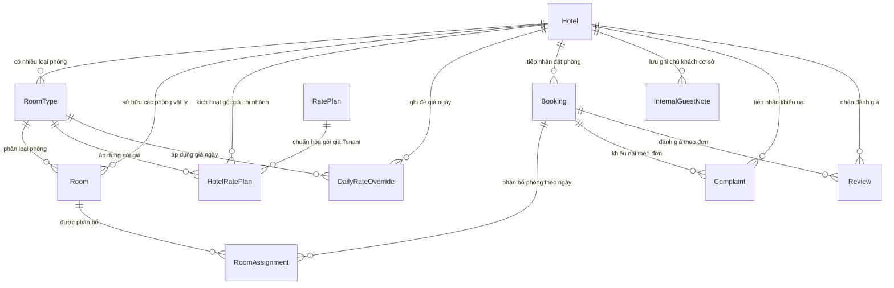

# Thiết Kế Mô Hình Dữ Liệu (Phase 1 Data Model): RM-008 - Hotel Manager Console

**Feature**: `008-hotel-manager-management`  
**Ngày thực hiện**: 2026-11-19  
**Mục tiêu**: Định nghĩa chi tiết các thực thể (Entities), kiểu liệt kê (Enums), cấu hình Fluent API, sơ đồ quan hệ CSDL và các quy tắc kiểm tra tính hợp lệ dữ liệu tuân thủ chuẩn Domain-Driven Design (DDD) của ABP Framework.

---

## 1. Sơ Đồ Thực Thể Quan Hệ (Entity-Relationship Diagram)



---

## 2. Kiểu Liệt Kê Chuẩn Hóa (Enumerations)

### 2.1. Trạng Thái Vận Hành Buồng Phòng (`RoomOperationalStatus`)
```csharp
namespace BookingHotel.Rooms;

public enum RoomOperationalStatus
{
    Available = 1,       // Phòng trống, sẵn sàng khai thác
    Occupied = 2,        // Đang có khách lưu trú
    Reserved = 3,        // Đã phân phòng cho đơn đặt phòng sắp tới
    Maintenance = 4,     // Đang bảo trì / sửa chữa sự cố ngắn hạn
    OutOfService = 5     // Ngừng kinh doanh dài hạn (loại khỏi AvailableInventory)
}
```

### 2.2. Tình Trạng Vệ Sinh Buồng Phòng (`HousekeepingStatus`)
```csharp
namespace BookingHotel.Rooms;

public enum HousekeepingStatus
{
    Clean = 1,           // Đã vệ sinh sạch
    Dirty = 2,           // Chưa vệ sinh / Phòng bẩn sau check-out
    Cleaning = 3,        // Đang tiến hành dọn phòng
    Inspected = 4        // Đã kiểm tra chất lượng đạt chuẩn đón khách
}
```

### 2.3. Vòng Đời Đặt Phòng (`BookingStatus`)
```csharp
namespace BookingHotel.Bookings;

public enum BookingStatus
{
    PendingConfirmation = 1, // Đang chờ duyệt (đơn trực tuyến chưa cọc hoặc đặt qua portal)
    Confirmed = 2,           // Đã xác nhận giữ chỗ chính thức
    CheckedIn = 3,           // Khách đã nhận phòng và đang lưu trú
    Completed = 4,           // Đã trả phòng, quyết toán xong công nợ
    Rejected = 5,            // Khách sạn từ chối tiếp nhận (kèm lý do)
    Cancelled = 6,           // Đơn bị hủy theo chính sách
    NoShow = 7               // Khách không đến nhận phòng sau giờ cutoff
}
```

### 2.4. Trạng Thái Thanh Toán (`PaymentStatus`)
```csharp
namespace BookingHotel.Bookings;

public enum PaymentStatus
{
    Unpaid = 1,              // Chưa thanh toán
    PartiallyPaid = 2,       // Đã đặt cọc một phần
    Paid = 3,                // Đã thanh toán đủ 100% tiền phòng
    Refunded = 4             // Đã hoàn tiền (toàn bộ hoặc một phần)
}
```

### 2.5. Trạng Thái Gán Phòng Thực Tế (`RoomAssignmentStatus`)
```csharp
namespace BookingHotel.Bookings;

public enum RoomAssignmentStatus
{
    Unassigned = 1,          // Giữ chỗ theo hạng phòng, chưa gán số phòng cụ thể
    Assigned = 2             // Đã gán phòng vật lý cụ thể (ví dụ: Phòng 304)
}
```

### 2.6. Trạng Thái Xử Lý Khiếu Nại (`ComplaintStatus`)
```csharp
namespace BookingHotel.Complaints;

public enum ComplaintStatus
{
    Open = 1,                // Tiếp nhận khiếu nại mới
    InInvestigation = 2,     // Đang xác minh / Điều tra xử lý
    Resolved = 3,            // Đã giải quyết xong và phản hồi khách
    Escalated = 4            // Quá hạn SLA 48h -> Leo thang lên Tenant Admin
}
```

---

## 3. Các Thực Thể Nghiệp Vụ Cốt Lõi (Domain Entities)

### 3.1. Loại Phòng (`RoomType`)
- **Tên lớp**: `RoomType`
- **Kế thừa**: `FullAuditedAggregateRoot<Guid>, IMultiTenant`
- **Các trường dữ liệu**:
  - `TenantId: Guid?` — Mã Tenant đa người dùng
  - `HotelId: Guid` — Mã cơ sở sở hữu hạng phòng này
  - `Name: string` (Max 128) — Tên loại phòng (Deluxe Ocean View, Executive Suite...)
  - `Description: string` (Max 2048) — Mô tả tiện nghi chi tiết
  - `StandardOccupancy: int` — Sức chứa tiêu chuẩn người lớn (mặc định 2)
  - `MaxOccupancy: int` — Sức chứa tối đa kể cả kê thêm giường phụ (mặc định 3 hoặc 4)
  - `BasePrice: decimal` — Giá niêm yết chuẩn
  - `SizeSquareMeters: double` — Diện tích phòng ($m^2$)
  - `AmenitiesJson: string` — Danh sách tiện nghi đi kèm (WiFi, Bồn tắm, Ban công, Minibar...)

### 3.2. Phòng Thực Tế (`Room`)
- **Tên lớp**: `Room`
- **Kế thừa**: `FullAuditedAggregateRoot<Guid>, IMultiTenant`
- **Các trường dữ liệu**:
  - `TenantId: Guid?` — Mã Tenant
  - `HotelId: Guid` — Mã cơ sở khách sạn
  - `RoomTypeId: Guid` — Khóa ngoại liên kết `RoomType`
  - `RoomNumber: string` (Max 32) — Số phòng (ví dụ: "101", "302B", "PH-01")
  - `Floor: int` — Số tầng của phòng
  - `OperationalStatus: RoomOperationalStatus` — Trạng thái vận hành
  - `HousekeepingStatus: HousekeepingStatus` — Tình trạng vệ sinh buồng phòng
  - `MaintenanceReason: string?` — Lý do bảo trì sửa chữa
  - `MaintenanceEndDate: DateTime?` — Ngày dự kiến hoàn thành bảo trì
  - `OutOfServiceReason: string?` — Lý do ngừng kinh doanh
  - `OutOfServiceEndDate: DateTime?` — Ngày dự kiến mở lại phòng kinh doanh

### 3.3. Danh Mục Gói Giá Chuẩn Toàn Chuỗi (`RatePlan`)
- **Tên lớp**: `RatePlan`
- **Kế thừa**: `FullAuditedAggregateRoot<Guid>, IMultiTenant`
- **Quản lý bởi**: Tenant Admin (Ban hành dùng chung cho toàn chuỗi)
- **Các trường dữ liệu**:
  - `TenantId: Guid?` — Mã Tenant
  - `Name: string` (Max 128) — Tên gói giá (ví dụ: Standard Flexible, Non-Refundable Promo, Breakfast Included)
  - `Code: string` (Max 32) — Mã định danh gói (ví dụ: `FLEX`, `NONREF`, `BB`)
  - `Description: string` — Chi tiết quyền lợi và điều kiện áp dụng
  - `IsRefundable: bool` — Được phép hoàn tiền khi hủy hay không
  - `IncludesBreakfast: bool` — Đã bao gồm buffet sáng hay không
  - `CancellationCutoffHours: int` — Số giờ cho phép hủy miễn phí trước giờ nhận phòng
  - `DefaultPriceAdjustmentPercent: decimal` — Tỷ lệ điều chỉnh giá mặc định (ví dụ -15% cho Non-Refundable)

### 3.4. Kích Hoạt Gói Giá Cơ Sở (`HotelRatePlan`)
- **Tên lớp**: `HotelRatePlan`
- **Kế thừa**: `FullAuditedEntity<Guid>, IMultiTenant`
- **Quản lý bởi**: Hotel Manager
- **Các trường dữ liệu**:
  - `TenantId: Guid?` — Mã Tenant
  - `HotelId: Guid` — Mã cơ sở áp dụng
  - `RoomTypeId: Guid` — Hạng phòng áp dụng
  - `RatePlanId: Guid` — Gói giá chuẩn kế thừa từ Tenant
  - `IsActive: bool` — Trạng thái kích hoạt bán tại cơ sở
  - `CustomBasePrice: decimal?` — Giá bán tùy chỉnh của gói (nếu có)
  - `PriceMultiplier: decimal` — Hệ số giá nhân với BasePrice (mặc định 1.0)

### 3.5. Bảng Ghi Đè Giá Ngày (`DailyRateOverride`)
- **Tên lớp**: `DailyRateOverride`
- **Kế thừa**: `FullAuditedEntity<Guid>, IMultiTenant`
- **Quản lý bởi**: Hotel Manager (Revenue Optimization)
- **Các trường dữ liệu**:
  - `TenantId: Guid?` — Mã Tenant
  - `HotelId: Guid` — Cơ sở áp dụng
  - `RoomTypeId: Guid` — Hạng phòng áp dụng
  - `Date: DateTime` — Ngày áp dụng (chỉ lấy phần Date `yyyy-MM-dd`)
  - `OverridePrice: decimal` — Mức giá bán ghi đè cụ thể cho ngày này
  - `IsClosedToArrival: bool` — Khóa không nhận khách check-in vào ngày này (CTA)
  - `IsClosedToDeparture: bool` — Khóa không cho khách check-out vào ngày này (CTD)

### 3.6. Đơn Đặt Phòng (`Booking`)
- **Tên lớp**: `Booking`
- **Kế thừa**: `FullAuditedAggregateRoot<Guid>, IMultiTenant`
- **Các trường dữ liệu**:
  - `TenantId: Guid?` — Mã Tenant
  - `HotelId: Guid` — Khách sạn tiếp nhận
  - `BookingCode: string` (Max 32) — Mã đặt phòng định dạng duy nhất (ví dụ: `BK-20261119-001`)
  - `GuestId: Guid?` — Khóa ngoại liên kết tài khoản khách hàng (nếu là thành viên hệ thống)
  - `GuestFullName: string` (Max 128) — Họ tên khách đặt phòng
  - `GuestPhone: string` (Max 32) — Số điện thoại liên hệ
  - `GuestEmail: string` (Max 128) — Email nhận thông tin xác nhận
  - `GuestIdentityNumberMasked: string` (Max 32) — Số CCCD/Passport đã che bảo mật (`***-***-1234`)
  - `CheckInDate: DateTime` — Ngày nhận phòng
  - `CheckOutDate: DateTime` — Ngày trả phòng
  - `TotalAmount: decimal` — Tổng giá trị đơn đặt phòng tính toán bởi Backend
  - `DepositAmount: decimal` — Số tiền cọc đã thu
  - `BookingStatus: BookingStatus` — Trạng thái vòng đời booking
  - `PaymentStatus: PaymentStatus` — Trạng thái thanh toán
  - `RoomAssignmentStatus: RoomAssignmentStatus` — Trạng thái gán phòng
  - `IsDirectBooking: bool` — Đánh dấu đơn đặt trực tiếp bởi Manager/Lễ tân
  - `ContractNotes: string?` — Ghi chú hợp đồng khách đoàn / corporate
  - `WaivePenaltyReason: string?` — Lý do miễn giảm phí phạt No-Show (nếu có)
  - `PenaltyAmount: decimal` — Số tiền phạt No-Show chính thức áp dụng
  - `SpecialRequests: string?` — Yêu cầu đặc biệt của khách

### 3.7. Gán Phòng Thực Tế (`RoomAssignment`)
- **Tên lớp**: `RoomAssignment`
- **Kế thừa**: `FullAuditedEntity<Guid>, IMultiTenant`
- **Các trường dữ liệu**:
  - `TenantId: Guid?` — Mã Tenant
  - `BookingId: Guid` — Khóa ngoại liên kết `Booking`
  - `RoomId: Guid` — Khóa ngoại liên kết căn phòng vật lý `Room`
  - `RoomTypeId: Guid` — Hạng phòng của căn phòng
  - `FromDate: DateTime` — Ngày bắt đầu chiếm chỗ
  - `ToDate: DateTime` — Ngày kết thúc chiếm chỗ
  - `IsActive: bool` — Đang có hiệu lực hay đã bị hủy do No-Show/đổi phòng

### 3.8. Ghi Chú Nội Bộ Khách Hàng (`InternalGuestNote`)
- **Tên lớp**: `InternalGuestNote`
- **Kế thừa**: `FullAuditedEntity<Guid>, IMultiTenant`
- **Các trường dữ liệu**:
  - `TenantId: Guid?` — Mã Tenant
  - `HotelId: Guid` — Khách sạn phát sinh ghi chú
  - `GuestId: Guid` — Mã khách hàng được ghi chú
  - `NoteText: string` (Max 2000) — Nội dung lưu ý chăm sóc, dị ứng, sở thích
  - `Category: string` (Max 64) — Phân loại (VIP, ServiceAlert, Dietary, SpecialPreference)
  - `IsAlert: bool` — Cần cảnh báo đỏ khi khách nhận phòng hay không

### 3.9. Khiếu Nại Khách Hàng (`Complaint`)
- **Tên lớp**: `Complaint`
- **Kế thừa**: `FullAuditedAggregateRoot<Guid>, IMultiTenant`
- **Các trường dữ liệu**:
  - `TenantId: Guid?` — Mã Tenant
  - `HotelId: Guid` — Khách sạn phát sinh khiếu nại
  - `GuestId: Guid?` — Khách hàng khiếu nại
  - `BookingId: Guid?` — Đơn đặt phòng liên quan
  - `Title: string` (Max 256) — Tiêu đề phản ánh
  - `Description: string` (Max 4000) — Chi tiết nội dung sự cố
  - `Priority: string` (Low, Medium, High, Urgent) — Mức độ ưu tiên
  - `Status: ComplaintStatus` — Vòng đời (`Open`, `InInvestigation`, `Resolved`, `Escalated`)
  - `SlaDeadline: DateTime` — Hạn chót cam kết giải quyết (CreationTime + 48 giờ)
  - `EscalatedAt: DateTime?` — Thời điểm kích hoạt leo thang lên Tenant Admin
  - `ResolutionNotes: string?` — Biên bản kết quả giải quyết & bồi thường
  - `ResolvedById: Guid?` — Nhân sự thực hiện đóng khiếu nại
  - `ResolvedAt: DateTime?` — Thời điểm đóng khiếu nại chính thức

### 3.10. Đánh Giá & Phản Hồi (`Review`)
- **Tên lớp**: `Review`
- **Kế thừa**: `FullAuditedAggregateRoot<Guid>, IMultiTenant`
- **Các trường dữ liệu**:
  - `TenantId: Guid?` — Mã Tenant
  - `HotelId: Guid` — Khách sạn được đánh giá
  - `GuestId: Guid` — Khách hàng đánh giá
  - `BookingId: Guid` — Đơn đặt phòng liên quan
  - `CleanlinessScore: int` (1-5) — Điểm tiêu chí Vệ sinh
  - `StaffScore: int` (1-5) — Điểm tiêu chí Phục vụ
  - `AmenitiesScore: int` (1-5) — Điểm tiêu chí Tiện nghi
  - `LocationScore: int` (1-5) — Điểm tiêu chí Vị trí
  - `OverallScore: double` — Điểm trung bình cộng 4 tiêu chí
  - `Comment: string` (Max 4000) — Nội dung nhận xét của khách
  - `OfficialReply: string?` (Max 4000) — Phản hồi chính thức của Hotel Manager
  - `RepliedById: Guid?` — Người đăng phản hồi
  - `RepliedAt: DateTime?` — Thời điểm đăng phản hồi

---

## 4. Cấu Hình Entity Framework Core (Fluent API & Indexing)

```csharp
builder.Entity<RoomType>(b =>
{
    b.ToTable("AppRoomTypes");
    b.ConfigureByConvention();
    b.Property(x => x.Name).IsRequired().HasMaxLength(128);
    b.Property(x => x.BasePrice).HasPrecision(18, 2);
    b.HasIndex(x => new { x.TenantId, x.HotelId, x.Name });
});

builder.Entity<Room>(b =>
{
    b.ToTable("AppRooms");
    b.ConfigureByConvention();
    b.Property(x => x.RoomNumber).IsRequired().HasMaxLength(32);
    b.HasIndex(x => new { x.TenantId, x.HotelId, x.RoomNumber }).IsUnique();
    b.HasOne<RoomType>().WithMany().HasForeignKey(x => x.RoomTypeId).OnDelete(DeleteBehavior.Restrict);
});

builder.Entity<DailyRateOverride>(b =>
{
    b.ToTable("AppDailyRateOverrides");
    b.ConfigureByConvention();
    b.Property(x => x.OverridePrice).HasPrecision(18, 2);
    b.HasIndex(x => new { x.TenantId, x.HotelId, x.RoomTypeId, x.Date }).IsUnique();
});

builder.Entity<Booking>(b =>
{
    b.ToTable("AppBookings");
    b.ConfigureByConvention();
    b.Property(x => x.BookingCode).IsRequired().HasMaxLength(32);
    b.HasIndex(x => new { x.TenantId, x.BookingCode }).IsUnique();
    b.HasIndex(x => new { x.TenantId, x.HotelId, x.BookingStatus });
    b.Property(x => x.TotalAmount).HasPrecision(18, 2);
    b.Property(x => x.DepositAmount).HasPrecision(18, 2);
    b.Property(x => x.PenaltyAmount).HasPrecision(18, 2);
});

builder.Entity<RoomAssignment>(b =>
{
    b.ToTable("AppRoomAssignments");
    b.ConfigureByConvention();
    b.HasIndex(x => new { x.RoomId, x.FromDate, x.ToDate, x.IsActive });
});

builder.Entity<Complaint>(b =>
{
    b.ToTable("AppComplaints");
    b.ConfigureByConvention();
    b.HasIndex(x => new { x.TenantId, x.HotelId, x.Status, x.SlaDeadline });
});
```