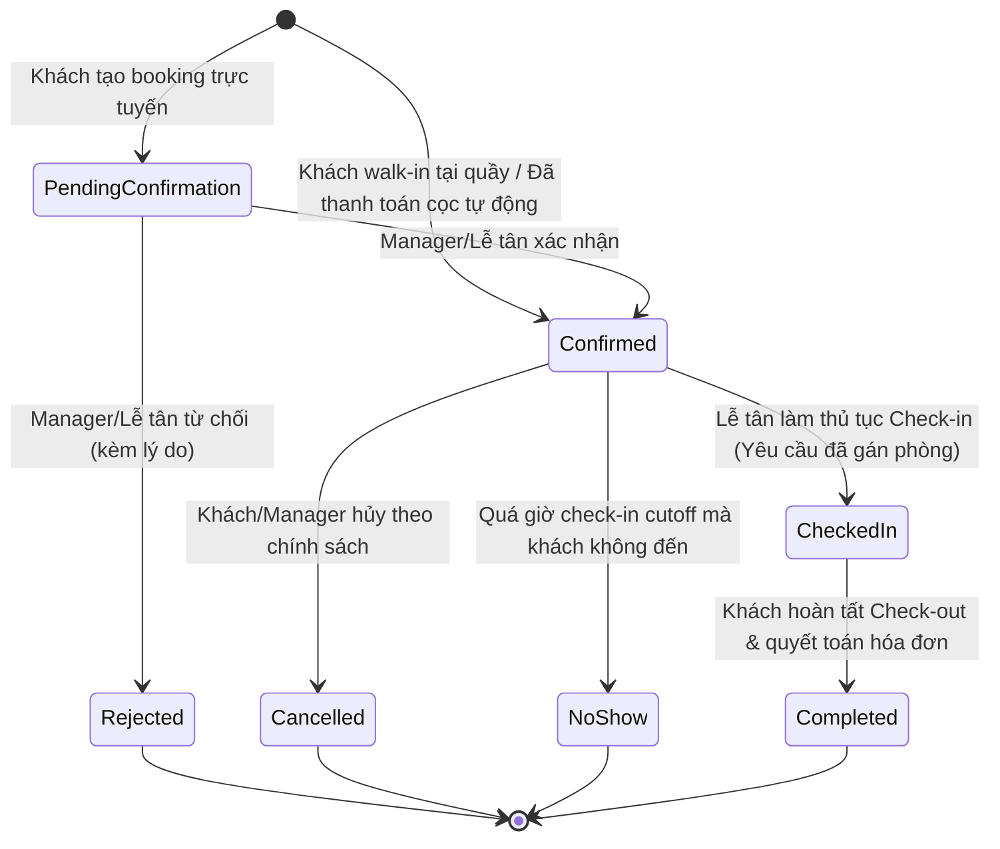
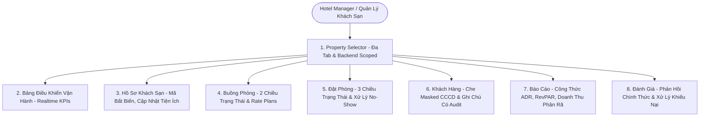

# Feature Specification: RM-008 - Thiết Kế Trang Quản Lý Cho Role Hotel Manager (Hotel Manager Operations & Property Console)

**Feature Branch**: `008-hotel-manager-management`  
**Created**: 2026-11-19  
**Status**: Draft (Updated based on Architecture Review 2026-11-19)  
**Input**: User description & Architecture Review:

- Tổng quan khách sạn & Bộ chọn cơ sở (Property Context được xác thực bắt buộc tại Backend, hỗ trợ nhiều tab).
- Quản lý thông tin khách sạn (Mã cơ sở bất biến, cập nhật mô tả, ảnh, tiện ích, giờ check-in/out chi nhánh).
- Quản lý buồng phòng (Tách biệt Trạng thái Vận hành và Trạng thái Vệ sinh, Loại phòng, Giá phòng đa tầng BasePrice/RatePlan/DailyRate, Sức chứa, Tiện nghi).
- Quản lý đặt phòng (Vòng đời Booking State Machine chuẩn hóa, tách biệt Payment & Room Assignment, xử lý No-Show giải phóng phòng theo ngày, theo dõi khách sắp đến và đang lưu trú).
- Quản lý khách hàng (Cô lập dữ liệu theo cơ sở, che CCCD/Passport, cấm sửa tài khoản người dùng, Ghi chú nội bộ có Audit Log).
- Báo cáo và phân tích (Công thức chuẩn Occupancy, ADR, RevPAR; phân tách Doanh thu phòng, Doanh thu dịch vụ và Tiền thực thu).
- Đánh giá và phản hồi (Điểm đánh giá chi tiết theo tiêu chí, Phản hồi chính thức của khách sạn, Luồng xử lý khiếu nại 3 bước).

---

## Clarifications

### Session 2026-11-19

- **Q1 (Thẩm quyền Quản lý Gói giá & RatePlan)**: Hotel Manager được phép tự tạo gói giá mới hay chỉ kế thừa danh mục chuẩn do Tenant Admin ban hành?
  - **Quyết định (Option A)**: Danh mục `RatePlan` chuẩn (ví dụ: _Room Only Standard Flexible_, _Non-Refundable Promo_, _Breakfast Included_) do **Tenant Admin** tạo lập và ban hành toàn chuỗi. **Hotel Manager** có quyền bật/tắt (Activate/Deactivate) các gói giá áp dụng tại cơ sở phụ trách, đồng thời toàn quyền cấu hình giá cơ bản (`BasePrice`) và thiết lập bảng ghi đè giá theo ngày (`DailyRateOverride` / `SeasonalRate`) cho từng loại phòng thuộc cơ sở. Hotel Manager không tự ý tạo thêm mã RatePlan nằm ngoài danh mục chuỗi để tránh phân mảnh báo cáo và chính sách thương hiệu.
- **Q2 (Quyết toán Tài chính khi Đánh dấu No-Show)**: Tiền phạt hoặc tiền cọc giữ lại khi khách không đến được xử lý cố định theo Tenant hay Manager được điều chỉnh?
  - **Quyết định (Option A)**: Hệ thống **tự động đề xuất mức phạt chuẩn** theo chính sách hủy/phạt của Tenant (Tenant Cancellation Policy). Tuy nhiên, **Hotel Manager được quyền điều chỉnh giảm phí phạt hoặc miễn phạt (0 VNĐ)** đối với các sự cố bất khả kháng (hoãn/hủy chuyến bay, bão lũ, lý do y tế...), với điều kiện **bắt buộc nhập lý do ngoại lệ (`WaivePenaltyReason`)** và toàn bộ thao tác được ghi vết kiểm toán minh bạch vào `AuditLog`. Tiền cọc thừa (nếu có) được tự động lập lệnh hoàn lại theo quy trình.
- **Q3 (Quy Trình Xử Lý Khiếu Nại, SLA 48h & Cơ Chế Leo Thang)**: Khiếu nại của khách hàng có áp dụng thời hạn cam kết xử lý (SLA) và leo thang lên Tenant Admin khi trễ hạn không?
  - **Quyết định (Option A)**: Thiết lập thời hạn cam kết xử lý **SLA chuẩn 48 giờ**. Vòng đời trạng thái khiếu nại bao gồm: `Open` $\rightarrow$ `InInvestigation` $\rightarrow$ `Resolved`, cùng trạng thái ngoại lệ `Escalated`. Nếu quá 48 giờ kể từ khi tiếp nhận mà khiếu nại chưa được giải quyết, hệ thống tự động gắn nhãn cảnh báo quá hạn (`Overdue SLA`) và gửi thông báo leo thang (`Escalated`) lên Tenant Admin để ban quản trị chuỗi kịp thời can thiệp bảo vệ uy tín thương hiệu.
- **Q4 (Thẩm Quyền Tạo Đặt Phòng Trực Tiếp - Direct / Corporate Booking)**: Hotel Manager có được phép tạo mới đơn đặt phòng trực tiếp trên console quản lý không?
  - **Quyết định (Option A)**: **Có**. Cấp quyền `Bookings.Create` cho Hotel Manager tại cơ sở phụ trách. Màn hình `/manager/bookings` hỗ trợ nút "Tạo Đặt Phòng Mới" (cho phép chọn hoặc tạo nhanh hồ sơ khách, chọn hạng phòng, áp dụng RatePlan hoặc giá thỏa thuận doanh nghiệp, nhập số tiền cọc ban đầu và ghi chú hợp đồng) để chủ động chốt khách đoàn, khách VIP và hợp đồng Corporate.
- **Q5 (Thẩm Quyền Đưa Phòng Vào Ngừng Kinh Doanh - OutOfService)**: Hotel Manager có toàn quyền chuyển phòng sang `OutOfService` không hay cần Tenant Admin phê duyệt?
  - **Quyết định (Option A)**: **Hotel Manager toàn quyền quyết định nhưng có ràng buộc kiểm soát chặt chẽ**: Bắt buộc nhập lý do chi tiết (`Reason`), ngày bắt đầu và ngày kết thúc dự kiến (`ExpectedEndDate`). Hệ thống **tuyệt đối chặn không cho phép** chuyển sang `OutOfService` nếu phòng đang có khách (`Occupied`) hoặc đã có booking được gán vào phòng đó (`Assigned`) trong khoảng ngày dự kiến đóng phòng. Toàn bộ thao tác được lưu vết kiểm toán (`AuditLog`) và tách riêng một mục thống kê thất thoát công suất trong báo cáo gửi Tenant Admin.

---

## 1. Quyết Định Kiến Trúc & Làm Rõ (Clarifications & Architectural Decisions)

### 1.1. Property Context — Xác Thực Bắt Buộc Tại Backend (Backend-Authoritative Property Scoping)

- **Vấn đề nhận diện**: Nếu chỉ lưu `HotelId` ở `PropertyContextService` hoặc `localStorage` trên Frontend, người dùng có thể can thiệp sửa đổi giá trị này hoặc truyền trực tiếp một `HotelId` khác vào URL/Payload nhằm truy cập dữ liệu cơ sở không thuộc quyền quản lý.
- **Quyết định kiến trúc chốt**:
  1. **Frontend Context**: `PropertyContextService` và URL Query Parameter (`?hotelId=...`) chỉ đóng vai trò lưu giữ lựa chọn trực quan của người dùng trên giao diện.
  2. **Backend Authoritative Verification**: 100% các API thuộc phân hệ Hotel Manager (`/api/app/manager/*`) bắt buộc đi qua bộ lọc ủy quyền trung tâm (`HotelManagerPropertyAuthorizationFilter` hoặc Interceptor):
     - Lấy `UserId` từ `CurrentUser.Id` và `TenantId` từ `CurrentTenant.Id`.
     - Kiểm tra trong bảng `UserHotelAssignment`: Nhân sự này PHẢI có bản ghi hoạt động (`IsActive == true` và `UnassignedAt == null`) liên kết với `HotelId` được yêu cầu.
     - Nếu không hợp lệ hoặc cố tình can thiệp: Backend lập tức trả về mã lỗi HTTP 403 Forbidden với mã lỗi `BookingHotel:CrossHotelOperationForbidden` và ghi nhận cảnh báo an ninh vào `SecurityLogs`.
  3. **Hành Vi Đa Tab (Multi-Tab Resilience)**:
     - Không sử dụng duy nhất một key toàn cục trong `localStorage` để quyết định ngữ cảnh API.
     - Định tuyến Angular gắn ngữ cảnh cơ sở vào URL State (hoặc `sessionStorage` riêng của từng tab), đảm bảo khi Manager mở tab 1 cho Khách sạn A và tab 2 cho Khách sạn B thì các thao tác trên hai tab hoàn toàn độc lập, không bị ghi đè ngữ cảnh chéo.

---

### 1.2. Trạng Thái Phòng — Tách Biệt Trạng Thái Khai Thác & Tình Trạng Vệ Sinh (Orthogonal Room States)

- **Vấn đề nhận diện**: Việc gộp trạng thái khai thác buồng phòng và tình trạng vệ sinh vào một trường duy nhất dẫn đến xung đột nghiệp vụ: Sau khi khách Check-out, phòng không còn khách nhưng vẫn chưa dọn sạch (`Dirty`), không thể xem là sẵn sàng bán (`Available`) ngay lập tức.
- **Quyết định kiến trúc chốt**: Hệ thống tách bạch buồng phòng thành 2 chiều trạng thái độc lập:

| Chiều Trạng Thái                                 | Các Giá Trị Chuẩn Hóa                                                                                                                                                                             | Ý Nghĩa Nghiệp Vụ                                                         | Thẩm Quyền Thay Đổi                                                                                                                                            |
| :----------------------------------------------- | :------------------------------------------------------------------------------------------------------------------------------------------------------------------------------------------------ | :------------------------------------------------------------------------ | :------------------------------------------------------------------------------------------------------------------------------------------------------------- |
| **Room Operational Status** (Khai thác vận hành) | • `Available` (Có thể khai thác) • `Occupied` (Đang có khách ở) • `Reserved` (Đã gán phòng cho booking) • `Maintenance` (Đang bảo trì / Sửa chữa) • `OutOfService` (Ngừng kinh doanh) | Xác định khả năng đưa phòng vào kế hoạch bán và vận hành kinh doanh.      | **Hotel Manager**: Toàn quyền cấu hình `Maintenance`, `OutOfService`, `Available`. **Receptionist**: Cập nhật qua luồng Check-in (`Occupied`) và Check-out. |
| **Housekeeping Status** (Tình trạng buồng phòng) | • `Clean` (Đã vệ sinh sạch) • `Dirty` (Chưa vệ sinh / Chờ dọn) • `Cleaning` (Đang tiến hành dọn) • `Inspected` (Đã kiểm tra chất lượng đạt chuẩn)                                        | Xác định mức độ sẵn sàng bàn giao chìa khóa cho khách nhận phòng thực tế. | **Housekeeping / Lễ tân**: Cập nhật trạng thái dọn. **Hotel Manager / Giám sát**: Cập nhật trạng thái `Inspected`.                                          |

- **Quy tắc sẵn sàng bán phòng (Sellable Room Rule)**:
  - Một phòng chỉ được phép bàn giao Check-in khi và chỉ khi:
    $$\text{Sellable} \iff (\text{OperationalStatus} == \text{Available}) \land (\text{HousekeepingStatus} \in \{\text{Clean}, \text{Inspected}\}) \land (\text{Không xung đột RoomAssignment})$$
- **Tính chất theo thời gian của Room Assignment**:
  - `Reserved` không phải là thuộc tính vật lý vĩnh viễn của căn phòng, mà là một **sự gắn kết theo khoảng thời gian** (`RoomAssignment` từ ngày $T_1$ đến $T_2$). Một phòng có thể đang `Occupied` hôm nay bởi khách X nhưng đã được `Reserved` cho khách Y từ ngày mai.
- **Quy tắc Kiểm soát Chuyển Ngừng Kinh Doanh (OutOfService & Maintenance Control)**:
  - Hotel Manager có toàn quyền chuyển phòng sang `OutOfService` hoặc `Maintenance` mà không cần duyệt trước nhằm giải quyết nhanh sự cố cơ sở hạ tầng.
  - Tuy nhiên, hệ thống **bắt buộc xác thực ràng buộc (Safety Guardrails)**:
    1. Yêu cầu nhập lý do (`Reason`) và ngày kết thúc dự kiến (`ExpectedEndDate`).
    2. Tự động kiểm tra xung đột: Từ chối chuyển nếu phòng đang `Occupied` hoặc có bất kỳ `RoomAssignment` nào trong khoảng thời gian đóng phòng.
    3. Ghi vết `AuditLog` và đưa vào báo cáo thất thoát công suất để Tenant Admin giám sát, ngăn chặn gian lận "làm đẹp" tỷ lệ lấp đầy.

---

### 1.3. Chuẩn Hóa Vòng Đời Đặt Phòng (Booking State Machine & Triple-State Separation)

- **Vấn đề nhận diện**: Cần tách bạch rõ ràng giữa Trạng thái Đơn hàng, Trạng thái Thanh toán và Trạng thái Phân bổ Buồng phòng để tránh hiểu nhầm nghiệp vụ (ví dụ: booking đã xác nhận nhưng chưa thanh toán cọc).
- **Quyết định kiến trúc chốt**: Tách độc lập 3 trường trạng thái trong thực thể `Booking`:

1. **BookingStatus (Trạng thái đặt phòng)**:
   - `PendingConfirmation`: Chờ khách sạn duyệt hoặc chờ cổng thanh toán báo kết quả cọc.
   - `Confirmed`: Đơn đã được xác nhận giữ chỗ chính thức.
   - `CheckedIn`: Khách đã đến nhận phòng và đang lưu trú tại khách sạn.
   - `Completed`: Khách đã trả phòng, quyết toán công nợ và hoàn tất kỳ nghỉ.
   - `Rejected`: Khách sạn từ chối tiếp nhận (trước khi xác nhận).
   - `Cancelled`: Đơn bị hủy sau khi đã xác nhận (tuân thủ chính sách hủy của chuỗi).
   - `NoShow`: Khách không đến nhận phòng sau giờ cutoff quy định.
2. **PaymentStatus (Trạng thái thanh toán)**:
   - `Unpaid`: Chưa thanh toán khoản nào.
   - `PartiallyPaid`: Đã thanh toán một phần (ví dụ đặt cọc 30% hoặc 50%).
   - `Paid`: Đã thanh toán đủ 100% chi phí tiền phòng.
   - `Refunded`: Đã hoàn tiền (toàn bộ hoặc một phần sau khi hủy phòng).
3. **RoomAssignmentStatus (Trạng thái phân phòng)**:
   - `Unassigned`: Đơn chỉ mới giữ chỗ theo Loại phòng (Room Type), chưa gán số phòng cụ thể.
   - `Assigned`: Đã gán số phòng thực tế (Room Number, ví dụ Phòng 302).

---

### 1.4. Xử Lý Khách Không Đến (No-Show) — Giải Phóng Phân Phòng Theo Khoảng Ngày

- **Vấn đề nhận diện**: Việc tự động gán thẳng `Room.OperationalStatus = Available` khi bấm No-Show có thể làm hỏng lịch trình nếu phòng đó đang có khách khác ở ngày hôm trước hoặc đã có booking khác gán vào ngày kế tiếp.
- **Quyết định kiến trúc chốt**:
  1. **Chỉ giải phóng bản ghi phân phòng (`RoomAssignment`)**: Khi Manager hoặc Lễ tân đánh dấu No-Show, hệ thống chỉ hủy liên kết giữa Booking này và căn phòng trong khoảng thời gian lưu trú của đơn đó (`UnassignRoomDateRange`).
  2. **Tính toán lại tồn kho**: Khả năng bán phòng trong các ngày tiếp theo được tính toán tự động dựa trên toàn bộ các `RoomAssignment` còn hiệu lực.
  3. **Tình trạng phòng**: Trạng thái khai thác và vệ sinh của phòng được giữ nguyên theo thực tế (nếu phòng chưa ai vào ở thì vẫn giữ `Clean`, không cần chuyển trạng thái cơ học).
  4. **Quyết toán tài chính No-Show**:
     - Mặc định hệ thống tự động tính mức phí phạt và khoản cọc giữ lại dựa trên chính sách hủy của Tenant (Tenant Cancellation Policy).
     - Cho phép Hotel Manager điều chỉnh số tiền phạt hoặc miễn phạt (0 VNĐ) trong các trường hợp bất khả kháng, bắt buộc cung cấp lý do (`WaivePenaltyReason`) và ghi nhận vào `AuditLog`.
     - Tự động tạo giao dịch quyết toán tài chính (`BillingTransaction`) và hoàn cọc thừa (`RefundTransaction`) nếu có chênh lệch.

---

### 1.5. Mô Hình Quản Lý Giá Phòng Linh Hoạt (Extensible Rate Management Model)

- **Vấn đề nhận diện**: Một khách sạn thực tế không thể chỉ vận hành với một giá cơ bản cố định trên `RoomType`. Giá phòng biến động theo gói giá (ăn sáng, hủy linh hoạt), ngày trong tuần, cuối tuần và mùa cao điểm. Đồng thời cần bảo đảm tính chuẩn hóa danh mục gói giá toàn chuỗi do Tenant quản lý.
- **Quyết định kiến trúc chốt**: Thiết lập cấu trúc dữ liệu bảng giá đa tầng:
  - **RatePlan Master Catalog (Cấp Tenant)**: Danh mục gói giá chuẩn do Tenant Admin ban hành (ví dụ: _Standard Flexible_, _Non-Refundable Promo_, _Breakfast Included_).
  - **Hotel RatePlan Activation & BasePrice (Cấp Cơ sở)**: Hotel Manager lựa chọn kích hoạt các gói giá áp dụng cho từng `RoomType` tại cơ sở và ấn định `BasePrice` tương ứng.
  - **DailyRateOverride & SeasonalRate (Cấp Cơ sở theo Ngày)**: Hotel Manager toàn quyền thiết lập bảng ghi đè giá theo ngày cụ thể (ngày lễ, Tết, cuối tuần thứ 6 - thứ 7) để tối ưu doanh thu (Revenue Management) theo thời gian thực.

---

### 1.6. Dữ Liệu Khách Hàng — Ranh Giới Bảo Mật & Kiểm Soát Ghi Chú Nội Bộ

- **Vấn đề nhận diện**: Cần định nghĩa chính xác từng trường dữ liệu khách hàng mà Hotel Manager được phép xem, đồng thời bảo vệ nghiêm ngặt các thông tin nhạy cảm của khách hàng trên nền tảng.
- **Quyết định kiến trúc chốt**:

| Trường Thông Tin Khách Hàng                   | Quyền Hạn Của Hotel Manager | Quy Định Chi Tiết & Bảo Mật                                                                                                                                                               |
| :-------------------------------------------- | :-------------------------: | :---------------------------------------------------------------------------------------------------------------------------------------------------------------------------------------- |
| **Họ và tên, Số điện thoại, Email liên hệ**   |        **Được xem**         | Chỉ xem đối với khách hàng đã phát sinh ít nhất 1 booking tại khách sạn do Manager phụ trách.                                                                                             |
| **Lịch sử lưu trú tại cơ sở**                 |        **Được xem**         | Chỉ xem lịch sử các lần ở tại chính khách sạn này (ngày đến, ngày đi, loại phòng, số tiền đã chi tiêu).                                                                                   |
| **Yêu cầu đặc biệt (Special Requests)**       |        **Được xem**         | Xem yêu cầu do khách nhập khi đặt phòng (tầng cao, không hút thuốc, giường phụ, lưu ý dị ứng).                                                                                            |
| **Giấy tờ tùy thân (CCCD / Passport)**        |   **Xem có che (Masked)**   | Chỉ hiển thị 4 số cuối (ví dụ: `***-***-1234`) phục vụ đối chiếu nhận phòng; không hiển thị toàn bộ số giấy tờ để bảo vệ quyền riêng tư cá nhân.                                          |
| **Mật khẩu, Token, Thông tin tài khoản Host** |      **TUYỆT ĐỐI CẤM**      | Mã hóa an toàn, không một API nào trả về các trường này.                                                                                                                                  |
| **Chỉnh sửa thông tin tài khoản Identity**    |      **TUYỆT ĐỐI CẤM**      | Manager không có quyền sửa đổi Email đăng nhập, SĐT tài khoản hay mật khẩu của khách hàng.                                                                                                |
| **Internal Guest Notes (Ghi chú nội bộ)**     |     **Tạo / Sửa / Xóa**     | Ghi nhận lưu ý chăm sóc khách VIP, thói quen ăn uống, lưu ý dị ứng nghiêm ngặt. **Bắt buộc lưu Audit Log** (người tạo, ngày tạo, lịch sử chỉnh sửa). **Cấm hiển thị ra Customer Portal**. |

---

### 1.7. Quy Tắc & Công Thức Tính Toán Chỉ Số Báo Cáo Chuẩn Quốc Tế

- **Định nghĩa tồn kho phòng sẵn có (Available Room Inventory)**:
  $$\text{Available Inventory} = \text{Tổng số phòng của khách sạn} - \text{Số phòng OutOfService}$$
  _(Lưu ý: Phòng đang bảo trì `Maintenance` tạm thời vẫn được tính trong Available Inventory của kỳ báo cáo theo chuẩn USALI, nhưng sẽ được ghi chú riêng trong báo cáo thất thoát công suất)._
- **Tỷ lệ lấp đầy phòng (Occupancy Rate)**:
  $$\text{Occupancy Rate (\%)} = \left(\frac{\text{Số phòng có khách thực tế (Occupied Rooms)}}{\text{Available Inventory}}\right) \times 100\%$$
- **Giá phòng bình quân ngày (ADR - Average Daily Rate)**:
  $$\text{ADR} = \frac{\text{Doanh thu tiền phòng thuần (Room Revenue)}}{\text{Số phòng bán được (Rooms Sold)}}$$
- **Doanh thu trên mỗi phòng sẵn có (RevPAR - Revenue Per Available Room)**:
  $$\text{RevPAR} = \frac{\text{Doanh thu tiền phòng thuần (Room Revenue)}}{\text{Available Inventory}} = \text{ADR} \times \text{Occupancy Rate}$$
- **Phân định rõ 5 loại dòng tiền trong báo cáo**:
  1. `RoomRevenue`: Doanh thu thuần từ tiền phòng lưu trú (đã trừ chiết khấu/voucher, chưa gồm VAT).
  2. `ServiceRevenue`: Doanh thu từ dịch vụ bổ sung (minibar, giặt là, spa, ẩm thực, xe đưa đón).
  3. `TotalBilledRevenue`: Tổng doanh thu ghi nhận trên hóa đơn $= \text{RoomRevenue} + \text{ServiceRevenue}$.
  4. `CollectedRevenue`: Tiền mặt/chuyển khoản thực thu qua cổng thanh toán hoặc quầy thu ngân.
  5. `RefundAmount`: Tổng số tiền đã hoàn trả cho khách do hủy phòng hoặc bồi thường sự cố.

---

## 2. Kịch Bản Người Dùng & Tiêu Chí Chấp Nhận (User Scenarios & Testing)

---

### User Story 1 - Chuyển Đổi Chi Nhánh & Bảng Điều Khiển Tổng Quan (Priority: P1)

Là Quản lý khách sạn (Hotel Manager), tôi muốn chuyển đổi giữa các khách sạn được phân công phụ trách thông qua bộ chọn trên Topbar với cơ chế xác thực an toàn từ Backend, và theo dõi bảng điều khiển vận hành với các chỉ số chuẩn xác (phòng trống/đã đặt/đang ở, tỷ lệ lấp đầy, doanh thu ngày/tuần/tháng, booking sắp đến, thống kê check-in/out) để điều hành cơ sở tức thời mà không lo bị nhầm lẫn dữ liệu giữa các tab làm việc.

**Why this priority**: Là cửa ngõ tác nghiệp chính của Quản lý; đảm bảo an toàn truy cập dữ liệu đa chi nhánh ngay từ tầng xác thực ngữ cảnh.

**Independent Test**:

1. Đăng nhập bằng tài khoản Hotel Manager được phân công quản lý `PLA-HCM-1` và `HS-VT-1`.
2. Mở Tab 1 chọn `PLA-HCM-1`; mở Tab 2 chọn `HS-VT-1`.
3. Kiểm tra Dashboard ở 2 tab hiển thị đúng dữ liệu của từng khách sạn riêng biệt, không bị đồng bộ đè lên nhau.
4. Dùng công cụ can thiệp request sửa `HotelId` thành một khách sạn C (không được phân công phụ trách): Backend lập tức chặn và trả về HTTP 403.
5. Kiểm tra các thẻ KPI: Tổng số phòng, phòng trống sẵn sàng bán (`Available` & `Clean`), phòng đang có khách (`Occupied`), phòng bảo trì (`Maintenance`).
6. Kiểm tra biểu đồ doanh thu theo Ngày, Tuần, Tháng được tính toán theo doanh thu thực thu.

**Acceptance Scenarios**:

1. **Chặn Can Thiệp Ngữ Cảnh Trái Phép**:
   - **Given** Hotel Manager chỉ được phân công quản lý khách sạn A và B.
   - **When** Gửi request API lấy dữ liệu Dashboard với `HotelId = C`.
   - **Then** Backend từ chối với HTTP 403 Forbidden, ghi log cảnh báo an ninh.
2. **Hiển Thị Tỷ Lệ Lấp Đầy & Tồn Kho Thực Tế**:
   - **Given** Khách sạn có 50 phòng, 5 phòng `OutOfService` dài hạn, 36 phòng đang có khách (`Occupied`).
   - **When** Dashboard tính toán tỷ lệ lấp đầy.
   - **Then** Tồn kho sẵn có là $50 - 5 = 45$ phòng; Tỷ lệ lấp đầy là $(36 / 45) \times 100\% = 80\%$.

---

### User Story 2 - Quản Lý Buồng Phòng, Loại Phòng & Gói Giá (Priority: P1)

Là Quản lý khách sạn (Hotel Manager), tôi muốn quản lý danh mục loại phòng (`RoomType`), danh sách phòng thực tế (`Room`), quản lý độc lập trạng thái vận hành và tình trạng vệ sinh, cùng việc cấu hình bảng giá đa tầng (BasePrice, RatePlan) để tối ưu công suất khai thác và ngăn chặn triệt để tình trạng bán phòng chưa dọn sạch hoặc đang bảo trì.

**Why this priority**: Cung cấp sản phẩm cốt lõi cho khách sạn; tách bạch trạng thái buồng phòng giúp bộ phận Lễ tân và Buồng phòng phối hợp nhịp nhàng, không xảy ra sự cố giao phòng bẩn cho khách.

**Independent Test**:

1. Vào phân hệ `/manager/rooms`, tạo Loại phòng "Executive Suite" kèm tiện ích và sức chứa.
2. Thiết lập `BasePrice` = 2.000.000 VNĐ; kích hoạt `RatePlan` chuẩn "Non-Refundable Promo" từ danh mục Tenant với giá 1.700.000 VNĐ và cấu hình `DailyRateOverride` tăng 20% cho dịp cuối tuần.
3. Tạo các phòng thực tế: 501, 502, 503.
4. Cập nhật phòng 501: `OperationalStatus = Available`, `HousekeepingStatus = Dirty`.
5. Thử gán Check-in cho khách vào phòng 501: Hệ thống cảnh báo phòng chưa dọn sạch và yêu cầu nhân viên xác nhận dọn phòng sang `Clean` trước khi bàn giao.
6. Chuyển phòng 502 sang `Maintenance` kèm lý do bảo trì: Hệ thống khóa không cho gán phòng trong khoảng ngày bảo trì.

**Acceptance Scenarios**:

1. **Quy Tắc Phòng Sẵn Sàng Bán (Sellable Condition)**:
   - **Given** Phòng 501 có `OperationalStatus == Available` nhưng `HousekeepingStatus == Dirty`.
   - **When** Lễ tân hoặc Manager kiểm tra danh sách phòng sẵn sàng đón khách.
   - **Then** Phòng 501 hiển thị nhãn "Chờ dọn dẹp", không được tự động đề xuất Check-in cho đến khi chuyển sang `Clean` hoặc `Inspected`.
2. **Khóa Phòng Bảo Trì An Toàn**:
   - **Given** Phòng 204 đang có khách lưu trú (`Occupied`).
   - **When** Manager cố gắng chuyển phòng 204 sang `Maintenance`.
   - **Then** Hệ thống từ chối và yêu cầu điều chuyển khách sang phòng khác trước.
3. **Kiểm Soát Chuyển Ngừng Kinh Doanh (OutOfService Guardrails)**:
   - **Given** Phòng 301 đã có một booking được gán phòng từ ngày 01/12 đến 03/12.
   - **When** Manager cố gắng chuyển phòng 301 sang `OutOfService` từ ngày 28/11 đến 05/12.
   - **Then** Hệ thống cảnh báo xung đột booking hiện có và từ chối chuyển trạng thái cho đến khi điều chuyển booking sang phòng khác.

---

### User Story 3 - Quản Lý Thông Tin Hồ Sơ Khách Sạn & Tiện Ích (Priority: P1)

Là Quản lý khách sạn (Hotel Manager), tôi muốn xem và cập nhật hồ sơ khách sạn phụ trách (mô tả, hotline, email lễ tân, tiện ích Amenities, hình ảnh, quy định lưu trú, giờ check-in/out chi nhánh) với mã Hotel Code được bảo vệ bất biến để thông tin cơ sở luôn chính xác và hấp dẫn khách hàng.

**Why this priority**: Giúp khách hàng nắm bắt đầy đủ tiện nghi và quy định của khách sạn; bảo vệ mã định danh cơ sở không bị can thiệp trái phép.

**Independent Test**:

1. Vào `/manager/hotel-profile`, quan sát Tên cơ sở và Mã Hotel Code: Cố định (Read-Only).
2. Cập nhật mô tả khách sạn, bổ sung tiện ích: Bể bơi bốn mùa, Đưa đón sân bay, Phòng họp VIP.
3. Tải lên 5 hình ảnh chất lượng cao về tiện ích và sảnh.
4. Điều chỉnh giờ Check-in tiêu chuẩn thành 14:00, Check-out thành 12:00.
5. Nhập quy định lưu trú nội bộ: "Cấm hút thuốc trong phòng, xuất trình giấy tờ tùy thân khi nhận phòng".
6. Lưu thành công và kiểm tra thông tin hiển thị trên trang thông tin khách sạn.

**Acceptance Scenarios**:

1. **Bảo Vệ Mã Cơ Sở Bất Biến**:
   - **Given** Manager đang ở màn hình cập nhật hồ sơ khách sạn.
   - **When** Kiểm tra trường `HotelCode`.
   - **Then** Trường bị vô hiệu hóa (`readonly`/`disabled`), không có nút chỉnh sửa.

---

### User Story 4 - Quản Lý & Điều Phối Đặt Phòng (Booking Operations) (Priority: P2)

Là Quản lý khách sạn (Hotel Manager), tôi muốn tạo mới đơn đặt phòng trực tiếp cho khách đoàn/doanh nghiệp, theo dõi danh sách đặt phòng với 3 trạng thái phân tách rõ ràng (BookingStatus, PaymentStatus, RoomAssignmentStatus), xác nhận/từ chối booking, và xử lý các trường hợp khách không đến (No-Show) bằng cách giải phóng phân phòng theo khoảng ngày lưu trú và ghi nhận phí phạt minh bạch.

**Why this priority**: Vận hành luồng đặt phòng chuẩn xác, chủ động kinh doanh tiếp nhận khách đoàn, theo dõi sát sao công nợ và tránh thất thoát doanh thu khi khách không đến.

**Independent Test**:

1. Vào `/manager/bookings`, bấm "Tạo Đặt Phòng Mới": Nhập thông tin khách doanh nghiệp, đặt 5 phòng Deluxe từ ngày 25/11 đến 28/11 kèm tiền cọc hợp đồng, lưu thành công đơn ở trạng thái `Confirmed`.
2. Tìm kiếm booking theo mã hoặc số điện thoại khách.
3. Mở chi tiết booking: Quan sát 3 trạng thái độc lập (ví dụ: `Confirmed` / `PartiallyPaid` / `Assigned`).
4. Xác nhận đơn đặt phòng mới đang chờ duyệt.
5. Với đơn đặt phòng quá giờ check-in cutoff mà khách không đến: Bấm **"Xác nhận Khách không đến (No-Show)"**.
6. Xác nhận hệ thống chuyển trạng thái booking sang `NoShow`, chỉ hủy bản ghi gán phòng cho khoảng ngày của đơn này, phòng quay lại trạng thái tính toán sẵn sàng bán cho các booking tiếp theo, ghi nhận phí phạt và lưu log kiểm toán.

**Acceptance Scenarios**:

1. **Xử Lý No-Show Giải Phóng Phòng Chính Xác**:
   - **Given** Booking BK-01 đặt phòng 305 từ ngày 20/11 đến 22/11; ngày 23/11 phòng 305 đã có booking BK-02 đặt trước.
   - **When** Manager đánh dấu BK-01 là `NoShow` vào tối 20/11.
   - **Then** Bản ghi phân phòng của BK-01 được hủy; phòng 305 mở lại tồn kho bán cho đêm 20/11 và 21/11; booking BK-02 ngày 23/11 vẫn giữ nguyên vẹn.
2. **Điều Chỉnh Phí Phạt No-Show Kèm Audit**:
   - **Given** Khách hàng có booking cọc 1.000.000 VNĐ, gặp bão hủy chuyến bay không thể đến nhận phòng.
   - **When** Manager chọn No-Show, kích hoạt tùy chọn điều chỉnh miễn phạt (0 VNĐ) và nhập lý do "Chuyến bay VN123 hủy do bão".
   - **Then** Hệ thống giải phóng phòng, áp mức phạt 0 VNĐ, lập lệnh hoàn 1.000.000 VNĐ cho khách, đồng thời ghi nhận lý do và `UserId` của Manager vào `AuditLog`.

---

### User Story 5 - Quản Lý Khách Hàng Lưu Trú Cơ Sở & Ghi Chú Có Audit (Priority: P2)

Là Quản lý khách sạn (Hotel Manager), tôi muốn xem danh sách khách hàng đã từng đặt phòng và lưu trú tại khách sạn của mình, xem lịch sử các lần ở, yêu cầu đặc biệt và tạo ghi chú nội bộ được lưu vết kiểm toán, đồng thời được bảo đảm không xem thông tin cá nhân của khách ngoài cơ sở phụ trách.

**Why this priority**: Nâng cao chất lượng phục vụ khách quen và khách VIP; bảo vệ tối đa dữ liệu riêng tư của khách hàng theo quy định an toàn thông tin.

**Independent Test**:

1. Vào `/manager/guests`, xem danh sách khách hàng: Chỉ xuất hiện những khách từng phát sinh booking tại khách sạn này.
2. Chọn khách hàng: Số CCCD/Passport hiển thị dưới dạng che bảo mật (`***-***-5678`).
3. Xem yêu cầu đặc biệt: "Khách ăn chay, yêu cầu chuẩn bị bữa sáng thuần chay".
4. Thêm ghi chú nội bộ: "Khách thân thiết của chuỗi, hỗ trợ nhận phòng sớm nếu phòng sẵn sàng".
5. Xác nhận ghi chú được lưu kèm thông tin người tạo (`CurrentUser.UserName`) và thời gian tạo; khách hàng không nhìn thấy ghi chú này khi đăng nhập.
6. Thử tìm kiếm khách hàng chỉ ở khách sạn khác: Hệ thống không trả về kết quả.

**Acceptance Scenarios**:

1. **Che Bảo Mật Thông Tin Định Danh Nhạy Cảm**:
   - **Given** Manager xem hồ sơ chi tiết của khách hàng tại màn hình `/manager/guests`.
   - **When** Quan sát trường số CCCD/Hộ chiếu.
   - **Then** Hệ thống chỉ hiển thị 4 số cuối dạng `***-***-XXXX`, ngăn chặn rủi ro lộ lọt thông tin cá nhân.

---

### User Story 6 - Báo Cáo Hiệu Suất & Phân Tích Doanh Thu Chi Nhánh (Priority: P3)

Là Quản lý khách sạn (Hotel Manager), tôi muốn xem các báo cáo phân tích hiệu suất chuyên sâu với công thức chuẩn quốc tế (Occupancy Rate, ADR, RevPAR, phân rã doanh thu phòng và doanh thu dịch vụ, tỷ lệ hủy phòng và no-show) được lọc chính xác theo cơ sở để đánh giá kết quả kinh doanh định kỳ.

**Why this priority**: Cung cấp bức tranh tài chính và vận hành định lượng, hỗ trợ quản lý điều chỉnh chiến lược giá và báo cáo Tenant Admin.

**Independent Test**:

1. Vào `/manager/reports`, chọn khoảng thời gian "Tháng trước".
2. Xem bảng phân rã doanh thu: Hiển thị riêng biệt Doanh thu phòng (`RoomRevenue`), Doanh thu dịch vụ (`ServiceRevenue`), và Tiền thực thu (`CollectedRevenue`).
3. Kiểm tra chỉ số ADR và RevPAR được tính toán khớp 100% với công thức chuẩn.
4. Xem tỷ lệ hủy phòng và tỷ lệ khách không đến (No-Show).
5. Xuất báo cáo ra định dạng Excel và kiểm tra số liệu khớp với màn hình hiển thị.

**Acceptance Scenarios**:

1. **Phân Rã Doanh Thu Rõ Ràng**:
   - **Given** Trong kỳ có đơn booking tiền phòng 10.000.000 VNĐ, tiền minibar 1.500.000 VNĐ, khách đã thanh toán cọc 5.000.000 VNĐ.
   - **When** Xem báo cáo tài chính.
   - **Then** Báo cáo ghi nhận đúng: `RoomRevenue` = 10.000.000 VNĐ, `ServiceRevenue` = 1.500.000 VNĐ, `CollectedRevenue` = 5.000.000 VNĐ.

---

### User Story 7 - Đánh Giá & Xử Lý Khiếu Nại Của Khách Hàng (Priority: P3)

Là Quản lý khách sạn (Hotel Manager), tôi muốn xem danh sách các đánh giá của khách hàng, theo dõi điểm đánh giá trung bình theo từng tiêu chí, gửi phản hồi chính thức của khách sạn và theo dõi tiến độ xử lý khiếu nại (Open $\rightarrow$ InInvestigation $\rightarrow$ Resolved, kèm Escalated khi trễ SLA 48h) để nâng cao chất lượng phục vụ và uy tín thương hiệu.

**Why this priority**: Giải quyết khiếu nại kịp thời theo cam kết thời gian và phản hồi chuyên nghiệp là yếu tố then chốt duy trì sự hài lòng của khách hàng và uy tín toàn chuỗi.

**Independent Test**:

1. Vào `/manager/reviews`, xem điểm đánh giá trung bình tổng thể và theo 4 tiêu chí: Vệ sinh, Thái độ nhân viên, Tiện nghi, Vị trí.
2. Chọn một đánh giá có nội dung phản ánh về tiếng ồn.
3. Cập nhật luồng xử lý sang "Đang xác minh (InInvestigation)", giao bộ phận bảo dưỡng kiểm tra cách âm.
4. Nhập phản hồi chính thức của khách sạn và bấm "Đăng phản hồi".
5. Kiểm tra phản hồi hiển thị công khai kèm nhãn "Đại diện Quản lý Khách sạn".
6. Giả lập một khiếu nại ở trạng thái `InInvestigation` quá 48 giờ: Kiểm tra hệ thống tự động gắn nhãn cảnh báo `Overdue SLA` và gửi thông báo `Escalated` lên Tenant Admin.

**Acceptance Scenarios**:

1. **Theo Dõi Tiến Độ Xử Lý Khiếu Nại**:
   - **Given** Có khiếu nại phát sinh từ khách hàng.
   - **When** Manager cập nhật trạng thái từ `Open` sang `Resolved` kèm ghi chú kết quả xử lý.
   - **Then** Hệ thống ghi nhận lịch sử thời gian và nhân sự xử lý, cập nhật trạng thái khiếu nại thành công.
2. **Cảnh Báo Quá Hạn SLA & Leo Thang Lên Tenant Admin**:
   - **Given** Một khiếu nại ở trạng thái `Open` hoặc `InInvestigation` đã tồn tại hơn 48 giờ mà chưa chuyển `Resolved`.
   - **When** Hệ thống chạy tác vụ kiểm tra SLA định kỳ.
   - **Then** Khiếu nại được gắn cờ đỏ `Overdue SLA`, chuyển trạng thái `Escalated`, và gửi thông báo cảnh báo đến Tenant Admin.

---

## 3. Yêu Cầu Chức Năng (Functional Requirements)

### Phân Hệ 1: Xác Thực Ngữ Cảnh Cơ Sở & Dashboard

- **FR-001**: Hệ thống PHẢI cung cấp bộ chọn chi nhánh (**Property Selector**) trên Topbar, tự động tải danh sách khách sạn mà người dùng được phân công làm quản lý trong `UserHotelAssignment` (`IsActive == true`).
- **FR-002**: Backend BẮT BUỘC xác thực quyền quản lý của `CurrentUser.Id` đối với `HotelId` được gửi lên trong mọi API tác nghiệp; từ chối với HTTP 403 Forbidden nếu không có quyền phân công hợp lệ.
- **FR-003**: Ngữ cảnh cơ sở PHẢI hỗ trợ làm việc đa tab độc lập thông qua URL state hoặc session context, không để tab này ghi đè ngữ cảnh của tab kia.
- **FR-004**: Dashboard PHẢI hiển thị các chỉ số thời gian thực: Tổng số phòng, phòng trống sẵn sàng bán (`Available` & `Clean`), phòng đang có khách (`Occupied`), phòng đã đặt (`Reserved`), phòng bảo trì (`Maintenance`), phòng ngừng kinh doanh (`OutOfService`).
- **FR-005**: Dashboard PHẢI hiển thị Tỷ lệ lấp đầy (Occupancy Rate) được tính trên tổng số phòng sẵn có (loại trừ `OutOfService`).
- **FR-006**: Dashboard PHẢI hiển thị danh sách các booking sắp đến nhận phòng trong ngày (Today Arrivals) và các công việc cần xử lý gấp (Action Items).

### Phân Hệ 2: Quản Lý Buồng Phòng & Bảng Giá Đa Tầng

- **FR-007**: Hệ thống PHẢI tách biệt 2 chiều trạng thái phòng:
  - `RoomOperationalStatus`: `Available`, `Occupied`, `Reserved`, `Maintenance`, `OutOfService`.
  - `HousekeepingStatus`: `Clean`, `Dirty`, `Cleaning`, `Inspected`.
- **FR-008**: Hệ thống BẮT BUỘC chỉ cho phép bàn giao phòng Check-in khi phòng thỏa mãn: `OperationalStatus == Available` VÀ `HousekeepingStatus` là `Clean` hoặc `Inspected`.
- **FR-009**: Hotel Manager ĐƯỢC PHÉP quản lý Loại phòng (`RoomType`): Tên, diện tích, sức chứa chuẩn & tối đa, tiện nghi đi kèm, `BasePrice`.
- **FR-010**: Hotel Manager ĐƯỢC PHÉP cấu hình áp dụng các gói giá (`RatePlan`) từ danh mục chuẩn do Tenant ban hành (bật/tắt gói, thiết lập `BasePrice` theo loại phòng và thiết lập ghi đè giá theo ngày `DailyRateOverride`). Hotel Manager KHÔNG tự ý tạo thêm mã RatePlan mới ngoài danh mục chuỗi.
- **FR-011**: Hotel Manager ĐƯỢC PHÉP quản lý danh sách phòng thực tế (`Room`): Số phòng, tầng, loại phòng.
- **FR-012**: Chuyển phòng sang `Maintenance` hoặc `OutOfService`:
  - Hotel Manager có toàn quyền chuyển trạng thái tại cơ sở phụ trách mà không cần duyệt trước.
  - BẮT BUỘC nhập lý do chi tiết (`Reason`) và ngày kết thúc dự kiến (`ExpectedEndDate`).
  - Hệ thống BẮT BUỘC kiểm tra xung đột: Tuyệt đối chặn không cho phép nếu phòng đang `Occupied` hoặc có bất kỳ `RoomAssignment` nào trong khoảng thời gian đóng phòng.
  - Thao tác BẮT BUỘC lưu vết `AuditLog` và được tổng hợp vào mục thất thoát công suất trong báo cáo gửi Tenant Admin.

### Phân Hệ 3: Quản Lý Hồ Sơ Khách Sạn

- **FR-013**: Mã cơ sở (`HotelCode`) và Tên cơ sở gốc BẮT BUỘC ở trạng thái chỉ đọc (Read-Only) đối với Hotel Manager.
- **FR-014**: Hotel Manager ĐƯỢC PHÉP cập nhật: Hotline, email lễ tân, mô tả giới thiệu, hình ảnh tiện ích, danh mục tiện ích (Amenities), quy định lưu trú nội bộ (House Rules), và giờ Check-in/Check-out của cơ sở.

### Phân Hệ 4: Quản Lý Đặt Phòng & Xử Lý No-Show

- **FR-015**: Đơn đặt phòng PHẢI quản lý tách biệt 3 trường trạng thái:
  - `BookingStatus`: `PendingConfirmation`, `Confirmed`, `CheckedIn`, `Completed`, `Rejected`, `Cancelled`, `NoShow`.
  - `PaymentStatus`: `Unpaid`, `PartiallyPaid`, `Paid`, `Refunded`.
  - `RoomAssignmentStatus`: `Unassigned`, `Assigned`.
- **FR-016**: Hotel Manager ĐƯỢC PHÉP tạo đơn đặt phòng trực tiếp (`Direct Booking`) tại cơ sở phụ trách, xác nhận (`Confirm`), từ chối (`Reject` kèm lý do), hoặc hủy booking theo chính sách chuỗi.
- **FR-017**: Thao tác **"Đánh dấu Khách không đến (No-Show)"**:
  - BẮT BUỘC chỉ hủy liên kết `RoomAssignment` của booking đó theo khoảng thời gian lưu trú; tính toán lại khả năng bán phòng theo lịch thực tế, không tự động chuyển trạng thái phòng vật lý cơ học.
  - Hệ thống tự động áp mức phạt chuẩn theo chính sách của Tenant, đồng thời CHO PHÉP Hotel Manager điều chỉnh giảm/miễn phạt (kèm lý do `WaivePenaltyReason` bắt buộc) và ghi vết `AuditLog`.
- **FR-018**: Màn hình đặt phòng PHẢI hỗ trợ tìm kiếm đa tiêu chí (mã đơn, họ tên, số điện thoại, ngày nhận phòng).

### Phân Hệ 5: Quản Lý Khách Hàng Cơ Sở & Ghi Chú Có Audit

- **FR-019**: Hotel Manager CHỈ ĐƯỢC XEM danh sách khách hàng đã từng phát sinh booking tại cơ sở khách sạn phụ trách; cấm tuyệt đối truy xuất danh sách khách toàn sàn hoặc khách của cơ sở khác.
- **FR-020**: Giấy tờ tùy thân (CCCD / Passport) BẮT BUỘC che bảo mật (`***-***-XXXX`), chỉ hiển thị 4 số cuối.
- **FR-021**: Hotel Manager ĐƯỢC PHÉP tạo, chỉnh sửa Ghi chú nội bộ (`InternalGuestNotes`); ghi chú này chỉ lưu hành nội bộ và BẮT BUỘC lưu log kiểm toán người tạo và lịch sử sửa đổi.
- **FR-022**: Hotel Manager TUYỆT ĐỐI KHÔNG ĐƯỢC chỉnh sửa thông tin tài khoản đăng nhập (email, SĐT gốc, mật khẩu) của khách hàng.

### Phân Hệ 6: Báo Cáo Hiệu Suất Chuẩn Hóa

- **FR-023**: Hệ thống PHẢI tính toán các chỉ số hiệu suất theo chuẩn quốc tế:
  - Tỷ lệ lấp đầy: $\text{Occupancy Rate} = (\text{Phòng có khách} / \text{Available Inventory}) \times 100\%$.
  - Giá bình quân ngày: $\text{ADR} = \text{Doanh thu phòng thuần} / \text{Số phòng bán được}$.
  - Doanh thu trên mỗi phòng sẵn có: $\text{RevPAR} = \text{Doanh thu phòng thuần} / \text{Available Inventory}$.
- **FR-024**: Báo cáo tài chính PHẢI phân rã độc lập: Doanh thu tiền phòng (`RoomRevenue`), Doanh thu dịch vụ phụ trợ (`ServiceRevenue`), và Tiền thực thu (`CollectedRevenue`).
- **FR-025**: Toàn bộ báo cáo PHẢI được lọc nghiêm ngặt theo `HotelId` của cơ sở đang chọn.

### Phân Hệ 7: Đánh Giá & Xử Lý Khiếu Nại

- **FR-026**: Hotel Manager ĐƯỢC PHÉP xem danh sách đánh giá của khách hàng và điểm trung bình theo từng tiêu chí (vệ sinh, tiện nghi, vị trí, thái độ phục vụ).
- **FR-027**: Hotel Manager ĐƯỢC PHÉP đăng **Phản hồi chính thức của khách sạn** cho từng đánh giá.
- **FR-028**: Hệ thống PHẢI hỗ trợ luồng theo dõi khiếu nại với 4 trạng thái: `Open` $\rightarrow$ `InInvestigation` $\rightarrow$ `Resolved`, kèm trạng thái `Escalated` (Leo thang lên Tenant Admin). Áp dụng SLA xử lý chuẩn 48 giờ; tự động gắn cờ cảnh báo quá hạn `Overdue SLA` và gửi thông báo cho Tenant Admin khi khiếu nại chưa được giải quyết trong thời hạn cam kết.

---

## 4. Yêu Cầu Phi Chức Năng & Hiệu Năng Mục Tiêu (Non-Functional Requirements)

- **NFR-001 (Concept Giao Diện & Trực Quan)**:
  - Áp dụng Concept _Operational Manager Console_: Sidebar Đen sâu (`#000000`), Điểm nhấn Cyan (`#00FFFF`), Nền Trắng (`#FFFFFF`), Huy hiệu vai trò Xanh dương (`#2563EB`).
  - Độ tương phản chữ/nền đạt chuẩn WCAG 2.1 AA ($\ge 4.5:1$).
- **NFR-002 (Mục Tiêu Hiệu Năng Thực Tế - P95 Latency)**:
  - Bảng điều khiển (Dashboard): Thời gian phản hồi **P95 < 2.0 giây**.
  - Danh sách buồng phòng: Thời gian phản hồi **P95 < 1.5 giây**.
  - Danh sách đặt phòng (Booking List): Thời gian phản hồi **P95 < 2.0 giây**.
  - Cập nhật trạng thái phòng / Thao tác tác nghiệp: Thời gian phản hồi **P95 < 1.0 giây**.
- **NFR-003 (Kiểm Thử An Toàn & Đồng Thời - Concurrency & Boundary Testing)**:
  - Kiểm thử ngăn chặn truy cập chéo cơ sở: Giả lập can thiệp `HotelId` trái phép trên request API.
  - Kiểm thử đồng thời (Concurrency): Hai người dùng cùng lúc gán phòng hoặc đặt phòng trên cùng một phòng trong cùng khoảng thời gian $\rightarrow$ Hệ thống bắt buộc sử dụng khóa lạc quan (`ConcurrencyStamp`) hoặc cơ chế khóa hàng để ngăn chặn Overbooking.
  - Kiểm thử No-Show và hoàn tiền cọc theo đúng chính sách.
- **NFR-004 (Đa Ngôn Ngữ Song Ngữ Toàn Diện)**:
  - 100% các nhãn form, trạng thái phòng, trạng thái booking, thông báo toastr khai báo song ngữ tại `vi.json` và `en.json` với tiền tố `Manager:*`.

---

## 5. Ranh Giới Bất Khả Xâm Phạm & Kiểm Soát Quyền Hạn (Anti-Tampering)

1. **Tuyệt Đối Không Can Thiệp Quản Trị Hệ Thống & Quản Trị Tenant**:
   - Hotel Manager HOÀN TOÀN KHÔNG CÓ quyền tạo, sửa, xóa, khóa/mở khóa tài khoản nhân sự (`IdentityUser`), không có quyền phân quyền vai trò (`IdentityRole`), không can thiệp cấu hình Tenant hay Platform Host. Mọi truy cập trái phép đều nhận HTTP 403 Forbidden.
2. **Cô Lập Tuyệt Đối Dữ Liệu Khách Hàng & Doanh Thu Chéo Cơ Sở**:
   - Dù cùng thuộc một Tenant chuỗi, Manager KHÔNG THỂ xem danh sách khách hàng, phòng hay doanh thu của các khách sạn khác không nằm trong danh sách phân công phụ trách của mình.
3. **Phân Định Rõ Ràng Giữa Giám Sát Và Tác Nghiệp Quầy Lễ Tân**:
   - Hotel Manager điều hành chính sách, giá phòng, duyệt ngoại lệ và xử lý booking. Thao tác Check-in / Check-out thực tế và sơ đồ Room Rack thời gian thực thuộc nghiệp vụ của Lễ tân quầy. Nếu Manager muốn tác nghiệp quầy, bắt buộc phải có thêm vai trò kiêm nhiệm `Receptionist`.

---

## 6. Ma Trận Quyền Hạn Chi Tiết (Detailed Permissions Matrix)

| Chức Năng / Nghiệp Vụ                          | Mã Quyền (`BookingHotelPermissions`)          |      Hotel Manager      |     Receptionist      |    Tenant Admin     |
| :--------------------------------------------- | :-------------------------------------------- | :---------------------: | :-------------------: | :-----------------: |
| **Xem & Cập nhật Hồ sơ Khách sạn**             | `Hotels.Default`, `Hotels.Edit`               |     ✅ (Cơ sở mình)     |     ❌ (Chỉ xem)      |   ✅ (Toàn chuỗi)   |
| **Quản lý Hạng phòng (RoomType)**              | `Rooms.Default`, `Rooms.Create`, `Rooms.Edit` |     ✅ (Cơ sở mình)     |          ❌           |   ✅ (Toàn chuỗi)   |
| **Quản lý Phòng thực tế (Rooms)**              | `Rooms.Create`, `Rooms.Edit`                  |     ✅ (Cơ sở mình)     |          ❌           |   ✅ (Toàn chuỗi)   |
| **Quản lý Gói giá & Giá ngày (Rates)**         | `Rooms.SetRates`                              |     ✅ (Cơ sở mình)     |          ❌           |   ✅ (Toàn chuỗi)   |
| **Đổi trạng thái Khai thác (Maintenance/OOS)** | `Rooms.ChangeStatus`                          |     ✅ (Cơ sở mình)     |          ❌           |   ✅ (Toàn chuỗi)   |
| **Cập nhật trạng thái Vệ sinh (Housekeeping)** | `Rooms.UpdateHousekeeping`                    | ✅ (Giám sát/Inspected) |   ✅ (Clean/Dirty)    |   ✅ (Toàn chuỗi)   |
| **Tạo mới Đặt phòng trực tiếp (Direct Booking)** | `Bookings.Create`                            |     ✅ (Cơ sở mình)     |          ✅           |   ✅ (Toàn chuỗi)   |
| **Xác nhận / Từ chối Booking**                 | `Bookings.Confirm`, `Bookings.Reject`         |     ✅ (Cơ sở mình)     |     ✅ (Theo ca)      |    ✅ (Giám sát)    |
| **Đánh dấu No-Show**                           | `Bookings.MarkNoShow`                         |     ✅ (Cơ sở mình)     |     ✅ (Theo ca)      |   ✅ (Toàn chuỗi)   |
| **Thực hiện Check-in / Check-out tại quầy**    | `Bookings.CheckIn`, `Bookings.CheckOut`       |   ❌ (Cần kiêm nhiệm)   |          ✅           | ❌ (Cần kiêm nhiệm) |
| **Gán phòng thực tế (Room Assignment)**        | `Bookings.AssignRoom`                         | ✅ (Giám sát/Điều phối) | ✅ (Tác nghiệp quầy)  |   ✅ (Toàn chuỗi)   |
| **Xem thông tin khách hàng cơ sở**             | `Guests.Default`                              |  ✅ (Khách cơ sở mình)  | ✅ (Khách cơ sở mình) |   ✅ (Toàn chuỗi)   |
| **Quản lý Ghi chú nội bộ khách hàng**          | `Guests.ManageNotes`                          |    ✅ (Tạo/Sửa/Xóa)     |  ✅ (Xem / Tạo mới)   |   ✅ (Toàn chuỗi)   |
| **Báo cáo Hiệu suất Chi nhánh (ADR/RevPAR)**   | `Reports.HotelPerformance`                    |     ✅ (Cơ sở mình)     |          ❌           |   ✅ (Toàn chuỗi)   |
| **Báo cáo Hợp nhất Chuỗi**                     | `Reports.Consolidated`                        |           ❌            |          ❌           |         ✅          |
| **Phản hồi Đánh giá & Xử lý Khiếu nại**        | `Reviews.Reply`, `Reviews.ManageComplaints`   |     ✅ (Cơ sở mình)     |     ❌ (Chỉ xem)      |   ✅ (Toàn chuỗi)   |
| **Quản lý Tài khoản & Phân quyền Identity**    | `Identity.Users.*`, `Hotels.AssignStaff`      |           ❌            |          ❌           |         ✅          |

---

## 7. Tiêu Chí Thành Công & Đo Lường (Success Criteria)

- **SC-001**: **100%** các request API thuộc phân hệ Hotel Manager được xác thực `UserHotelAssignment` tại Backend; ngăn chặn 100% các hành vi can thiệp trái phép `HotelId`.
- **SC-002**: Hệ thống tách bạch hoàn toàn 2 chiều trạng thái phòng (`OperationalStatus` và `HousekeepingStatus`) với cơ chế an toàn ngăn chặn bán phòng bẩn hoặc đang bảo trì đạt độ chính xác **100%**.
- **SC-003**: Vòng đời Booking chuẩn hóa 3 chiều (`BookingStatus`, `PaymentStatus`, `RoomAssignmentStatus`); thao tác No-Show giải phóng phòng theo khoảng thời gian lưu trú và tính phạt chính xác theo cấu hình.
- **SC-004**: Bảo vệ dữ liệu khách hàng: Che bảo mật CCCD (`***-***-XXXX`), cấm sửa tài khoản Identity, ghi chú nội bộ có Audit Log đạt chuẩn an toàn thông tin **100%**.
- **SC-005**: Toàn bộ báo cáo hiệu suất (Occupancy, ADR, RevPAR) tính toán đúng theo công thức chuẩn quốc tế và phân rã minh bạch dòng tiền phòng và dịch vụ.
- **SC-006**: Đạt chỉ tiêu hiệu năng P95 trên môi trường kiểm thử (Dashboard < 2s, Danh sách < 2s, Tác nghiệp < 1s) và Pass **100%** các bài kiểm thử tự động.
