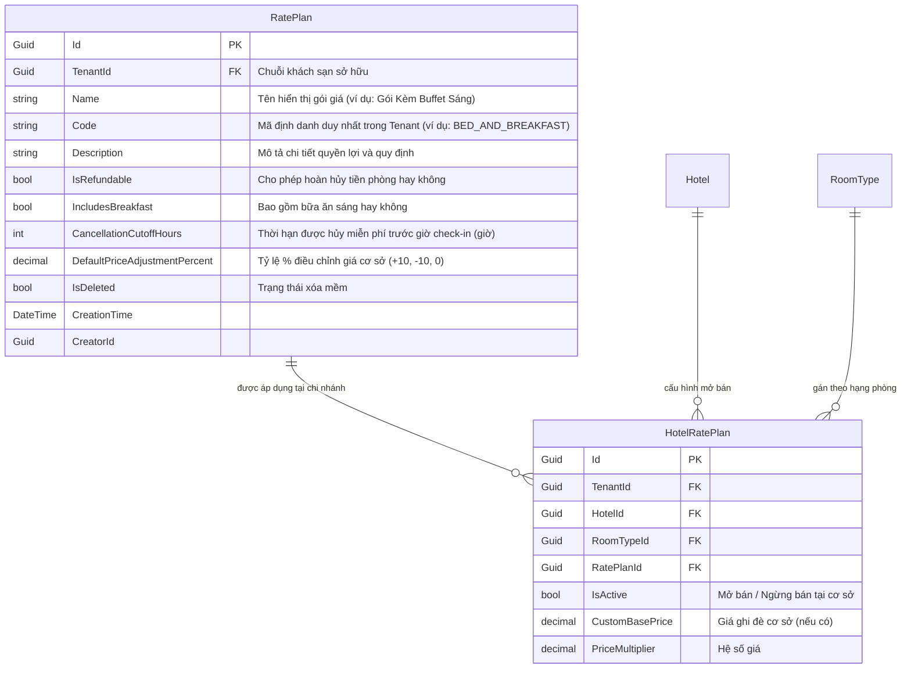

# Phase 1 Data Model: Quản Lý Gói Giá Chuỗi (RM-009)

## 1. Entity: `RatePlan` (Bảng `AppRatePlans`)

## 2. Validation & Business Rules
1. **Mã gói (`Code`)**:
   - Bắt buộc (`[Required]`), tối đa 32 ký tự.
   - Định dạng: Chữ in hoa, số, dấu gạch dưới (tự động `.ToUpper().Trim()`).
   - Duy nhất (`Unique`) trong phạm vi Tenant (`CurrentTenant.Id`).
2. **Tên gói (`Name`)**:
   - Bắt buộc (`[Required]`), tối đa 128 ký tự.
3. **Chính sách hoàn hủy (`IsRefundable`, `CancellationCutoffHours`)**:
   - Nếu `IsRefundable == false`, `CancellationCutoffHours` mặc định = 0.
   - Nếu `IsRefundable == true`, `CancellationCutoffHours` phải $\ge 0$.
4. **Tỷ lệ điều chỉnh giá (`DefaultPriceAdjustmentPercent`)**:
   - Giá trị thuộc khoảng: $-99.00 \le x \le 500.00$.
5. **Soft Delete Policy**:
   - Khi xóa, cập nhật `IsDeleted = true`.
   - Cập nhật toàn bộ các bản ghi `HotelRatePlan` tương ứng sang `IsActive = false`.
