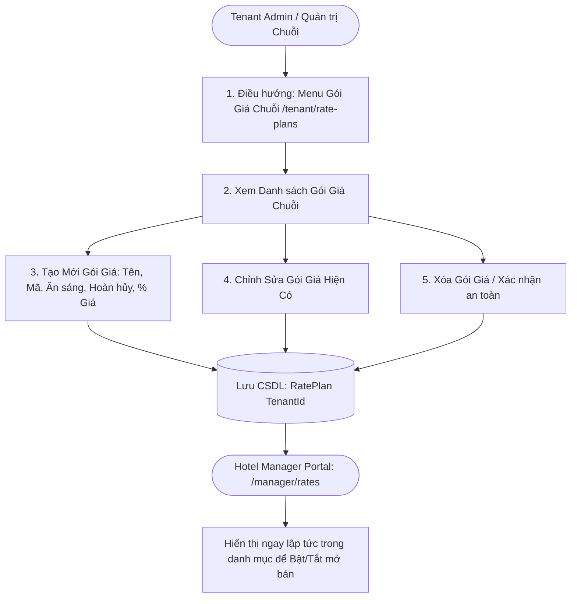

# Feature Specification: RM-007 - Quản Lý Gói Giá Chuỗi Cho Admin Tenant (Tenant Master Rate Plans Management)

**Feature Branch**: `009-tenant-rate-plan-management`  
**Created**: 2026-11-20  
**Status**: Draft  
**Input**: User request: "RM-007 Xây dựng trang "Quản lý Gói Giá Chuỗi" bên Admin Tenant (nằm ở thanh Menu bên trái cùng cấp với Khách sạn, Nhân sự, Đặt phòng, Báo cáo). Admin Chuỗi có quyền: Tạo mới gói giá (Tên gói, Mã gói, Chính sách hoàn hủy, Suất ăn sáng, % điều chỉnh giá mặc định), Chỉnh sửa hoặc Xóa gói. Ngay khi Admin Chuỗi tạo xong, tất cả các khách sạn chi nhánh (Hotel Managers) sẽ lập tức thấy gói đó xuất hiện để Bật/Tắt mở bán."

---

## 1. Quyết Định Kiến Trúc & Làm Rõ (Clarifications & Architectural Decisions)

### Session 2026-11-20 (Interactive Clarification Loop)

- **Q1: Cơ chế xử lý khi xóa gói giá đang được mở bán hoặc có booking**: Khi Admin Chuỗi thực hiện xóa một gói giá (Rate Plan) mà gói này đang được một số khách sạn chi nhánh bật mở bán hoặc đã có lịch sử booking, hệ thống xử lý thế nào?
  $\rightarrow$ **A (Chốt - Option A: Soft Delete & Tự động tắt mở bán)**:
  - Áp dụng cơ chế **Soft Delete (Xóa mềm)** trên bảng `RatePlan` kế thừa `FullAuditedAggregateRoot<Guid>`.
  - Tự động chuyển `IsActive = false` tại toàn bộ các bản ghi `HotelRatePlan` liên kết ở các cơ sở chi nhánh để lập tức dừng tiếp nhận đặt phòng mới.
  - Bảo toàn 100% dữ liệu lịch sử đặt phòng cũ và các Folio giao dịch trước đây để phục vụ kiểm toán tài chính, không làm ảnh hưởng đến dữ liệu quá khứ.

- **Q2: Cơ chế áp dụng tỷ lệ điều chỉnh giá mặc định (`DefaultPriceAdjustmentPercent`)**: Tỷ lệ điều chỉnh giá của gói giá sẽ tác động xuống giá bán phòng tại các chi nhánh theo quy tắc nào?
  $\rightarrow$ **A (Chốt - Option A: Tự động tính khởi tạo linh hoạt)**:
  - Giá bán khởi tạo của gói giá tại từng khách sạn được tính tự động theo công thức:
    $$\text{Giá Gói} = \text{Giá Hạng Phòng} \times \left(1 + \frac{\text{DefaultPriceAdjustmentPercent}}{100}\right)$$
  - Quản lý cơ sở (`HotelManager`) vẫn giữ quyền chủ động điều chỉnh hoặc ghi đè giá bán linh hoạt theo ngày/mùa (`DailyRateOverride`) tại bảng bên phải của trang `/manager/rates` để tối ưu doanh thu thực tế.

- **Q3: Phân quyền truy cập trang Quản lý Gói Giá Chuỗi (`/tenant/rate-plans`)**: Ai bên phía Chuỗi được phép thao tác trên trang này?
  $\rightarrow$ **A (Chốt - Option A: Giới hạn nghiêm ngặt chỉ tài khoản Tenant Admin)**:
  - Chỉ tài khoản có vai trò `TenantAdmin` mới được phép truy cập và thực thi Thêm / Sửa / Xóa tại route `/tenant/rate-plans`.
  - Được bảo vệ 2 lớp: Frontend Guard (`tenantAdminGuard`) và Backend Authorize (`[Authorize(BookingHotelPermissions.Tenants.Manage)]` hoặc quyền chuyên biệt `RatePlans.Manage`).
  - Quản lý cơ sở (`HotelManager`) không truy cập vào trang này mà chỉ thao tác Bật/Tắt mở bán tại `/manager/rates`.

### Phân Định Ranh Giới Quản Trị Chuỗi & Vận Hành Chi Nhánh (Tenant vs Hotel Manager Boundary)
- **Cấp Chuỗi (Tenant Admin)**:
  - Sở hữu thực thể danh mục gốc `RatePlan` (Master Rate Plans).
  - Định nghĩa chính sách bán hàng cốt lõi và tiêu chuẩn thương hiệu: Tên gói, Mã định danh (`Code`), Mô tả, Chính sách hoàn/hủy (`IsRefundable`, `CancellationCutoffHours`), Dịch vụ kèm theo (`IncludesBreakfast`), và Tỷ lệ điều chỉnh giá cơ bản mặc định (`DefaultPriceAdjustmentPercent`).
  - Quyền hạn: Toàn quyền **Thêm mới (Create)**, **Chỉnh sửa (Update)**, và **Xóa (Delete)** gói giá chuỗi.
- **Cấp Chi Nhánh (Hotel Manager)**:
  - Kế thừa danh mục `RatePlan` từ Tenant.
  - Sử dụng thực thể liên kết `HotelRatePlan`: Cho phép Quản lý từng khách sạn **Bật / Tắt (Active / Inactive)** mở bán gói giá cho từng hạng phòng (`RoomType`) tại cơ sở của mình, hoặc ghi đè giá bán linh hoạt theo ngày (`DailyRateOverride`).
  - Không được phép tự ý thay đổi cấu trúc chính sách gốc (ví dụ: không thể tự đổi gói không hoàn hủy thành hoàn hủy).
- **Tính Kế Thừa Thời Gian Thực (Real-Time Availability)**:
  - Khi Tenant Admin tạo mới hoặc cập nhật một `RatePlan`, API phía Hotel Manager (`ManagerRateAppService.GetRatePlansAsync`) truy vấn trực tiếp từ `RatePlan` của Tenant, do đó gói mới lập tức hiển thị trên giao diện của toàn bộ Hotel Manager mà không cần chạy lại seed data hay đồng bộ thủ công.

---

## 2. Kịch Bản Người Dùng & Tiêu Chí Chấp Nhận (User Scenarios & Testing)

---

### User Story 1 - Xem Danh Sách & Tạo Mới Gói Giá Chuỗi (Priority: P1)

Là Quản trị viên Tenant (`TenantAdmin`), tôi muốn truy cập trang "Quản lý Gói Giá Chuỗi" từ menu thanh điều hướng bên trái và tạo mới các gói giá phòng chuẩn mực cho toàn chuỗi (với đầy đủ chính sách hoàn hủy, ăn sáng, và % điều chỉnh giá mặc định) để định hình chính sách bán hàng đồng nhất cho toàn bộ hệ thống khách sạn.

**Why this priority**: Đây là năng lực cốt lõi để Admin Chuỗi chủ động thiết lập danh mục sản phẩm kinh doanh mà không phải phụ thuộc vào việc can thiệp dữ liệu kỹ thuật qua CSDL.

**Independent Test**:
1. Đăng nhập với vai trò `TenantAdmin`.
2. Kiểm tra thanh Menu bên trái (Sidebar) hiển thị mục **"Quản lý Gói Giá"** (cùng cấp với *Khách sạn, Nhân sự, Đặt phòng, Báo cáo*).
3. Nhấp vào menu, trình duyệt điều hướng tới `/tenant/rate-plans`.
4. Bấm nút **"+ Thêm gói giá mới"**.
5. Nhập form modal:
   - Tên gói giá: `Gói Nghỉ Dưỡng Gia Đình Kèm Ăn Sáng`
   - Mã gói: `FAMILY_BB`
   - Mô tả: `Bao gồm bữa sáng tự chọn và miễn phí hủy trước 48h`
   - Có kèm ăn sáng: `true` (Check)
   - Cho phép hoàn hủy: `true` (Check) $\rightarrow$ Khung giờ hủy miễn phí: `48` giờ.
   - % Điều chỉnh giá mặc định: `+15%`
6. Nhấn **Lưu**. Gói giá mới xuất hiện ngay trên bảng danh sách với đầy đủ huy hiệu (badges) trực quan.

**Acceptance Scenarios**:
1. **Hiển thị Menu & Danh sách**:
   - **Given** Người dùng đăng nhập tài khoản có vai trò `TenantAdmin`.
   - **When** Người dùng nhìn vào thanh Sidebar điều hướng.
   - **Then** Thấy mục menu "Quản lý Gói Giá" (icon `sell` hoặc `tags`) và click vào chuyển đúng đến URL `/tenant/rate-plans`.
2. **Tạo Mới Thành Công**:
   - **Given** Tenant Admin mở modal thêm gói giá và nhập các trường hợp lệ.
   - **When** Bấm nút "Lưu".
   - **Then** Hệ thống lưu bản ghi vào bảng `RatePlan` với `TenantId = CurrentTenant.Id`, đóng modal, hiển thị thông báo thành công song ngữ, và cập nhật danh sách ngay lập tức.
3. **Kiểm Tra Trùng Mã Gói (Validation Unique Code)**:
   - **Given** Gói giá có mã `STANDARD` đã tồn tại trong chuỗi.
   - **When** Tenant Admin cố gắng tạo gói mới với mã `STANDARD` (hoặc `standard`).
   - **Then** Hệ thống báo lỗi trùng mã gói và ngăn chặn lưu dữ liệu.

---

### User Story 2 - Chỉnh Sửa & Xóa Gói Giá Chuỗi (Priority: P2)

Là Quản trị viên Tenant, tôi muốn chỉnh sửa thông tin hoặc xóa một gói giá khi chính sách của chuỗi thay đổi, để cập nhật chính sách bán hàng kịp thời và loại bỏ các gói không còn kinh doanh.

**Why this priority**: Bảo đảm tính linh hoạt và khả năng bảo trì danh mục dịch vụ theo thời gian của doanh nghiệp chuỗi khách sạn.

**Independent Test**:
1. Tại danh sách gói giá `/tenant/rate-plans`, tìm gói cần sửa.
2. Nhấn nút ✏️ **Chỉnh sửa**, thay đổi tỷ lệ điều chỉnh giá từ `+15%` thành `+20%`.
3. Nhấn **Lưu**, kiểm tra số liệu được cập nhật tức thì.
4. Nhấn nút 🗑️ **Xóa**, xác nhận trên hộp thoại cảnh báo an toàn. Gói giá biến mất khỏi danh sách.

**Acceptance Scenarios**:
1. **Chỉnh Sửa Gói Giá**:
   - **Given** Gói giá đang tồn tại.
   - **When** Tenant Admin sửa tên, mô tả, giờ hoàn hủy hoặc % giá và bấm Lưu.
   - **Then** Dữ liệu được cập nhật trong CSDL và phản ánh ngay lập tức trên UI.
2. **Xóa Gói Giá An Toàn**:
   - **Given** Gói giá không có ràng buộc booking xung đột.
   - **When** Tenant Admin xác nhận xóa.
   - **Then** Hệ thống thực hiện Soft Delete bản ghi `RatePlan`, các cơ sở khách sạn sẽ không còn thấy gói này mở bán nữa.

---

### User Story 3 - Tự Động Đồng Bộ Sang Phân Hệ Hotel Manager (Priority: P1)

Là Quản lý khách sạn (`HotelManager`), tôi muốn thấy ngay gói giá mới do Admin Chuỗi tạo khi vào trang Quản Lý Giá Phòng (`/manager/rates`) để có thể quyết định Bật/Tắt mở bán cho các hạng phòng tại cơ sở của mình.

**Why this priority**: Khép kín luồng nghiệp vụ end-to-end từ cấp Chuỗi xuống chi nhánh.

**Independent Test**:
1. Tenant Admin tạo gói giá mới `SUMMER_PROMO` bên `/tenant/rate-plans`.
2. Đăng nhập hoặc chuyển sang tài khoản `HotelManager` tại chi nhánh bất kỳ.
3. Truy cập trang `/manager/rates?hotelId=...`.
4. Kiểm tra cột bên trái "Danh mục gói giá phòng (Rate Plans)": Gói `SUMMER_PROMO` đã xuất hiện trong danh sách kèm công tắc Bật/Tắt mở bán.

**Acceptance Scenarios**:
1. **Given** Tenant Admin vừa thêm một gói giá mới vào hệ thống.
2. **When** Hotel Manager truy cập trang `/manager/rates`.
3. **Then** Gói giá mới hiển thị ngay lập tức trong danh sách các gói có sẵn của cơ sở, trạng thái mặc định là sẵn sàng mở bán (`Active`).

---

## 3. Yêu Cầu Chức Năng (Functional Requirements)

- **FR-001**: Hệ thống PHẢI cung cấp mục menu **"Quản lý Gói Giá"** (`Menu:TenantRatePlans`) trên thanh điều hướng bên trái (`Sidebar`) của phân hệ Tenant Admin, cùng cấp với *Khách sạn, Nhân sự, Đặt phòng, Báo cáo, Cài đặt*.
- **FR-002**: Hệ thống PHẢI có route `/tenant/rate-plans` được bảo vệ bởi `tenantAdminGuard`.
- **FR-003**: Hệ thống PHẢI cung cấp bảng danh sách các gói giá của Tenant với các thông tin: Tên gói, Mã gói (`Code`), Mô tả, Trạng thái hoàn hủy (kèm số giờ quy định), Suất ăn sáng, % điều chỉnh giá mặc định, và Cột thao tác (Sửa, Xóa).
- **FR-004**: Hệ thống PHẢI hỗ trợ modal **Thêm mới / Chỉnh sửa Gói giá** với các trường dữ liệu bắt buộc có dấu sao đỏ `*`:
  - `Name` (Bắt buộc, tối đa 128 ký tự).
  - `Code` (Bắt buộc, ký tự chữ in hoa/số/gạch dưới, tối đa 32 ký tự, duy nhất trong Tenant).
  - `Description` (Không bắt buộc, tối đa 512 ký tự).
  - `IsRefundable` (Checkbox/Switch).
  - `CancellationCutoffHours` (Số nguyên $\ge 0$, hiển thị khi `IsRefundable = true`).
  - `IncludesBreakfast` (Checkbox/Switch).
  - `DefaultPriceAdjustmentPercent` (Số thập phân từ -99% đến +500%).
- **FR-005**: Hệ thống PHẢI kiểm tra tính duy nhất của `Code` trong cùng Tenant; nếu trùng mã phải thông báo lỗi rõ ràng.
- **FR-006**: Hệ thống PHẢI ngăn chặn việc xóa gói giá nếu gói giá đang có các đơn đặt phòng (Bookings) đang hoạt động liên kết tới.
- **FR-007**: Hệ thống PHẢI tuân thủ nguyên tắc **Zero Hardcoded Text**: 100% văn bản giao diện, tiêu đề, nhãn, nút bấm, thông báo lỗi phải được cấu hình song ngữ trong `vi.json`, `en.json` và `fallback-localizations.ts`.
- **FR-008**: Hệ thống PHẢI tuân thủ nguyên tắc **Zero Mock Data**: Dữ liệu lấy 100% từ CSDL thật thông qua API Backend. Khi chưa có gói giá nào, phải hiển thị Trạng thái trống (`Empty State`) đạt chuẩn.

---

## 4. Thiết Kế Kỹ Thuật (Technical Specifications)

### 4.1 Backend (ASP.NET Core & ABP Framework)
- **Application Contracts (`BookingHotel.Application.Contracts`)**:
  - `Tenant/Rates/ITenantRatePlanAppService.cs`:
    - `Task<List<RatePlanDto>> GetListAsync();`
    - `Task<RatePlanDto> GetAsync(Guid id);`
    - `Task<RatePlanDto> CreateAsync(CreateUpdateRatePlanDto input);`
    - `Task<RatePlanDto> UpdateAsync(Guid id, CreateUpdateRatePlanDto input);`
    - `Task DeleteAsync(Guid id);`
  - `Tenant/Rates/TenantRatePlanDtos.cs`:
    - `CreateUpdateRatePlanDto` kèm data annotations validation (`[Required]`, `[StringLength]`, `[Range]`).
    - `RatePlanDto`.
- **Application Layer (`BookingHotel.Application`)**:
  - `Tenant/Rates/TenantRatePlanAppService.cs`:
    - Kế thừa `BookingHotelAppService`, gán `[Authorize(BookingHotelPermissions.Tenants.Manage)]` hoặc quyền quản trị Tenant tương ứng.
    - Lọc tự động theo `CurrentTenant.Id` nhờ giao diện `IMultiTenant`.
- **HTTP API Controller (`BookingHotel.HttpApi`)**:
  - `Controllers/Tenant/TenantRatePlanController.cs`:
    - Route: `/api/app/tenant/rate-plans`
    - Hỗ trợ đầy đủ phương thức `GET`, `POST`, `PUT`, `DELETE`.

### 4.2 Frontend (Angular)
- **Service (`tenant-rate-plan.service.ts`)**:
  - Gọi API `/api/app/tenant/rate-plans`.
- **Component (`tenant-rate-plans.component.ts`, `.html`, `.scss`)**:
  - Đặt tại `angular/src/app/admin/tenant/rates/`.
  - Bảng danh sách với giao diện tương phản cao, thẻ badge trạng thái (`IsRefundable`, `IncludesBreakfast`).
  - Modal form reactive hoặc template-driven hỗ trợ song ngữ.
- **Routing & Navigation**:
  - `tenant.routes.ts`: Bổ sung route `{ path: 'rate-plans', loadComponent: ... }`.
  - `tenant-admin-layout.component.html`: Bổ sung menu item "Quản lý Gói Giá" với icon `fa-solid fa-tags` hoặc `sell`.

---

## 5. Tiêu Chí Đo Lường Thành Công (Success Criteria)

- **SC-001**: Tenant Admin có thể tạo mới thành công 1 gói giá chuỗi chỉ trong dưới 30 giây.
- **SC-002**: 100% gói giá mới tạo xuất hiện tức thì bên màn hình `/manager/rates` của Quản lý cơ sở mà không cần restart server hay nạp lại seed data.
- **SC-003**: 100% nhãn và chuỗi văn bản hiển thị chuẩn song ngữ (Tiếng Việt và Tiếng Anh), không có bất kỳ chuỗi cứng (hardcoded text) nào.
- **SC-004**: Không có lỗi build TypeScript (`npx tsc --noEmit` đạt mã 0) và không có lỗi build .NET (`dotnet build` đạt 0 error).
