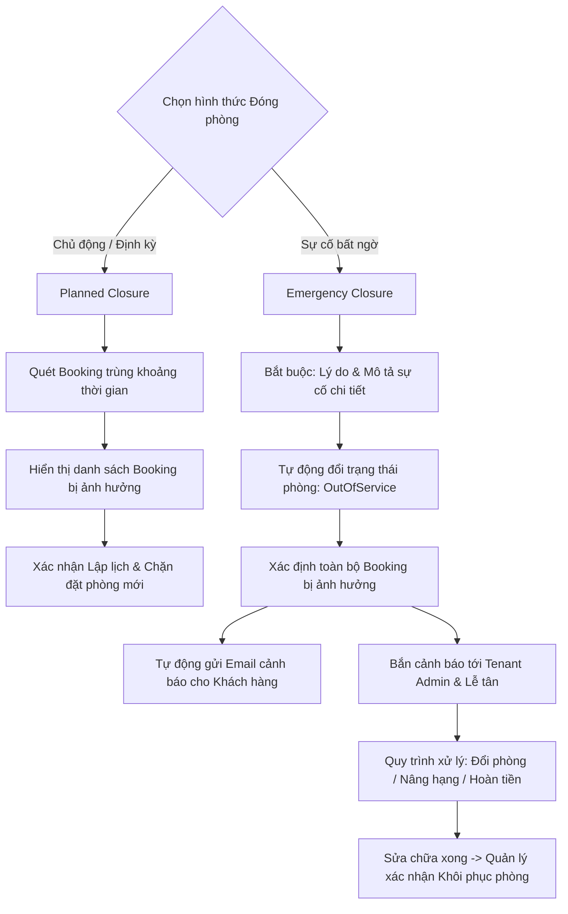

# Feature Specification: RM-010 – ROOM MANAGEMENT (Quản Lý Phòng Khách Sạn)

**Feature Branch**: `010-room-management`  
**Created**: 2026-11-20  
**Status**: Specified / In Progress  
**Spec Path**: `specs/010-room-management/spec.md`  
**Input**: `/speckit-specify # RM-010 – ROOM MANAGEMENT`

---

## 1. Tổng Quan & Mục Tiêu (Overview & Objectives)

**Room Management** là phân hệ cho phép **Hotel Manager (Quản lý khách sạn)** quản trị toàn bộ phòng vật lý thuộc cơ sở lưu trú (Hotel) được phân công phụ trách. Chức năng cung cấp công cụ quản lý thông tin phòng, phân loại phòng, theo dõi trạng thái sử dụng (Occupancy Status), trạng thái vận hành (Operational Status) và kiểm soát năng lực khai thác phòng theo từng khoảng thời gian thực tế.

Đặc biệt, hệ thống cung cấp 2 cơ chế đóng phòng:
1. **Lập lịch ngừng khai thác theo kế hoạch (Planned Closure)**: Chủ động khóa phòng trong tương lai cho các kế hoạch bảo dưỡng định kỳ hoặc chính sách kinh doanh.
2. **Ngừng khai thác khẩn cấp (Emergency Closure)**: Ngừng khai thác phòng ngay lập tức khi xảy ra sự cố đột xuất (hỏng điện nước, sự cố kết cấu, cháy nổ...), tự động dò quét các booking bị ảnh hưởng, phát lệnh gửi email cảnh báo cho khách hàng và thông báo điều hành cho Tenant Admin & nhân viên Lễ tân (Receptionist) để thực hiện quy trình giải quyết booking (Room Change, Room Upgrade, Refund, Other Resolution).

### Phạm Vi Quản Lý
- Mỗi Room thuộc duy nhất một Hotel.
- Hotel Manager chỉ được quản lý phòng thuộc Hotel mà mình được phân công phụ trách (`UserHotelAssignment`).
- Tenant Admin quản lý và giám sát dữ liệu toàn bộ Hotel trực thuộc Tenant theo quyền được cấp.
- Dữ liệu Room được phân tách đa người thuê độc lập (`TenantId`) bảo đảm nguyên tắc **Multi-Tenant Isolation**.

---

## 2. Vai Trò Người Dùng (User Roles & Responsibilities)

| Vai trò | Quyền hạn và Trách nhiệm |
|---|---|
| **Tenant Admin** | Giám sát dữ liệu phòng của các Hotel thuộc Tenant; cấu hình chính sách vận hành và ngừng khai thác; nhận cảnh báo sự cố tức thời khi xảy ra Emergency Closure. |
| **Hotel Manager** | Quản lý toàn diện danh mục phòng và loại phòng thuộc Hotel được phân công; tạo, chỉnh sửa, deactivate phòng; thiết lập Planned Closure và kích hoạt Emergency Closure; điều phối xử lý booking sự cố. |
| **Receptionist** | Xem trạng thái phòng trực quan và danh sách booking bị ảnh hưởng; tiếp nhận và thực hiện phương án xử lý (đổi phòng, nâng hạng, hoàn tiền) theo chỉ đạo của Manager. |

*Ghi chú*: Một nhân sự có thể đảm nhiệm nhiều vai trò nếu được phân quyền phù hợp trong hệ thống Identity.

---

## 3. Yêu Cầu Chức Năng Chi Tiết (Functional Requirements)

### 3.1. Dashboard – Tổng Quan Phòng Khách Sạn
Khu vực tổng quan cung cấp các chỉ số đo lường tức thời (Real-time Metrics) giúp Hotel Manager nắm bắt sức khỏe buồng phòng:

#### Các Thẻ Đo Lường (Dashboard Cards)
- **Total Rooms**: Tổng số phòng vật lý đang được quản lý tại Hotel hiện tại.
- **Occupied Rooms**: Số phòng hiện đang có khách lưu trú thực tế.
- **Vacant Rooms**: Số phòng trống, sạch và sẵn sàng đón khách ngay lập tức.
- **Reserved Rooms**: Số phòng có booking hợp lệ đã được xác nhận trong khoảng thời gian đang xét.
- **Unavailable Rooms**: Số phòng tạm thời không thể khai thác (do bảo trì, sự cố, bị khóa hoặc đóng theo lịch).

#### Phân Rã Theo 2 Chiều Trạng Thái
- **Occupancy Status (Sử dụng)**: `Vacant` (Trống), `Reserved` (Đã giữ chỗ), `Occupied` (Đang ở), `Blocked` (Bị khóa).
- **Operational Status (Vận hành)**: `Active` (Hoạt động), `Under Maintenance` (Bảo trì), `Out of Service` (Ngừng kinh doanh).

*Nguyên tắc tính toán*: Dữ liệu đặt phòng được tính toán động theo khoảng thời gian thực tế (`FromDate` - `ToDate`), không coi trạng thái booking là thuộc tính tĩnh cố định vĩnh viễn của phòng.

---

### 3.2. Quản Lý Thông Tin Phòng (Room Information Management)

Hotel Manager thực hiện các thao tác quản lý danh mục phòng thực tế:
- **Xem danh sách phòng**: Bố cục chuyên biệt **Dạng Lưới Thẻ theo Tầng (Room Cards grouped by Floor)** trực quan, phản ánh chính xác tình trạng buồng phòng thực tế của từng tầng tại khách sạn.
- **Tìm kiếm**: Tìm kiếm linh hoạt theo số phòng (`RoomNumber`).
- **Bộ lọc đa chiều**: Lọc theo Tầng (`Floor`), Hạng phòng (`RoomType`), Trạng thái sử dụng (`OccupancyStatus`), và Trạng thái vận hành (`OperationalStatus`).
- **Tạo mới phòng**: Nhập số phòng, chọn tầng, chọn loại phòng (`RoomTypeId`), tòa nhà/khu vực (`Building`), mô tả (`Description`).
- **Chỉnh sửa thông tin**: Cập nhật số phòng, tầng, hạng phòng, ghi chú.
- **Ngừng kích hoạt phòng (`Deactivate`)**: Khóa không cho đưa vào kinh doanh nhưng vẫn bảo toàn toàn bộ lịch sử booking.
- **Xóa phòng (`Delete`)**: Chỉ cho phép xóa khi phòng chưa từng phát sinh dữ liệu giao dịch/booking.

#### Cấu Trúc Dữ Liệu Phòng (Room Information Schema)
| Trường dữ liệu | Kiểu | Mô tả |
|---|---|---|
| `Id` | `Guid` | Định danh duy nhất của phòng vật lý. |
| `TenantId` | `Guid?` | Định danh Tenant sở hữu khách sạn. |
| `HotelId` | `Guid` | Khách sạn sở hữu phòng. |
| `RoomNumber` | `string` | Số phòng (duy nhất trong phạm vi Hotel). |
| `RoomTypeId` | `Guid` | Hạng phòng phân loại. |
| `Floor` | `int` | Tầng chứa phòng. |
| `Building` | `string?` | Tòa nhà / Block / Phân khu. |
| `Description` | `string?` | Ghi chú hoặc đặc điểm riêng của phòng. |
| `OccupancyStatus` | `Enum` | `Vacant`, `Reserved`, `Occupied`, `Blocked`. |
| `OperationalStatus`| `Enum` | `Active`, `UnderMaintenance`, `OutOfService`. |
| `IsActive` | `bool` | Trạng thái kích hoạt phục vụ kinh doanh. |
| `CreationTime` | `DateTime` | Thời điểm tạo phòng. |
| `LastModificationTime` | `DateTime?` | Thời điểm cập nhật cuối cùng. |

*Lưu ý*: Các thông tin như Sức chứa (`Capacity`), Loại giường (`BedType`) và Tiện nghi (`Amenities`) được quản lý tập trung tại **Room Type** để tránh trùng lặp dữ liệu.

---

### 3.3. Quản Lý Trạng Thái Phòng & Ràng Buộc Khả Dụng (Availability)

Hệ thống phân chia rạch ròi 2 trục trạng thái độc lập:

#### A. Trục Trạng Thái Sử Dụng (Occupancy Status)
- `Vacant`: Phòng hiện không có khách lưu trú.
- `Reserved`: Phòng đã có booking hợp lệ trong khoảng thời gian được xét.
- `Occupied`: Khách đã check-in và đang lưu trú thực tế.
- `Blocked`: Phòng bị lễ tân/quản lý khóa cục bộ, không tiếp nhận booking mới.

#### B. Trục Trạng Thái Vận Hành (Operational Status)
- `Active`: Phòng vận hành bình thường, đủ điều kiện vật lý để khai thác.
- `Under Maintenance`: Phòng đang được bảo trì/sửa chữa kỹ thuật.
- `Out of Service`: Phòng ngừng khai thác do sự cố nghiêm trọng, hỏng hóc hoặc cải tạo dài hạn.

#### C. Quy Tắc Tính Khả Dụng Đặt Phòng (`Room Availability`)
Khả năng đặt phòng (`isAvailable`) không được đánh đồng với `OccupancyStatus == Vacant`. Phòng chỉ khả dụng cho một khoảng thời gian $[T_{start}, T_{end}]$ khi thỏa mãn đồng thời 6 điều kiện:
1. Phòng thuộc đúng `HotelId` được ủy quyền.
2. Phòng đang ở trạng thái kích hoạt (`IsActive == true`).
3. Trạng thái vận hành là `Active` (`OperationalStatus == Active`).
4. Không bị khóa (`OccupancyStatus != Blocked`).
5. Không có bất kỳ Booking nào trùng lặp thời gian lưu trú:
   $$\neg \exists b \in \text{Bookings} : (b.\text{RoomId} = r.\text{Id}) \land (b.\text{FromDate} < T_{end}) \land (b.\text{ToDate} > T_{start}) \land (b.\text{Status} \notin \{\text{Cancelled}, \text{Rejected}\})$$
6. Không có bất kỳ Room Closure nào có hiệu lực giao cắt với khoảng thời gian:
   $$\neg \exists c \in \text{RoomClosures} : (c.\text{RoomId} = r.\text{Id}) \land (c.\text{StartDate} < T_{end}) \land (c.\text{EndDate} > T_{start}) \land (c.\text{Status} = \text{Active})$$

---

### 3.4. Quản Lý Kích Hoạt Phòng (Deactivate vs Delete)

- **Deactivate Room**:
  - Chuyển `IsActive = false`.
  - Phòng lập tức biến mất khỏi danh sách phòng có thể đặt mới trên mọi kênh.
  - Bảo toàn 100% dữ liệu lịch sử check-in, doanh thu và booking quá khứ.
  - Chặn Deactivate nếu phòng đang có khách lưu trú (`Occupied`) hoặc có booking tương lai chưa được xử lý.
- **Delete Room**:
  - Chỉ cho phép xóa vật lý (Hard Delete / Soft Delete không ràng buộc) khi phòng vừa tạo thử nghiệm và **chưa từng phát sinh bất kỳ booking hay giao dịch nào**.
  - Nếu đã có lịch sử booking, hệ thống chặn xóa và yêu cầu chuyển sang Deactivate.

---

### 3.5. Quản Lý Lịch Ngừng Khai Thác Phòng (Room Closure Management)

Hệ thống quản lý 2 hình thức ngừng khai thác phòng:



#### A. Planned Closure – Ngừng Khai Thác Theo Kế Hoạch
- **Mục đích**: Bảo dưỡng định kỳ, sơn sửa phòng, đóng tầng thấp điểm.
- **Thao tác**: Chọn một hoặc nhiều phòng $\rightarrow$ Chọn ngày giờ bắt đầu (`StartDate`) & kết thúc (`EndDate`) $\rightarrow$ Nhập lý do ngừng khai thác.
- **Kiểm tra xung đột**:
  - Hệ thống quét tự động toàn bộ booking trùng thời gian.
  - Hiển thị danh sách cảnh báo booking bị ảnh hưởng để Hotel Manager chủ động xử lý trước khi bấm lưu.
  - **Không tự ý hủy booking hay tự động hoàn tiền**.
- **Chặn đặt phòng**: Các phòng nằm trong khoảng Planned Closure sẽ tự động bị rút khỏi kết quả tìm kiếm phòng trên portal khách hàng.

#### B. Emergency Closure – Ngừng Khai Thác Khẩn Cấp
- **Mục đích**: Xử lý sự cố bất ngờ đe dọa an toàn hoặc công năng sử dụng (chập cháy điện, vỡ đường ống nước, nứt tường, thiên tai...).
- **Thông tin bắt buộc**:
  - Danh sách phòng bị ảnh hưởng (`AffectedRooms`).
  - Lý do sự cố (`Reason` - Bắt buộc, không được để trống).
  - Mô tả sự cố chi tiết (`IncidentDescription`).
  - Thời điểm bắt đầu (`StartDate`).
  - Thời gian dự kiến khắc phục (`EstimatedRecoveryTime` - nếu ước lượng được).
- **Tác vụ tự động của hệ thống**:
  1. Lập tức chuyển trạng thái phòng sang `OutOfService`.
  2. Khóa cổng đặt phòng mới cho các phòng này ngay lập tức.
  3. Quét và trích xuất toàn bộ booking hiện có bị giao cắt thời gian.
  4. **Customer Notification**: Hệ thống kích hoạt Background Job (`IBackgroundJobManager`) gửi email bất đồng bộ đến toàn bộ khách hàng có booking thực tế bị ảnh hưởng nhằm phản hồi tức thời cho Hotel Manager mà không làm nghẽn request đóng phòng. Trạng thái gửi mail được lưu vết vào `AffectedBookingResolution.IsCustomerNotified`.
  5. **Staff Notification**: Gửi cảnh báo hệ thống (Notification/Email) tới **Tenant Admin** và toàn bộ **Receptionist** đang trực tại Hotel để tiếp đón và giải quyết khi khách đến.

#### C. Affected Booking Resolution – Quy Trình Xử Lý Booking Bị Ảnh Hưởng
Hệ thống cung cấp màn hình quản lý điều phối booking sự cố với 4 phương án chuẩn mực:
1. **Room Change**: Chuyển khách sang phòng khả dụng khác cùng hạng trong khách sạn. Hệ thống tự động lọc và gợi ý các phòng thực tế đang `Available` trong cùng khách sạn thỏa mãn khoảng thời gian lưu trú để chọn một cú click.
2. **Room Upgrade**: Nâng hạng miễn phí sang phòng hạng cao hơn còn trống. Hệ thống tự động gợi ý các phòng còn trống thuộc các hạng phòng có `BasePrice` cao hơn trong cùng khách sạn.
3. **Refund**: Hoàn tiền 100% hoặc theo chính sách thỏa thuận.
4. **Other Resolution**: Phương án dàn xếp riêng (chuyển sang khách sạn liên kết cùng chuỗi...).

Với mỗi booking, hệ thống ghi vết nhật ký kiểm toán: `BookingId`, `Khách hàng`, `Phòng ban đầu`, `Phương án giải quyết`, `Phòng thay thế`, `Người xử lý`, `Thời điểm xử lý`, `Kết quả` và `Ghi chú`.

#### D. Room Recovery – Khôi Phục Hoạt Động Của Phòng
- Khi sự cố đã sửa chữa xong, Hotel Manager hoặc người có thẩm quyền thực hiện thao tác **Xác nhận Khôi phục (Confirm Recovery)**.
- Ghi nhận thời điểm khôi phục và nhân sự nghiệm thu.
- Phòng được đưa về trạng thái `Active`.
- *Quy tắc kiểm tra chéo*: Nếu phòng vẫn còn một bản ghi `Planned Closure` hoặc `Emergency Closure` khác đang trong hạn, hệ thống giữ nguyên trạng thái không khả dụng, không được tự ý kích hoạt lại.

---

### 3.6. Lịch Sử Ngừng Khai Thác Phòng (Room Closure History)
Hệ thống lưu trữ lịch sử kiểm toán bất biến (Audit Trail) cho toàn bộ hoạt động đóng/mở phòng:
- `ClosureId`, `RoomNumber`, `ClosureType` (Planned / Emergency).
- Lý do, Mô tả sự cố, Thời gian bắt đầu, Thời gian kết thúc.
- Người tạo, Thời gian tạo, Người xác nhận khôi phục, Thời gian khôi phục.
- Trạng thái xử lý: `Pending`, `Active`, `Resolved`, `Cancelled`.
- Đối với Emergency: Danh sách booking bị ảnh hưởng, trạng thái gửi email, kết quả điều phối từng booking.

---

## 4. Danh Mục Quy Tắc Nghiệp Vụ (Business Rules)

| Mã | Quy tắc nghiệp vụ |
|---|---|
| **BR-01** | Mỗi Room phải thuộc duy nhất một Hotel. |
| **BR-02** | Room Number phải là duy nhất trong phạm vi một Hotel. Các Hotel khác nhau có thể sử dụng cùng Room Number. |
| **BR-03** | Room Type và Floor được gán cho Room phải thuộc cùng Hotel với Room đó. |
| **BR-04** | Tenant ID của Room phải tương ứng với Tenant sở hữu Hotel. |
| **BR-05** | Không cho phép xóa vĩnh viễn phòng đã phát sinh booking, lưu trú hoặc dữ liệu nghiệp vụ cần bảo toàn. |
| **BR-06** | Không cho phép Deactivate phòng đang có khách lưu trú hoặc còn booking chưa xử lý. |
| **BR-07** | Occupancy Status phải được đồng bộ chính xác với các nghiệp vụ Booking, Check-in và Check-out. |
| **BR-08** | Operational Status độc lập với Occupancy Status và phản ánh đúng công năng vật lý của phòng. |
| **BR-09** | Phòng Under Maintenance hoặc Out of Service không được tiếp nhận booking mới trong khoảng thời gian không khả dụng. |
| **BR-10** | Phòng Blocked không được tiếp nhận booking mới trong khoảng thời gian bị khóa. |
| **BR-11** | Room Availability phải được xác định dựa trên trạng thái phòng, booking hiện có và các Room Closure áp dụng cho khoảng thời gian yêu cầu. |
| **BR-12** | Hotel Manager được chủ động lựa chọn bất kỳ khoảng thời gian nào trong tương lai để tạo Planned Closure theo chính sách của Tenant. Không bắt buộc lịch cố định hoặc lặp lại tự động. |
| **BR-13** | Trước khi xác nhận Planned Closure, hệ thống phải kiểm tra và hiển thị các booking có thời gian lưu trú bị ảnh hưởng. |
| **BR-14** | Emergency Closure bắt buộc phải có lý do (`Reason`). Hệ thống không cho phép xác nhận nếu Reason bị bỏ trống. |
| **BR-15** | Khi Emergency Closure được xác nhận, hệ thống phải tự động gửi email đến tất cả khách hàng có booking thực sự bị ảnh hưởng. |
| **BR-16** | Khi Emergency Closure được xác nhận, hệ thống phải thông báo đến Tenant Admin của Tenant sở hữu Hotel và tất cả Receptionist được phân công tại Hotel bị ảnh hưởng. |
| **BR-17** | Hệ thống phải cho phép nhân sự có quyền ghi nhận và theo dõi phương án xử lý từng booking bị ảnh hưởng. |
| **BR-18** | Phòng chỉ được khôi phục về Active sau khi sự cố được khắc phục và người có thẩm quyền xác nhận. Nếu còn Closure khác đang có hiệu lực, phòng vẫn phải tiếp tục không khả dụng. |
| **BR-19** | Hệ thống phải lưu lịch sử Planned Closure và Emergency Closure, bao gồm thời gian, lý do, người thực hiện và kết quả xử lý. |
| **BR-20** | Hệ thống phải lưu trạng thái gửi thông báo và lịch sử gửi email để hỗ trợ theo dõi, xử lý các trường hợp gửi thất bại. |
| **BR-21** | Việc gửi thông báo không tự động đồng nghĩa với việc hủy booking, đổi phòng hoặc hoàn tiền. Các nghiệp vụ này phải được xử lý theo chính sách của Hotel và Tenant. |
| **BR-22** | Một phòng không được tiếp nhận booking mới nếu khoảng thời gian lưu trú có giao với bất kỳ Room Closure nào đang có hiệu lực. |

---

## 5. Ranh Giới Dữ Liệu & Cách Ly Đa Thuê (Multi-Tenant & Security Rules)

- **Nguyên tắc Multi-Tenant**: Mọi truy vấn Entity `Room`, `RoomClosure`, `AffectedBookingResolution` đều kế thừa `IMultiTenant` (`TenantId`). ABP Framework tự động áp dụng Data Filter theo tenant hiện tại.
- **Ràng buộc Chi nhánh Khách sạn (`HotelId`)**: Phải luôn kiểm tra phân bổ nhân sự qua `UserHotelAssignmentAppService` / `CheckHotelManagerAccessAsync(hotelId)` tại tầng Application Service. Hotel Manager tuyệt đối không được đọc hoặc can thiệp phòng của khách sạn khác.
- **Backend Authoritative**: Mọi ràng buộc kiểm tra xung đột booking, xác định danh sách bị ảnh hưởng và gửi email đều thực hiện tại Server; Frontend chỉ hiển thị giao diện tương tác và xác nhận.

---

## 6. Hạng Mục Ngoài Phạm Vi (Scope Exclusions)

Các nghiệp vụ sau **không nằm trong phạm vi của RM-010** và được tách riêng thành các module khác:
- Quản lý ca trực nhân viên dọn phòng (Housekeeping Staff Management).
- Phân công nhiệm vụ buồng phòng hàng ngày (Cleaning Task Assignment).
- Danh mục kiểm tra vệ sinh buồng phòng chi tiết (Room Cleaning Checklist).
- Quy trình giám sát buồng phòng (Room Inspection Workflow).
- Báo cáo chi tiết công tác buồng phòng (Housekeeping Reports).
- Quy trình bảo trì kỹ thuật chuyên sâu (Detailed Maintenance Workflow).
- Quản lý tồn kho vật tư và phụ tùng thay thế (Maintenance Inventory Management).

---

## 7. Phụ Thuộc Module Hệ Thống (Module Dependencies)

| Module | Mục đích phụ thuộc |
|---|---|
| **Tenant Management** | Xác thực Tenant, áp dụng hạn ngạch và chính sách chung của chuỗi. |
| **Hotel Management** | Xác định thông tin Hotel, chi nhánh và cơ cấu vận hành. |
| **Room Type Management** | Cung cấp thông tin hạng phòng, giá cơ bản, tiện nghi và sức chứa. |
| **Booking Management** | Kiểm tra xung đột phòng, lấy danh sách booking bị ảnh hưởng khi đóng phòng. |
| **Check-in / Check-out** | Đồng bộ trạng thái thực tế `Occupied` / `Vacant`. |
| **Identity & Access** | Xác thực phân quyền cho `TenantAdmin`, `HotelManager`, `Receptionist`. |
| **Email Notification** | Cung cấp dịch vụ gửi mail tự động thông báo sự cố cho khách hàng. |

---

## 8. Mô Hình Dữ Liệu & Hợp Đồng Kỹ Thuật (Domain & API Contracts)

### 8.1. Các Enum Nghiệp Vụ Mở Rộng
```csharp
namespace BookingHotel.Rooms;

public enum RoomOccupancyStatus
{
    Vacant = 1,
    Reserved = 2,
    Occupied = 3,
    Blocked = 4
}

public enum RoomOperationalStatus
{
    Active = 1,
    UnderMaintenance = 2,
    OutOfService = 3
}

public enum RoomClosureType
{
    Planned = 1,
    Emergency = 2
}

public enum RoomClosureStatus
{
    Pending = 1,
    Active = 2,
    Resolved = 3,
    Cancelled = 4
}

public enum AffectedBookingResolutionType
{
    RoomChange = 1,
    RoomUpgrade = 2,
    Refund = 3,
    OtherResolution = 4
}
```

### 8.2. Thực Thể Bổ Sung / Mở Rộng (Entities)
1. **`Room`**: Bổ sung `OccupancyStatus`, `IsActive`, `Building`, `Description`.
2. **`RoomClosure`**:
   - `Id`: `Guid`
   - `TenantId`: `Guid?`
   - `HotelId`: `Guid`
   - `RoomId`: `Guid`
   - `ClosureType`: `RoomClosureType` (Planned / Emergency)
   - `Reason`: `string`
   - `IncidentDescription`: `string?`
   - `StartDate`: `DateTime`
   - `EndDate`: `DateTime?`
   - `EstimatedRecoveryTime`: `DateTime?`
   - `Status`: `RoomClosureStatus`
   - `RecoveryConfirmedBy`: `Guid?`
   - `RecoveryConfirmedTime`: `DateTime?`
3. **`AffectedBookingResolution`**:
   - `Id`: `Guid`
   - `TenantId`: `Guid?`
   - `RoomClosureId`: `Guid`
   - `BookingId`: `Guid`
   - `ResolutionType`: `AffectedBookingResolutionType?`
   - `AlternativeRoomId`: `Guid?`
   - `ResolvedBy`: `Guid?`
   - `ResolvedTime`: `DateTime?`
   - `Notes`: `string?`
   - `IsCustomerNotified`: `bool`

### 8.3. Danh Mục API Endpoints Chính (`/api/app/manager/rooms`)
- `GET /dashboard-overview?hotelId={hotelId}`: Lấy chỉ số tổng quan phòng (Total, Occupied, Vacant, Reserved, Unavailable, Occupancy breakdown, Operational breakdown).
- `GET /physical-rooms?hotelId={hotelId}&floor={floor}&roomTypeId={typeId}&occupancyStatus={occ}&operationalStatus={op}&search={keyword}`: Danh sách phòng kèm bộ lọc.
- `POST /physical-rooms`: Tạo mới phòng.
- `PUT /physical-rooms/{id}`: Cập nhật thông tin phòng.
- `POST /physical-rooms/{id}/deactivate`: Ngừng kích hoạt phòng (có kiểm tra ràng buộc).
- `DELETE /physical-rooms/{id}?hotelId={hotelId}`: Xóa phòng (chỉ khi chưa có booking).
- `POST /closures/check-affected-bookings`: Kiểm tra trước các booking bị ảnh hưởng bởi một khoảng thời gian đóng phòng dự kiến.
- `POST /closures/planned`: Tạo lịch đóng phòng có kế hoạch.
- `POST /closures/emergency`: Kích hoạt đóng phòng khẩn cấp (tự động chuyển trạng thái, quét booking, gửi mail cảnh báo).
- `GET /closures/history?hotelId={hotelId}&closureType={type}`: Xem lịch sử đóng phòng và chi tiết giải quyết booking.
- `POST /closures/{closureId}/resolve-booking`: Cập nhật phương án giải quyết cho booking bị sự cố.
- `POST /closures/{closureId}/confirm-recovery`: Nghiệm thu khôi phục phòng về hoạt động.

---

## 9. Tiêu Chí Chấp Nhận & Nghiệm Thu (Acceptance Criteria)

- **AC-01 (Hiển thị Dashboard)**: Mở trang `/manager/rooms`, các chỉ số KPI Total/Occupied/Vacant/Reserved/Unavailable hiển thị chuẩn xác dựa theo dữ liệu thực tế tại khách sạn đã chọn.
- **AC-02 (Bộ Lọc Danh Sách Phòng)**: Lọc tức thời theo Tầng, Hạng phòng, Occupancy Status và Operational Status không reload cả trang.
- **AC-03 (Tạo / Sửa / Xóa)**: Số phòng không được trùng trong cùng khách sạn. Xóa phòng đã có booking bị từ chối với thông báo hướng dẫn chuyển sang Deactivate.
- **AC-04 (Deactivate an toàn)**: Không cho phép Deactivate nếu phòng đang `Occupied` hoặc có booking tương lai chưa giải quyết.
- **AC-05 (Planned Closure)**: Cho phép chọn khoảng thời gian tương lai, hiển thị danh sách booking bị trùng để người dùng duyệt trước khi xác nhận.
- **AC-06 (Emergency Closure)**: Bắt buộc nhập lý do; khi xác nhận, phòng đổi ngay thành `OutOfService`, hệ thống bắn email tự động đến các khách hàng bị ảnh hưởng và gửi thông báo đến Tenant Admin & Lễ tân.
- **AC-07 (Giải Quyết Booking)**: Lễ tân hoặc Quản lý có thể chọn Đổi phòng, Nâng hạng, Hoàn tiền cho từng booking và lưu vết kiểm toán đầy đủ.
- **AC-08 (Khôi Phục Phòng)**: Xác nhận khôi phục thành công đưa phòng về `Active`, trừ khi vẫn còn một Closure khác còn hiệu lực trên cùng phòng.
- **AC-09 (Đa Thuê & Phân Quyền)**: Người dùng thuộc Hotel A không thể xem hay tác động phòng của Hotel B.
- **AC-10 (Đồng Bộ Song Ngữ)**: 100% nhãn, thông báo và modal hỗ trợ trọn vẹn tiếng Việt (`vi.json`) và tiếng Anh (`en.json`).
