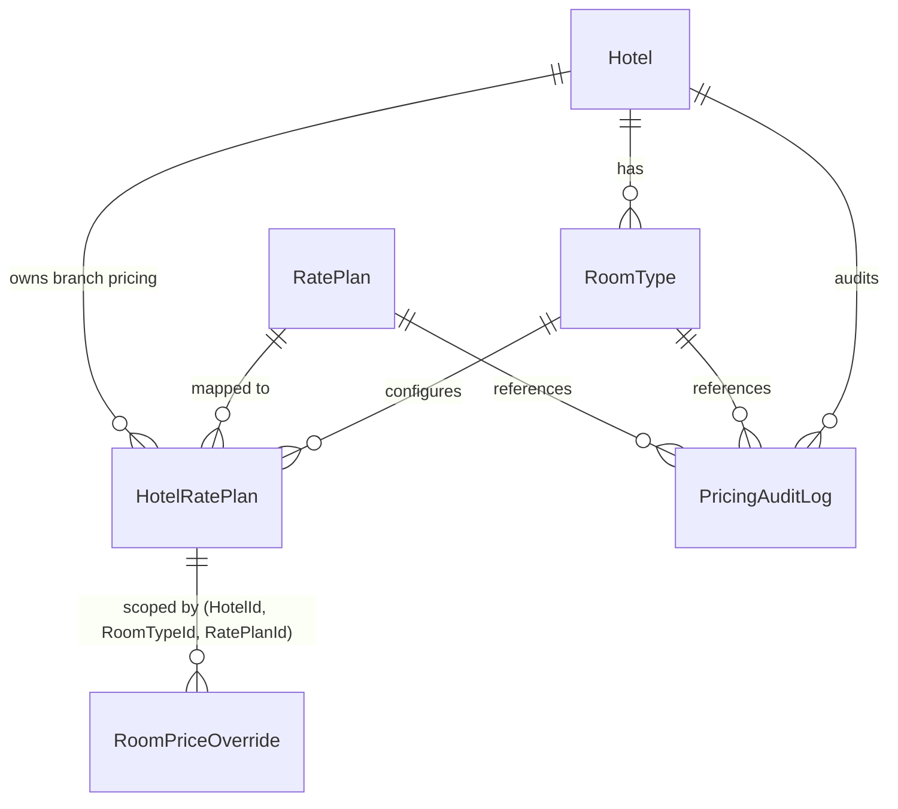
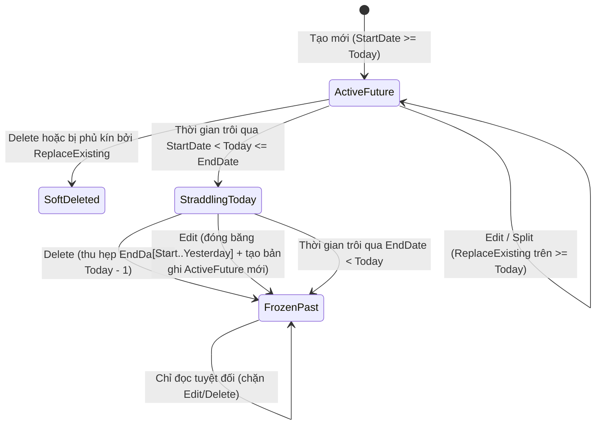

# Data Model: RM-011 – Quản Lý Giá Phòng (Room Pricing Management)

**Feature**: `011-room-pricing-management`  
**Date**: 2026-11-25  
**Spec**: [spec.md](./spec.md)

---

## 1. Enums Mới (`BookingHotel.Domain.Shared/Rooms/PricingEnums.cs`)

| Enum | Values | Mô tả |
|---|---|---|
| `PriceAdjustmentType` | `FixedPrice = 1` `Percentage = 2` `RestrictionsOnly = 3` | Phương thức điều chỉnh: giá cố định VNĐ, điều chỉnh % trên `Base Price` (snapshot làm tròn 1.000 VNĐ), hoặc chỉ cập nhật `CTA`/`CTD` (giữ nguyên giá). |
| `PriceConflictResolution` | `Cancel = 0` `ReplaceExisting = 1` `SkipExisting = 2` | Phương án xử lý khi khoảng ngày áp dụng trùng với `RoomPriceOverride` đã tồn tại (FR-013). |
| `PricingAuditActionType` | `CreatePriceOverride = 1` `UpdatePriceOverride = 2` `DeletePriceOverride = 3` `UpdateBasePrice = 4` `ToggleRatePlanStatus = 5` `UpdateRestrictions = 6` | 6 nhóm thao tác bắt buộc ghi nhận vào `PricingAuditLog` (FR-017, SC-006). |

---

## 2. Sơ Đồ Quan Hệ Thực Thể (Entity Relationships)

---

## 3. Thực Thể Hiện Có Tái Sử Dụng (Read / Update Scope)

### 3.1. `RatePlan` *(Read-Only trong RM-011 — do Tenant Admin quản lý tại RM-009)*
- **Table**: `AppRatePlans`
- **Fields sử dụng**: `Id`, `TenantId`, `Name`, `Code`, `Description`, `IsRefundable`, `IncludesBreakfast`, `CancellationCutoffHours`, `DefaultPriceAdjustmentPercent`.
- **Rule**: Hotel Manager tuyệt đối không sửa các trường trên `RatePlan` (BR-13, Clarifications Q1).

### 3.2. `RoomType` *(Read-Only trong RM-011 — quản lý tại RM-010)*
- **Table**: `AppRoomTypes`
- **Fields sử dụng**: `Id`, `TenantId`, `HotelId`, `Name`, `BasePrice` (giá cơ bản tham khảo của hạng phòng).

### 3.3. `HotelRatePlan` *(Branch-level Base Price & Active Status)*
- **Table**: `AppHotelRatePlans`
- **Key**: Unique `(TenantId, HotelId, RoomTypeId, RatePlanId)` where `IsDeleted = 0`.
- **Editable fields trong RM-011**:
  - `IsActive` (`bool`, default `true`): Bật/tắt kinh doanh gói giá tại chi nhánh (FR-004, BR-11).
  - `CustomBasePrice` (`decimal?`, precision `18, 2`): Giá cơ bản (`Base Price`) tùy chỉnh tại chi nhánh cho tổ hợp `RoomType + RatePlan`; phải `> 0` (BR-02, BR-06). Nếu `null`, hệ thống tính giá cơ bản mặc định = `RoundToNearest1000(RoomType.BasePrice * (1 + RatePlan.DefaultPriceAdjustmentPercent / 100m))`.
- **Rule**: Thay đổi `CustomBasePrice` hoặc `IsActive` tuyệt đối không xóa hoặc sửa đổi bất kỳ bản ghi `RoomPriceOverride` hay `Booking` nào đã tồn tại (BR-08, BR-11, BR-12).

---

## 4. Thực Thể Mới (EF Core Migration: `AddRoomPricingManagement`)

### 4.1. `RoomPriceOverride` (`BookingHotel.Domain/Rooms/RoomPriceOverride.cs`)
- **Base Class**: `FullAuditedAggregateRoot<Guid>, IMultiTenant`
- **Table**: `AppRoomPriceOverrides`

| Field | Type | Constraints | Mô tả |
|---|---|---|---|
| `Id` | `Guid` | PK | Khóa chính |
| `TenantId` | `Guid?` | Indexed, `IMultiTenant` | Cô lập dữ liệu đa khách thuê (BR-14) |
| `HotelId` | `Guid` | Required | Cơ sở khách sạn sở hữu (BR-14) |
| `RoomTypeId` | `Guid` | Required | Hạng phòng áp dụng (BR-01, BR-04) |
| `RatePlanId` | `Guid` | Required | Gói giá áp dụng (BR-01, BR-04) |
| `StartDate` | `DateTime` | Required, Date-only (`date`) | Ngày bắt đầu (inclusive) |
| `EndDate` | `DateTime` | Required, Date-only (`date`), `>= StartDate` | Ngày kết thúc (inclusive, BR-05) |
| `AdjustmentType` | `PriceAdjustmentType` | Required | `FixedPrice`, `Percentage`, `RestrictionsOnly` |
| `AdjustmentValue` | `decimal?` | `decimal(18, 2)`, nullable | Giá cố định VNĐ hoặc `%` (null nếu `RestrictionsOnly`) |
| `CalculatedEffectivePrice` | `decimal?` | `decimal(18, 2)`, nullable | Giá bán chốt (`Snapshot`, bội số `1.000 VNĐ`, `> 0`) khi `FixedPrice`/`Percentage`; `null` khi `RestrictionsOnly` |
| `IsClosedToArrival` | `bool` | Required, default `false` | Cờ `CTA` (BR-09) |
| `IsClosedToDeparture` | `bool` | Required, default `false` | Cờ `CTD` (BR-10) |
| `CreatorName` | `string` | Required, `MaxLength(256)` | Snapshot tên người tạo để hiển thị bảng Section 5 |
| *Audit fields* | ABP `FullAudited` | `CreationTime`, `CreatorId`, `LastModificationTime`, `LastModifierId`, `IsDeleted`, `DeleterId`, `DeletionTime` | Theo dõi vòng đời & soft-delete |

**Indexes**:
- `IX_RoomPriceOverrides_Scope_Dates`: `(TenantId, HotelId, RoomTypeId, RatePlanId, StartDate, EndDate)` (filtered `[IsDeleted] = 0`) — tối ưu truy vấn lịch tháng và phát hiện xung đột.
- `IX_RoomPriceOverrides_Hotel_RoomType`: `(TenantId, HotelId, RoomTypeId)` (filtered `[IsDeleted] = 0`) — tối ưu đếm tổng số lịch ghi đè ở Section 1.

**Domain Invariants**:
1. `StartDate.Date <= EndDate.Date` (BR-05).
2. Khi `AdjustmentType == FixedPrice`: `AdjustmentValue.HasValue && AdjustmentValue > 0 && CalculatedEffectivePrice == AdjustmentValue`.
3. Khi `AdjustmentType == Percentage`: `AdjustmentValue.HasValue && CalculatedEffectivePrice.HasValue && CalculatedEffectivePrice >= 1000m` (và `> 0`, BR-06).
4. Khi `AdjustmentType == RestrictionsOnly`: `AdjustmentValue == null && CalculatedEffectivePrice == null`.
5. Trong tập bản ghi `IsDeleted == false` của cùng `(TenantId, HotelId, RoomTypeId, RatePlanId)`, **không được tồn tại bất kỳ hai bản ghi nào có khoảng `[StartDate, EndDate]` giao nhau** (BR-07).

---

### 4.2. `PricingAuditLog` (`BookingHotel.Domain/Rooms/PricingAuditLog.cs`)
- **Base Class**: `CreationAuditedEntity<Guid>, IMultiTenant` *(append-only, không soft-delete hay chỉnh sửa)*
- **Table**: `AppPricingAuditLogs`

| Field | Type | Constraints | Mô tả |
|---|---|---|---|
| `Id` | `Guid` | PK | Khóa chính |
| `TenantId` | `Guid?` | Indexed, `IMultiTenant` | Cô lập theo Tenant |
| `HotelId` | `Guid` | Required | Cô lập theo Hotel |
| `RoomTypeId` | `Guid` | Required | Hạng phòng liên quan |
| `RoomTypeName` | `string` | Required, `MaxLength(128)` | Snapshot tên hạng phòng |
| `RatePlanId` | `Guid` | Required | Gói giá liên quan |
| `RatePlanCode` | `string` | Required, `MaxLength(32)` | Snapshot mã gói giá |
| `RatePlanName` | `string` | Required, `MaxLength(128)` | Snapshot tên gói giá |
| `ActionType` | `PricingAuditActionType` | Required | Một trong 6 nhóm thao tác (FR-017) |
| `ActorId` | `Guid` | Required | ID người thực hiện |
| `ActorName` | `string` | Required, `MaxLength(256)` | Tên hiển thị / Username người thực hiện |
| `ActionTime` | `DateTime` | Required | Thời điểm thực hiện (UTC) |
| `BeforeValueJson` | `string?` | `MaxLength(4000)` | JSON cấu trúc giá trị trước thay đổi |
| `AfterValueJson` | `string?` | `MaxLength(4000)` | JSON cấu trúc giá trị sau thay đổi |
| `AffectedStartDate` | `DateTime?` | Date-only, nullable | Ngày bắt đầu phạm vi ảnh hưởng (null cho sửa BasePrice/Toggle) |
| `AffectedEndDate` | `DateTime?` | Date-only, nullable | Ngày kết thúc phạm vi ảnh hưởng |
| `SummaryNote` | `string?` | `MaxLength(500)` | Ghi chú mô tả ngắn (ví dụ: phương án xử lý trùng ngày đã chọn) |

**Indexes**:
- `IX_PricingAuditLogs_Hotel_Time`: `(TenantId, HotelId, ActionTime DESC)`
- `IX_PricingAuditLogs_Scope_Time`: `(TenantId, HotelId, RoomTypeId, RatePlanId, ActionTime DESC)`
- `IX_PricingAuditLogs_Hotel_Action_Time`: `(TenantId, HotelId, ActionType, ActionTime DESC)`

---

## 5. Vòng Đời & Chuyển Đổi Trạng Thái Khoảng Ghi Đè (State Transitions)

---

## 6. Ghi Chú Tương Thích Ngược

- Bảng `AppDailyRateOverrides` (`DailyRateOverride`) từ RM-008 giữ nguyên trong `BookingHotelDbContext` ở trạng thái không dùng cho luồng RM-011 mới (không `DROP TABLE`) để tránh mất dữ liệu dev cũ và giữ lịch sử migration sạch sẽ.
- Bảng `AppBookings` (`Booking`) không bị tác động bởi bất kỳ lệnh ghi nào của RM-011 (BR-12).
