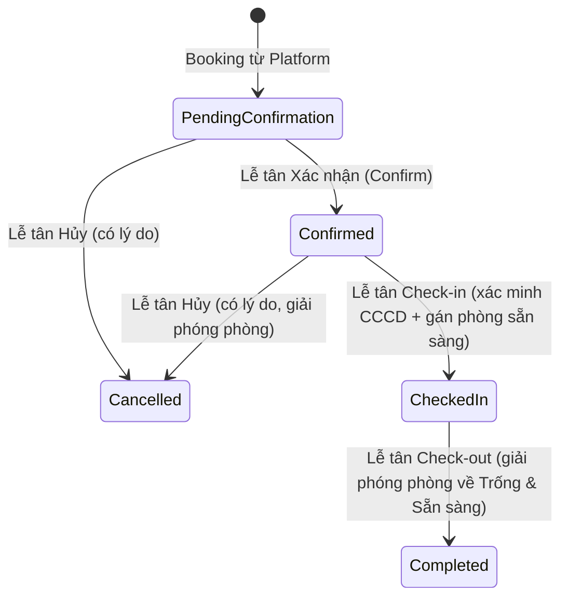

# Data Model: RM-012 Phân hệ Tác nghiệp Lễ tân

**Feature**: `012-receptionist-frontdesk-portal`  
**Date**: 2026-11-25

---

## 1. Thực thể hiện hữu được sử dụng & mở rộng

### 1.1 `Booking` (`AppBookings` — Mở rộng tối giản)

Thực thể cốt lõi đại diện cho đơn đặt phòng từ nền tảng Booking Hotel Platform. Kế thừa `FullAuditedAggregateRoot<Guid>, IMultiTenant`.

| Trường (Property) | Kiểu C# / SQL | Trạng thái | Ràng buộc / Ghi chú |
| --- | --- | --- | --- |
| `Id` | `Guid` | Có sẵn | Khóa chính |
| `TenantId` | `Guid?` | Có sẵn | Cô lập đa khách thuê (`IMultiTenant`) |
| `HotelId` | `Guid` | Có sẵn | Khóa ngoại logic tới `AppHotels`, bắt buộc |
| `RoomTypeId` | `Guid?` | **Mới (RM-012)** | Hạng phòng được đặt (cho phép xác định đúng hạng phòng kể cả khi booking chưa gán phòng vật lý). Quy tắc fallback cho booking cũ có `RoomTypeId == null`: tra theo `RoomAssignment.RoomTypeId` gần nhất; nếu vẫn `null` thì cho phép chọn phòng trống bất kỳ trong cơ sở và tự backfill `Booking.RoomTypeId` khi gán phòng |
| `BookingCode` | `string` (32) | Có sẵn | Mã booking duy nhất theo Tenant |
| `GuestId` | `Guid?` | Có sẵn | Định danh khách (nếu khách có tài khoản) |
| `GuestFullName` | `string` (128) | Có sẵn | Họ tên khách hàng, bắt buộc |
| `GuestPhone` | `string` (32) | Có sẵn | SĐT liên hệ, bắt buộc |
| `GuestEmail` | `string` (128) | Có sẵn | Email liên hệ |
| `GuestIdentityNumberMasked` | `string` (32) | Có sẵn | Số CCCD/Hộ chiếu đã che một phần (giữ 4 ký tự cuối, ví dụ `********1234`) |
| `IsIdentityVerified` | `bool` | **Mới (RM-012)** | Default `false`; bật `true` khi Lễ tân hoàn tất xác minh lúc Check-in |
| `CheckInDate` | `DateTime` | Có sẵn | Ngày dự kiến nhận phòng |
| `CheckOutDate` | `DateTime` | Có sẵn | Ngày dự kiến trả phòng |
| `ActualCheckInTime` | `DateTime?` | **Mới (RM-012)** | Thời điểm thực tế Lễ tân xác nhận Check-in |
| `ActualCheckOutTime` | `DateTime?` | **Mới (RM-012)** | Thời điểm thực tế Lễ tân xác nhận Check-out |
| `TotalAmount` | `decimal(18,2)` | Có sẵn | Tổng tiền (chỉ đọc đối với Lễ tân) |
| `DepositAmount` | `decimal(18,2)` | Có sẵn | Tiền cọc (chỉ đọc đối với Lễ tân) |
| `BookingStatus` | `BookingStatus` | Có sẵn | `PendingConfirmation(1)`, `Confirmed(2)`, `CheckedIn(3)`, `Completed(4)`, `Rejected(5)`, `Cancelled(6)`, `NoShow(7)` |
| `PaymentStatus` | `PaymentStatus` | Có sẵn | `Unpaid(1)`, `PartiallyPaid(2)`, `Paid(3)`, `Refunded(4)` (chỉ đọc đối với Lễ tân) |
| `RoomAssignmentStatus` | `RoomAssignmentStatus` | Có sẵn | `Unassigned(1)`, `Assigned(2)` |
| `SpecialRequests` | `string?` (2000) | Có sẵn | Yêu cầu đặc biệt của khách (Lễ tân có thể cập nhật bổ sung) |
| `FrontdeskNotes` | `string?` (2000) | **Mới (RM-012)** | Ghi chú tiếp nhận/tác nghiệp của quầy Lễ tân |
| `CancellationReason` | `string?` (1000) | **Mới (RM-012)** | Lý do hủy booking bắt buộc khi Lễ tân thực hiện Hủy |
| `RejectionReason` | `string?` (1000) | Có sẵn | Lý do từ chối (thuộc luồng Hotel Manager, chỉ đọc với Lễ tân) |

**Indexes mới trên `AppBookings`**:
- `IX_AppBookings_Tenant_Hotel_RoomType` trên `(TenantId, HotelId, RoomTypeId)` hỗ trợ kiểm tra quỹ phòng theo hạng phòng khi Xác nhận booking.
- Các index sẵn có `(TenantId, HotelId, BookingStatus)` và `(TenantId, HotelId, CheckInDate, CheckOutDate)` phục vụ truy vấn Dashboard & Reservation nhanh.

### 1.2 `Room` (`AppRooms` — Không đổi lược đồ)
- Sử dụng các trường sẵn có: `Id`, `HotelId`, `RoomTypeId`, `RoomNumber`, `Floor`, `OperationalStatus` (`Active=1`, `UnderMaintenance=2`, `OutOfService=3`), `OccupancyStatus` (`Vacant=1`, `Reserved=2`, `Occupied=3`, `Blocked=4`), `HousekeepingStatus` (`Clean=1`, `Dirty=2`, `Cleaning=3`, `Inspected=4`), `IsActive`, `MaintenanceReason`, `OutOfServiceReason`.
- **Quy tắc hiển thị tình trạng sẵn sàng trên Frontdesk Room Rack**:
  - `Unavailable` (Không khả dụng): `!IsActive || OperationalStatus != Active || OccupancyStatus == Blocked`
  - `Occupied` (Đang có khách): `OccupancyStatus == Occupied`
  - `Reserved` (Đã đặt trước): `OccupancyStatus == Reserved`
  - `NotReady` (Chưa sẵn sàng): `HousekeepingStatus is Dirty or Cleaning` *(chỉ đọc; không cung cấp thao tác dọn phòng trong RM-012)*
  - `Ready` (Sẵn sàng đón khách): `IsActive && OperationalStatus == Active && OccupancyStatus == Vacant && HousekeepingStatus is Clean or Inspected`

### 1.3 `RoomAssignment` (`AppRoomAssignments` — Không đổi lược đồ)
- Trường: `Id`, `TenantId`, `BookingId`, `RoomId`, `RoomTypeId`, `FromDate`, `ToDate`, `IsActive`.
- **Bất biến**: Tại mọi thời điểm, một `Booking` có tối đa **1** `RoomAssignment` với `IsActive = true`. Hai `RoomAssignment` đang `IsActive = true` cho cùng `RoomId` không được phép giao nhau theo khoảng `[FromDate, ToDate)` (`a.FromDate < b.ToDate && a.ToDate > b.FromDate`).

### 1.4 `RoomClosure` (`AppRoomClosures` — Chỉ đọc để chống trùng lịch)
- Khi gợi ý hoặc lưu gán phòng cho khoảng `[CheckInDate, CheckOutDate)`, kiểm tra không tồn tại `RoomClosure` nào của `RoomId` có `Status in (Pending, Active)` giao cắt khoảng ngày đó.

### 1.5 `UserHotelAssignment` (`AppUserHotelAssignments` — Cô lập cơ sở)
- Khóa chặt mọi API trong `Frontdesk` theo `HotelId` có bản ghi `UserId == CurrentUser.Id && HotelId == hotelId && IsActive && UnassignedAt == null` (ngoại lệ duy nhất là `TenantAdmin` trong cùng Tenant).

---

## 2. Sơ đồ chuyển trạng thái (State Transitions)

### 2.1 Vòng đời Booking trong phân hệ Lễ tân

> Các chuyển trạng thái `PendingConfirmation -> Rejected` và `Confirmed -> NoShow` bị chặn ở phân hệ Lễ tân (thuộc thẩm quyền Hotel Manager theo Q1).

### 2.2 Đồng bộ trạng thái Phòng vật lý (`Room`)

| Hành động Lễ tân | `BookingStatus` | `RoomAssignment.IsActive` | `Room.OccupancyStatus` | `Room.HousekeepingStatus` |
| --- | --- | --- | --- | --- |
| Gán phòng (Booking Confirmed) | `Confirmed` | `true` (bản ghi mới) | `Reserved` (nếu đang `Vacant`) | Không đổi |
| Đổi phòng trước Check-in | `Confirmed` | Cũ: `false`, Mới: `true` | Cũ: tính lại (`Vacant`/`Reserved`), Mới: `Reserved` | Không đổi |
| Hủy Booking có phòng gán | `Cancelled` | `false` | Tính lại (`Vacant`/`Reserved`) | Không đổi |
| Check-in | `CheckedIn` | `true` | `Occupied` | Không đổi |
| Check-out (Q2 = Option A) | `Completed` | `false` | Tính lại (`Reserved` nếu có booking kế tiếp, ngược lại `Vacant`) | `Clean` (Sẵn sàng đón khách ngay) |

---

## 3. Quy tắc kiểm tra hợp lệ dữ liệu (Validation & Privacy Rules)

1. **Che giấy tờ tùy thân (`MaskIdentityNumber`)**:
   - Đầu vào không được rỗng khi Check-in; sau khi trim phải có độ dài 6–32 ký tự.
   - Nếu đầu vào chứa toàn ký tự hợp lệ (chữ/số/dấu `-`), giữ nguyên 4 ký tự cuối và thay toàn bộ ký tự trước bằng `*` (tối thiểu 4 dấu `*`, ví dụ `012345678901` → `********8901`, `B1234567` → `****4567`).
   - Nếu người dùng giữ nguyên giá trị đã masked hiện có (chứa `*` ở đầu và 4 ký tự cuối hợp lệ, độ dài ≥ 6), giữ nguyên giá trị đã masked đó.
2. **Bảo vệ trường tài chính**:
   - Mọi DTO ghi của phân hệ Lễ tân (`UpdateFrontdeskBookingDto`, `FrontdeskCheckInDto`, `UpdateFrontdeskGuestDto`) **tuyệt đối không chứa** các trường `TotalAmount`, `DepositAmount`, `PenaltyAmount`, `PaymentStatus`, `BasePrice` hay `RatePlanId`.
3. **Lý do hủy booking**:
   - Bắt buộc nhập (`[Required]`), tối thiểu 5 ký tự, tối đa 1000 ký tự.
4. **Thông tin khách hàng (`GuestFullName`, `GuestPhone`, `GuestEmail`)**:
   - `GuestFullName`: bắt buộc, 2–128 ký tự.
   - `GuestPhone`: bắt buộc, 8–20 ký tự.
   - `GuestEmail`: tùy chọn, đúng định dạng email nếu nhập, tối đa 128 ký tự.
   - Khi cập nhật thông tin khách ở Guest Management, đồng bộ cập nhật trên tất cả booking đang hoạt động (`PendingConfirmation`, `Confirmed`, `CheckedIn`) của khách đó thuộc cùng `HotelId`.
